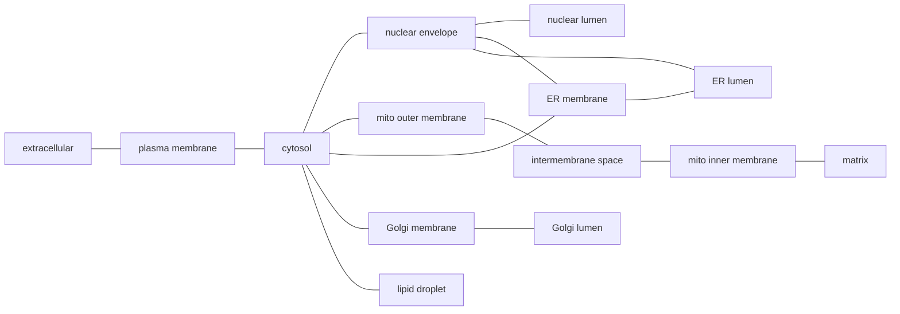

# GO-CAM compartments

**Bottom line:** a GO-CAM activity's `occurs_in` should place it in one distinct
compartment of the cell, and two activities joined by a causal edge should sit
in the same compartment or in compartments that share a boundary.
`just gocam-compartments` checks both against a small, explicit spatial model: a
disjoint set of compartments plus adjacency rules
([`gocam_compartments.yaml`](../src/ai_gene_review/data/gocam_compartments.yaml)).
In the first run over all 2,036 cached production models, 338 models have at
least one activity whose location reaches no compartment (chromatin is the
largest group, 293 activities in 104 models), and 150 models have a causal edge
between compartments that do not touch (139 of these edges use a *direct*
predicate). Two new QC flags, `UNRESOLVED_COMPARTMENT` and
`NONADJACENT_COMPARTMENTS`, record these findings in GO-CAM reviews.

## The two motivating cases

**A location that cannot be traced to a compartment.** In
`600ced8500002343` (BMP9 signaling, human), the SMAD1 transcription factor
activity `occurs_in` `GO:0000785` chromatin. Any biologist reads that as
"nuclear", but the model does not say so: in GO, chromatin is `part_of`
chromosome, and chromosome is not `part_of` nucleus, because prokaryotes have
chromosomes too. No `is_a`/`part_of` path from chromatin reaches the nucleus, the
cytosol or any other compartment. The term that does say it is `GO:0000228`
nuclear chromosome (`part_of` nuclear lumen).

**A causal edge between compartments that do not touch.** In
`59cc772c00000000` (IL-1β signaling, human), CASP1 cysteine-type endopeptidase
activity in the cytosol *directly positively regulates* IL1B cytokine activity
in the extracellular region. CASP1 cleaves pro-IL-1β in the cytosol; the
cytokine reaches the extracellular region by a separate release step (through
gasdermin D pores or unconventional secretion) that the model does not show.
The edge crosses the plasma membrane without an activity that does so.

## The spatial model

### Disjoint compartments

The model is a set of pairwise-disjoint regions that together cover a cell
(eukaryote, plant, Gram-negative bacterium) and its surroundings. Each region is
a **membrane** or a **space**:

| Kind | Compartments |
|---|---|
| space | extracellular region, cytosol, nuclear lumen, mitochondrial intermembrane space, mitochondrial matrix, ER lumen, Golgi lumen, endosome lumen, lysosomal lumen, vacuolar lumen, peroxisomal matrix, cytoplasmic vesicle lumen, chloroplast stroma, thylakoid lumen, periplasm, lipid droplet |
| membrane | plasma membrane, nuclear envelope, mitochondrial outer and inner membranes, ER, Golgi, endosome, lysosomal, vacuolar, peroxisomal and vesicle membranes, chloroplast envelope, thylakoid membrane, cell outer membrane |

Each compartment has a GO anchor term. An `occurs_in` term **resolves** to a
compartment when the anchor is the term or one of its `is_a`/`part_of`
ancestors; where several anchors match, the most specific wins (lysosomal lumen
is a vacuolar lumen in GO, and resolves to lysosomal lumen).

A term can also be:

- **coarse**: it reaches a union of compartments but not one of them.
  `cytoplasm` (cytosol plus the organelles in it), `nucleus` (envelope plus
  lumen), `mitochondrion`, `endoplasmic reticulum`, `membrane`, `cell surface`.
- **ambiguous**: it reaches two unrelated anchors (endolysosome lumen is both an
  endosome lumen and a lysosomal lumen; the nuclear lamina is part of both the
  envelope and the nuclear periphery).
- **unresolved**: it reaches nothing. This is the `UNRESOLVED_COMPARTMENT` flag.

### Adjacency

Two compartments are adjacent when they share a boundary: a membrane and the
space on each side of it.

(The same pattern repeats for endosomes, lysosomes, vacuoles, peroxisomes,
vesicles and chloroplasts; the bacterial envelope runs plasma membrane →
periplasm → outer membrane → extracellular.) Two consequences follow:

- **Lumens are never adjacent to each other or to the cytosol.** Material
  crosses only by an activity in the membrane between them (a transporter, a
  channel, a translocon, a pore) or by vesicle traffic.
- **The cytosol is not adjacent to the nuclear lumen.** The envelope is between
  them; nuclear import and export are transport steps.

A causal edge is then classified by the distance between its two ends:

| Edge status | Meaning |
|---|---|
| `SAME` | both activities in one compartment |
| `ADJACENT` | they share a boundary |
| `BRIDGED` | two membranes bordering the same space, e.g. ER membrane → Golgi membrane or outer → inner mitochondrial membrane; plausible at a membrane contact site or on vesicle docking, so reported at lower priority |
| `NONADJACENT` | anything farther; the `NONADJACENT_COMPARTMENTS` flag |
| `INDETERMINATE` | one end is unresolved or missing |

For coarse locations the closest reading is used, so an edge is called
non-adjacent only when no reading of the coarse term makes it adjacent.

### Context hints

The check does not guess. An unresolved term stays unresolved even when its
usual location is obvious, because the point is that the model does not say it.
The report attaches a **hint** instead: the usual compartment and, where one
exists, a term that would state it. Hints apply to a term and its descendants,
and the most specific wins.

| Unresolved term (and descendants) | Activities | Models | Hint |
|---|---|---|---|
| chromatin (heterochromatin, ...) | 293 | 104 | nuclear lumen; use `GO:0000228` nuclear chromosome |
| chromosome (site of DNA damage, replication fork, kinetochore, ...) | 204 | 62 | nuclear lumen; use `GO:0000228` nuclear chromosome |
| other organism part (host cell cytoplasm, symbiont cell surface, ...) | 132 | 61 | a location in another organism; edges into it cross organisms |
| cellular_component (root) | 67 | 41 | no location at all |
| cell junction (synapse, adherens junction, ...) | 44 | 28 | spans membrane, cytosol and outside; name the side |
| a cell type (CL term) used as `occurs_in` | 44 | 5 | says which cell, not where in it |
| organelle membrane contact site | 39 | 31 | name the membrane the activity is in |
| spindle pole body | 36 | 3 | nuclear envelope (fungal SPB is embedded in it) |
| cytoskeleton, actin cytoskeleton, centrosome, microtubule | 81 | 30 | cytosol |
| cell division site | 17 | 5 | a region of the cell periphery |
| (no hint) | 17 | 10 | |

## First corpus run

`just gocam-compartments -o projects/GOCAM_COMPARTMENTS/gocam-compartments-report.yaml`,
2,036 cached production models, GO `releases/2026-07-26`. The full report lists
every unresolved location and non-adjacent edge per model:
[gocam-compartments-report.yaml](GOCAM_COMPARTMENTS/gocam-compartments-report.yaml).

| Activity location | Count |
|---|---|
| resolved to one compartment | 7,417 |
| coarse (a union) | 2,203 |
| ambiguous | 15 |
| unresolved | 974 |
| no `occurs_in` | 1,976 |

| Causal edge | Count |
|---|---|
| same compartment | 4,676 |
| adjacent | 1,207 |
| bridged (membrane–space–membrane) | 63 |
| non-adjacent | 264 (139 with a direct predicate) |
| indeterminate | 2,956 |

The largest groups of non-adjacent edges (upstream → downstream, all edges /
direct edges):

| Upstream | Downstream | Edges | Direct | Usual missing step |
|---|---|---|---|---|
| plasma membrane | nucleus | 99 | 76 | the receptor or kinase acts on a cytosolic factor, which then enters the nucleus (JAK1 → STAT3 in `5f46c3b700002685`); 61 models |
| nucleus | extracellular region | 21 | 3 | gene expression → secreted product, normally an indirect edge |
| nucleus | plasma membrane | 16 | 0 | as above, for a membrane product |
| cytoplasmic vesicle (coarse) | ER (coarse) | 11 | 11 | all in one *S. pombe* model (`693b3c0900004859`): COPII cargo receptors acting on Sec24; placing both ends in their membranes would make these bridged |
| mitochondrial inner membrane | cytosol | 8 | 8 | export through the outer membrane (Slc25a10 → Mdh1 in `61e0e55600001225`) |
| extracellular region | cytoplasm | 8 | 0 | ligand → intracellular response without the receptor |
| mitochondrial outer membrane | mitochondrial matrix | 8 | 4 | import across the inner membrane (Tspo → Cyp11a1 in `68b0f0d000004550`) |
| cytosol | mitochondrial matrix | 5 | 2 | pyruvate import by MPC (pyk1 → pda1 in `663d668500002302`) |
| cytosol | extracellular region | 2 | 0 | (plus the CASP1 → IL1B direct edge above) |

Indirect edges across compartments can be deliberate summaries ("this
transcription factor indirectly increases secretion of X"), so the strong signal
is the direct ones.

## Review leads

The report is a list of leads for GO-CAM reviews. It does not write reviews or
fill in QC flags. A finding is a question about the model: a reviewer opens the
model, reads the evidence behind the edge or location, and decides whether there
is a real problem. Only that judgement goes into a review, as
`UNRESOLVED_COMPARTMENT` or `NONADJACENT_COMPARTMENTS` with the missing step
named. A finding the reviewer rejects (a deliberate summary edge, a location the
evidence really cannot resolve) goes in `notes`, so the next reader knows it was
checked.

Most useful first are the 81 models with at least one **direct** edge between
non-adjacent compartments. Only one of them has a review so far. The models with
the most such edges:

| Model | Title | Direct non-adjacent edges | Example |
|---|---|---|---|
| `693b3c0900004859` | ER to Golgi vesicle-mediated transport (*S. pombe*, partial) | 13 | yip1 → erv29 |
| `66e382fb00002105` | BMP8A role in spermatogenesis via SMAD1, SMAD5 and SMAD9 (human) | 4 | BMPR1A → SMAD5 |
| `626b20c100000025` | IL9-mediated signaling pathway (human) | 3 | JAK3 → STAT5A |
| `62b4ffe300003747` | Response to IFN-beta, leading to JAK-STAT activation (human) | 3 | TYK2 → STAT1 |
| `62d0afa500000298` | Gluconeogenesis 3 (mouse) | 3 | Slc25a12 → Got1 |
| `645d887900001795` | BMP2 signaling pathway (human) | 3 | BMPR1A → SMAD9 |
| `663d668500002824` | Activin E signaling pathway (human) | 3 | ACVR1C → SMAD2 |
| `66e382fb00001232` | BMP4 signaling pathway (human) | 3 | BMPR1A → SMAD5 |
| `66e382fb00001606` | Hepcidin induction by BMP6 signaling (human) | 3 | ACVR1 → SMAD1 |
| `66e382fb00001786` | Hepcidin induction by BMP2/BMP6 complex signaling (human) | 3 | BMPR1A → SMAD5 |
| `6796b94c00004996` | SARS-CoV-2 entry into host cell | 3 | ACAT1 → Spike protein S2 |
| `69729a3800007453` | protein import into mitochondrial matrix (*S. pombe*) | 3 | tom40 → tim50 |

Many of these follow one pattern: a receptor kinase at the plasma membrane
directly activates a transcription factor whose activity is placed in the
nucleus (BMP receptor → SMAD, JAK → STAT). The pattern runs across many models
from the same curation groups, so it is probably a modelling convention, not a
string of separate mistakes. One question to the curators settles all of them,
for example whether the transcription factor's phosphorylation should be a
cytosolic step with nuclear import modelled separately. A review should raise it
as that question, not report one defect per model.

Unresolved locations are second priority, because the biology is usually
obvious. A review deals with them by noting the term that would state the
location (chromatin → `GO:0000228` nuclear chromosome).

## Limitations

- The model is topological, not geometric. A membrane protein is placed in its
  membrane without recording which face its active site is on, so a cytosolic
  kinase acting on the cytosolic tail of a receptor is correctly adjacent, but a
  luminal enzyme annotated only to "ER membrane" looks adjacent to the cytosol
  too.
- `BRIDGED` accepts two membranes that border a common space whether or not a
  contact site or docking event is part of the biology.
- Topologically, the lumen of the secretory pathway is equivalent to the
  outside of the cell. The model does not use this equivalence: a Golgi lumen →
  extracellular edge is non-adjacent, which is what it should be, since a
  vesicle traffic step is needed.
- Multi-organism models (host–pathogen) place activities in another organism's
  cell. The model covers one cell, so these are left unresolved with a hint.
- 1,976 activities (about 16%) have no `occurs_in`, so 2,956 edges cannot be
  placed at all.

## Possible next steps

- Work through the review leads below, writing a GO-CAM review for each
  model taken up.
- Report chromatin → nuclear chromosome upstream to the GO-CAM curators and to
  the Noctua form defaults; it is the single largest fixable group.
- Consider face-aware membrane locations (`cytoplasmic side of plasma membrane`,
  `lumenal side of ER membrane`) as a refinement of the membrane compartments.
- Apply the same model to module (`modules/`) connections, which have the same
  spatial semantics.
