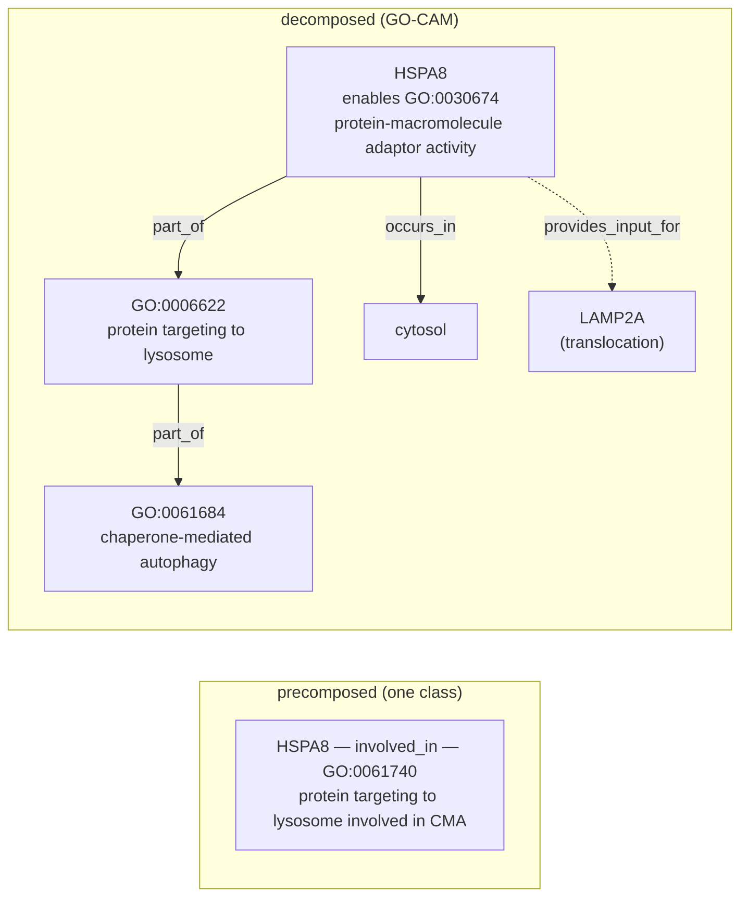

# "X involved in Y" — Precomposed GO Terms and Their Decomposition

**Bottom line:** GO contains 784 live terms whose label reads "X involved in
Y", and it has already obsoleted 1,265 more, 883 of them with a comment that
the term "is pre-composed and should be captured as a GO-CAM model". Our gene
reviews use 299 distinct such terms in 1,023 `existing_annotations` rows
across 519 genes (23 species folders); 14 of those rows already sit on
obsolete terms. The schema could not express the replacement GO asks for:
`MODIFY` took replacement terms only, with no annotation extension and no
link to a GO-CAM or module. This project added that schema (MODIFY plus
`proposed_replacement_extensions` and `decomposed_into`), worked the 14
obsolete-term rows and a chaperone-mediated autophagy pilot with a new module,
and queues the remaining genes and the recurring "Y" contexts as module
candidates.

## What "precomposed" means, and what "replace it with a GO-CAM" means

A precomposed term packs two statements into one class. For example, for
GO:0061740 *protein targeting to lysosome involved in chaperone-mediated
autophagy*, GO's logical definition is

```
GO:0061740 ≡ GO:0006622 protein targeting to lysosome
             and part_of some GO:0061684 chaperone-mediated autophagy
```

The first part, the **genus** (X), says what the gene product does. The second
part, the **differentia** (Y, here attached by `part_of`), says what larger
process that activity serves. Annotating HSPA8 to GO:0061740 asserts both at
once. GO uses the same shape at three levels:

| Pattern | Example | Live terms |
|---|---|---|
| MF `part_of` BP | GO:1904315 *transmitter-gated monoatomic ion channel activity involved in regulation of postsynaptic membrane potential* | 46 (+2 with no logical definition whose label splits cleanly) |
| BP `part_of` BP | GO:0001658 *branching involved in ureteric bud morphogenesis* | 429 (+7) |
| regulation of a BP that is itself "X involved in Y" | GO:0090050 *positive regulation of cell migration involved in sprouting angiogenesis* | 153 |
| no logical definition | GO:0031152 *aggregation involved in sorocarp development* | 147 |

Precomposition does not scale. GO would need a term for every X crossed with
every Y. Each pair is also a little GO-CAM squeezed into a class name, and it
cannot say *which* Y instance, *which* upstream or downstream activity, or in
what cell. GO has therefore been retiring these terms. The obsolete stanzas
say so: 501 carry "obsoleted because it is a pre-composed term that should be
captured as a GO-CAM model" (e.g. GO:1902284 *neuron projection extension
involved in neuron projection guidance*, go-ontology#31330), 200 "represents
a GO-CAM model", and 40 "pre-composed and should be represented as a GO-CAM
model". A 2023 GO annotation call also noted that "BP involved in BP" and "MF
involved in BP" terms are better represented as GO-CAMs
([Annotation Conf. Call 2023-05-16](https://wiki.geneontology.org/Annotation_Conf._Call_2023-05-16);
only the search-result summary was reachable from here, not the page itself).

"Replace with a GO-CAM" means **un-packing the class back into the graph it
abbreviates**:



The decomposed form keeps every assertion the class made: HSPA8 is still
inferred `involved_in` both X and Y. It also gains what the class could not
hold, namely the MF that does the work, the location, and the causal links to
the other participants. Nothing is lost if the Y context is kept *somewhere
linked to the annotation*. The loss happens when people "decompose" by
splitting the row into two unrelated annotations (`involved_in X`,
`involved_in Y`), because that drops the fact that X happens *as part of* Y.

There are three places in our framework that can hold the link, from
lightest to heaviest:

1. **Annotation extension** (GAF column 16 / GPAD): `involved_in GO:0006622`
   with extension `part_of(GO:0061684)`. This is single-gene and
   single-hop, and exactly equivalent to the precomposed class. It is what
   GO's own `replaced_by`/`consider` migration produces when it is done
   carefully.
2. **`core_functions`** in the gene review. These are already a gene-local
   GO-CAM: `molecular_function` + `directly_involved_in` + `locations` +
   `in_complex`. An MF-`part_of`-BP term maps one-to-one onto a core function
   (`molecular_function: X`, `directly_involved_in: [Y]`).
3. **Module / production GO-CAM**. This is multi-gene and causal, and it is
   the right home when Y is a pathway or developmental program with several
   reviewed participants (ureteric bud branching, sprouting angiogenesis,
   ESCRT/MVB sorting, cardiac conduction).

## Inventory (GO release 2026-07-26)

Generated by [`scripts/inventory.py`](INVOLVED_IN_PRECOMPOSITION/scripts/inventory.py)
into [`data/`](INVOLVED_IN_PRECOMPOSITION/data/summary.yaml). Nothing is
hardcoded, so re-running it against a newer `go.obo` updates every number
here.

| | |
|---|---|
| live "involved in" terms in GO | 784 (BP 728, MF 53, CC 3) |
| obsolete "involved in" terms | 1,265 (883 with a GO-CAM comment) |
| review rows using one | 1,023 rows, 299 terms, 519 genes |
| rows on already-obsolete terms | 14 |
| rows on nested terms (Y is itself "… involved in …") | 217 |
| rows whose existing review already records an extension | 1 |
| rows where the gene is in any cached GO-CAM | 257 |
| rows where a GO-CAM of the same gene realizes Y | 23 |
| rows where a same-symbol GO-CAM in another species realizes Y | 16 |
| rows whose gene is named in a module | 558 |

Current review actions on these rows: KEEP_AS_NON_CORE 494, ACCEPT 288,
MARK_AS_OVER_ANNOTATED 73, MODIFY 71, UNDECIDED 56, REMOVE 19, NEW 19,
PENDING 3. **None of the 71 existing MODIFY rows decomposes.** One proposes
the bare genus. The other 70 are lateral moves to a different term (e.g.
`DNA strand elongation involved in DNA replication` → `G1/S transition of
mitotic cell cycle` for *Drosophila* chromatin factors). Evidence: IMP 284,
IEA 216, ISS 146, IDA 121, IGI 71, IBA 68, other 117.

By organism folder: human 554 rows, mouse 123, DROME 93, worm 82, DICDI 75,
yeast 21, DANRE 19, other 56.

### Rows on already-obsolete terms (fix first)

| Gene | Obsolete term | Current action | GO pointer |
|---|---|---|---|
| human/GATA3 (IEA, ISS) | GO:2000607 neg. reg. of cell proliferation involved in mesonephros development | KEEP_AS_NON_CORE | consider GO:0008285 + GO:0001823 |
| human/GATA3 (IEA, ISS) | GO:2000703 neg. reg. of FGFR signaling involved in ureteric bud formation | MARK_AS_OVER_ANNOTATED | consider GO:0040037 + GO:0060676 |
| human/GATA3 (IEA, ISS) | GO:2000734 neg. reg. of GDNF receptor signaling involved in ureteric bud formation | MARK_AS_OVER_ANNOTATED | none |
| human/NOTCH1 (IEA, ISS) | GO:0003252 neg. reg. of cell proliferation involved in heart valve morphogenesis | KEEP_AS_NON_CORE | none |
| human/DNMT1, mouse/Dnmt1 (IMP, IEA, ISO) | GO:1905931 neg. reg. of VSMC differentiation involved in phenotypic switching | KEEP_AS_NON_CORE | none |
| yeast/GET3 (IMP) | GO:0000750 pheromone-dependent signal transduction involved in conjugation with cellular fusion | KEEP_AS_NON_CORE | replaced_by GO:0071507 |
| SCHPO/cps1 (IBA) | GO:0051603 proteolysis involved in protein catabolic process | MODIFY → GO:0030163 | replaced_by GO:0030163 ✓ |
| rat/Rgn (IDA) | GO:1903052 pos. reg. of proteolysis involved in protein catabolic process | MODIFY → GO:0045732 | replaced_by GO:0045732 ✓ |

The GATA3 `consider` pairs show the information loss directly. GO offers
both halves as separate terms, and only an extension (or a model) can keep
"negative regulation of proliferation *as part of* mesonephros development".

### Where GO-CAMs already realize the decomposition

The check looks for a cached GO-CAM activity whose BP is Y or a descendant of
Y. Examples:

- **HSPA8** (human; mouse and rat by ISO/ISS) — model `63c0ac2b00001252`:
  `protein-macromolecule adaptor activity` part_of GO:0061740. The production
  model still uses the precomposed BP itself, so obsoleting the term would
  mean nesting `protein targeting to lysosome` inside `chaperone-mediated
  autophagy` in the model as well. A GO-CAM is only "the replacement" once its
  own process nodes are decomposed.
- **SYK** (mouse rows) — human model `66c7d41500000715`: `protein tyrosine
  kinase activity` part_of `neutrophil activation involved in immune
  response`. This is an ortholog hit through the same-symbol proxy.
- **RAD51** (human; SCHPO rad51 by ortholog) — `69a0c46f00002668`:
  `single-stranded DNA binding` part_of `double-strand break repair involved
  in meiotic recombination`, which realizes Y = meiotic cell cycle for the
  row `chromosome organization involved in meiotic cell cycle`.
- **ATG7** — `6446bfcb00001774`: `Atg12 activating enzyme activity` part_of
  `autophagosome assembly`, which realizes `protein lipidation involved in
  autophagosome assembly` with a *better* MF than the precomposed BP carries.

Production GO-CAMs are themselves full of precomposed BP nodes. "Replace with
a GO-CAM" is therefore an instruction to the GO-CAM curators too, not only to
the GAF.

### Recurring Y contexts (module candidates)

[`data/module_candidates.yaml`](INVOLVED_IN_PRECOMPOSITION/data/module_candidates.yaml)
groups rows by Y. There are 184 contexts. 67 have three or more genes, and
54 of those are named by no module (crude test: the GO id does not appear in
any module YAML). Strong candidates for new or extended modules:

| Y context | Genes | Existing module |
|---|---|---|
| GO:0007605 sensory perception of sound (hair-cell mechanotransduction) | 12 (TMC1, tmc2a/b, LOXHD1, WHRN, PDZD7, ADGRV1, …; also developmental MYC/KIT/Sox2) | none |
| GO:0002042 / GO:0002040 sprouting angiogenesis | 11 + 7 (VEGFA, NOTCH1, FGF2, ABL1, …) | `vegfr_signaling` (does not name the BP) |
| GO:0060675 / GO:0001658 ureteric bud (branching) morphogenesis | 10 + 7 (BMP4, FGF1/2, SHH, SOX9, AGT, …) | `fgfr_signaling`, `hedgehog_signaling` (indirect) |
| GO:0086064 electrical coupling in cardiac conduction | 9 (CALM1-3, CAV1, TBX5, …) | none |
| GO:0043162 ubiquitin-dependent catabolism via MVB sorting (ESCRT-I) | 9 (TSG101, VPS28, VPS37A/B, MVB12A, UBAP1, …) | none |
| GO:0035773 glucose-stimulated insulin secretion | 13 | `beta_cell_glucose_stimulated_insulin_secretion` ✓ |
| GO:0061684 chaperone-mediated autophagy | 4 (HSPA8 in human, mouse and rat; CLU) | none (production GO-CAM exists) |
| GO:0003272 endocardial cushion formation (EMT) | 6 (NOTCH1, RBPJ, BMP4, FGF8) | `notch_signaling` (indirect) |
| DICDI sorocarp development (aggregation, culmination, slug) | 69 rows | `dicty_extracellular_camp_relay`, `dicty_starvation_initiation`, `dicty_allorecognition_adhesion` |

Broad contexts such as `apoptotic process` (26 genes), `immune response`, or
`anatomical structure development` are not module candidates. They mostly
mark grouping terms (see class D below).

## Triage scheme for every row

Each row gets one **decomposition outcome**, recorded alongside the ordinary
action:

| Class | Rows | Default outcome |
|---|---|---|
| **A. MF `part_of` BP** | 72 | Decompose: genus MF (`enables`) + `part_of(Y)`. Also make it a `core_function` (MF + `directly_involved_in: [Y]`) if core. |
| **B. BP `part_of` BP** | 513 | Decompose: `involved_in` genus + `part_of(Y)`. If the gene's real contribution is an MF, record that in core_functions. |
| **C. regulation of a nested term** | 222 | Two-step unfolding: `regulation of X` + `part_of(Y)`. Check sign and directness. Most are IEA/ISS over-propagations from developmental phenotypes. |
| **D. no logical definition** | 216 | Sort into (i) lineage stage terms that are the right grain (DICDI sorocarp stages, *Drosophila* morphogenetic furrow): keep; (ii) grouping classes (`biological process involved in interaction with symbiont`, `developmental process involved in reproduction`, `anatomical structure formation involved in morphogenesis`, CC `protein complex involved in cell adhesion`): keep, and flag as uninformative where a specific term exists; (iii) undefined precompositions (`cysteine-type endopeptidase inhibitor activity involved in apoptotic process`, `mitochondrial fragmentation involved in apoptotic process`): treat as A/B and file a GO ticket for the missing logical definition. |

Outcomes:

- `DECOMPOSE_EXTENSION` — MODIFY to the genus with `part_of(Y)` (needs schema change 1).
- `DECOMPOSE_MODEL` — MODIFY to the genus, and Y lives in a named GO-CAM activity or module node (needs schema change 2). Use this when Y has a module, or an existing GO-CAM for the gene or an ortholog realizes Y.
- `DROP_CONTEXT` — MODIFY to the genus alone, because the Y context was the over-annotation (e.g. *Drosophila* acetyltransferase complex members on `DNA strand elongation involved in DNA replication`).
- `KEEP_PRECOMPOSED` — the term is the right grain (D-i/D-ii) or GO is not retiring it. Record the reason.
- Ordinary `REMOVE` / `MARK_AS_OVER_ANNOTATED` when neither X nor Y holds. Decomposing does not rescue a wrong annotation.

The CLAUDE.md rules still apply. Rows sharing a term must get consistent
actions. A true precomposed term is never REMOVEd to deduplicate. Experimental
rows whose full text we have not read are not overruled. The "do not add
what curators declined" test also applies to Y: being necessary for Y (a
knockout phenotype) is not the same as doing part of Y, and many class C
rows fail that test.

## Schema: decomposition slots on MODIFY (implemented)

Before this project, `Review` had only `action`, `reason` and
`proposed_replacement_terms` (id and label). It could carry **no extension
and no link to a GO-CAM or module**. `extensions` existed only on
`ExistingAnnotation`, describing the *original* GOA row. "MODIFY to X with
part_of(Y)" could only be written as prose.

Decision (project owner, 2026-10-18): keep **MODIFY**, with no new action, and
add two optional slots to `Review`:

```yaml
review:
  action: MODIFY
  proposed_replacement_terms:
    - id: GO:0006622
      label: protein targeting to lysosome
  proposed_replacement_extensions:        # AnnotationExtension list; qualifies every replacement
    - predicate: BFO:0000050              # part_of
      term:
        id: GO:0061684
        label: chaperone-mediated autophagy
  decomposed_into:                        # Decomposition: where Y now lives
    gocam_associations:                   # GoCamAssociation (same class modules use)
      - model: gomodel:63c0ac2b00001252
        activity: gomodel:63c0ac2b00001252/63c0ac2b00001260
    module_associations:                  # ModuleAssociation: modules/<module>.yaml + element id
      - module: chaperone_mediated_autophagy
        element: hspa8_substrate_adaptor
    in_core_functions: true               # Y recorded in core_functions[].directly_involved_in
    context_dropped: false                # true = Y was the over-annotation, deliberately dropped
    notes: ...
```

Validation (`src/ai_gene_review/validation/decomposition.py`, run by `just
validate`, tested in `tests/test_decomposition_validation.py`):

| check | severity |
|---|---|
| slots used with an action other than MODIFY | error |
| `module_associations[].module` not at `modules/<module>.yaml`, or `element` not an id in it | error |
| `gocam_associations[].model` not cached under `gocams/` | error |
| `context_dropped` combined with somewhere Y went | error |
| MODIFY of "X involved in Y" to exactly X, with no extension, no `decomposed_into`, and no `context_dropped` | warning (`decomposition_context_dropped_silently`) |

Lateral MODIFYs, where the replacement is not the genus, are not flagged. The
warning only catches X being kept while Y disappears without a word. The
gene-review HTML template shows extensions next to the replacement terms and
`decomposed_into` as badges.

## Worked cases (round 1)

Each case is recorded in the gene review with the new slots and validates
cleanly. 16 rows now carry a recorded decomposition (`rows_decomposition_recorded`
in `data/summary.yaml`).

### The obsolete-term rows

| Gene (rows) | Obsolete term | Outcome | What we did |
|---|---|---|---|
| human/GATA3 (IEA, ISS) | GO:2000607 neg. reg. of cell proliferation involved in mesonephros development | `DECOMPOSE_EXTENSION` | MODIFY → GO:0008285 negative regulation of cell population proliferation + `part_of(GO:0001823 mesonephros development)`, GO's own `consider` pair re-joined. Supported by Grote et al. 2008 (PMID:19112489) citing Gata3's role in pro/mesonephric proliferation control. |
| human/GATA3 (IEA, ISS ×2) | GO:2000703 / GO:2000734 neg. reg. of FGFR / GDNF-receptor signaling involved in ureteric bud formation | keep Y, drop X | **Decomposition exposed a bad genus.** In PMID:19112489, Gata3 acts *upstream of Ret* and maintains its expression. The ectopic buds of the mutant *require* GDNF/Ret and FGF signaling, so nothing shows Gata3 inhibiting those pathways. Moving to GO's `consider` genus (GO:0040037) would carry the unsupported half forward. MODIFY → GO:0072106 regulation of ureteric bud formation, which is sign-neutral because the evidence points both ways. |
| human/NOTCH1 (IEA, ISS) | GO:0003252 neg. reg. of cell proliferation involved in heart valve morphogenesis | `DECOMPOSE_EXTENSION` | MODIFY → GO:0008285 + `part_of(GO:0003179 heart valve morphogenesis)`. GO gave no replacement. The claim was not re-judged, because the mouse source was not inspected. |
| human/DNMT1 (IMP), mouse/Dnmt1 (IEA, ISO) | GO:1905931 neg. reg. of VSMC differentiation involved in phenotypic switching | `DECOMPOSE_EXTENSION` | MODIFY → GO:1905064 + `part_of(GO:0036166 phenotypic switching)`. GO gave no replacement. The reason spells out the GO-CAM it abbreviates: DNMT1 methyltransferase activity silences *SOD2*, upstream of VSMC differentiation, which is indirect and non-core. |
| yeast/GET3 (IMP) | GO:0000750 pheromone-dependent signal transduction involved in conjugation with cellular fusion | lateral, better than `replaced_by` | **GO's automatic `replaced_by` would be wrong here.** It points at GO:0071507 pheromone response MAPK cascade, which suits the kinases. Arr4/Get3 is a non-receptor GEF for Gpa1 (PMID:18261907), upstream of the cascade. Following the GO-CAM idiom in the *S. pombe* pheromone model `693b3c0900000536` (GEF activity positively regulates the cascade), MODIFY → GO:0062038 positive regulation of pheromone response MAPK cascade. |
| SCHPO/cps1 (IBA), rat/Rgn (IDA) | GO:0051603 / GO:1903052 (pos. reg. of) proteolysis involved in protein catabolic process | no change | These already MODIFY to GO's `replaced_by`, which keeps Y (protein catabolic process). Nothing is lost, because proteolysis is annotated separately where it applies. |

### Pilot: chaperone-mediated autophagy (GO:0061740)

- **New module**
  [`modules/chaperone_mediated_autophagy.yaml`](../modules/chaperone_mediated_autophagy.yaml).
  It has two steps: (1) HSPA8 recognizes the KFERQ-motif substrate and
  delivers it to the lysosome (protein-macromolecule adaptor activity, part of
  protein targeting to lysosome); (2) LAMP-2A multimerizes into the
  translocation complex, and HSPA8 then disassembles it. It is grounded in
  PMID:2799391, PMID:11559757, PMID:18644871 and PMID:26212789, and linked to
  production GO-CAM `63c0ac2b00001252`. The module types LAMP-2A as
  *transmembrane protein transporter activity*, not the GO-CAM's *signaling
  adaptor activity*, and says why.
- **HSPA8** (human IDA ×2, IMP, TAS; mouse ISO, ISS; rat ISS, ISO; 8 rows):
  `DECOMPOSE_MODEL`. MODIFY → GO:0006622 protein targeting to lysosome +
  `part_of(GO:0061684)`, with `decomposed_into` pointing at the GO-CAM
  activity (the human ortholog's, for mouse and rat), the module annoton
  `hspa8_substrate_adaptor`, and `in_core_functions`. Each core function's
  `directly_involved_in` swaps GO:0061740 for GO:0006622 and keeps CMA.
- **CLU** (IDA, PMID:9228033): `DROP_CONTEXT`. **Decomposition exposed a wrong
  Y.** The evidence is LRP2/megalin receptor-mediated endocytosis of
  extracellular CLU–Aβ complexes, followed by lysosomal degradation. That is
  not CMA, which translocates *cytosolic* KFERQ proteins through LAMP-2A.
  MODIFY → GO:0006622 with `context_dropped: true`. The CLU core function now
  lists protein targeting to lysosome instead of the CMA-specific term.

### Lessons from round 1

1. **GO's `replaced_by` / `consider` are not safe to apply blindly.** For
   GET3, `replaced_by` names the wrong participant role. For GATA3, `consider`
   names a genus the evidence does not support. Each row needs a reading of
   the evidence, which is what this project is for.
2. **Decomposing is a review, not a reformat.** Splitting the term into X and
   Y forces each half to be justified separately. In 2 of 7 genes (GATA3
   ureteric bud, CLU), one half failed. The precomposed class had hidden that.
3. **Same-term rows move together.** The IEA, ISS and ISO copies of a claim get
   the same decomposition, as the action-consistency rules require.
4. **Production GO-CAMs still use precomposed terms** (the CMA model's HSPA8
   node is GO:0061740), so a module is often the cleaner decomposition target.

## Plan

1. ~~**Schema**~~ — done: `proposed_replacement_extensions` and
   `decomposed_into`, a validator, tests, and template rendering.
2. ~~**Obsolete-term rows**~~ — done (see above).
3. ~~**Pilot**~~ — done: HSPA8 in human, mouse and rat, CLU, and the CMA module.
4. **Next cases** — the clean, high-yield clusters:
   - **MF part_of BP** (class A, 72 rows), above all
     `cysteine-type endopeptidase inhibitor/regulator/activator activity
     involved in apoptotic process` (33 rows across 18 genes: XIAP, CFLAR, APAF1, *Drosophila* Diap1/2, Dark, hid,
     worm ced-3/ced-4…). Use the existing apoptosis modules
     (`intrinsic_apoptotic_signaling`, `dmel_rhg_apoptosome_caspase_activation`,
     `c_elegans_core_apoptosis`) as `module_associations`.
   - **ESCRT-I** (`protein transport to vacuole involved in ubiquitin-dependent
     protein catabolic process via the multivesicular body sorting pathway`,
     10 rows, TSG101/VPS28/VPS37A–D/MVB12A/UBAP1), which needs a new ESCRT-I
     module.
   - **hair-cell mechanotransduction** (`detection of mechanical stimulus
     involved in sensory perception of sound`, 18 rows), which needs a new
     module.
5. **Full pass** — walk `data/annotations.yaml` gene by gene, from class A to
   B, C and D. Check `gocam_same_gene` and `gocam_same_symbol_other_species`
   first, and confirm orthology before citing the symbol-matched hits.
6. **Modules** — sprouting angiogenesis, ureteric bud branching, and cardiac
   conduction coupling, as the cases reach them.
7. **Upstream** — collect class D-iii terms and GO-CAM process nodes that
   still use precomposed BPs for go-ontology tickets. From round 1, also
   report the GO:0000750 `replaced_by` (GEF-type participants should go to
   GO:0062038).

## Reproducing

```bash
curl -sSL -o go.obo http://purl.obolibrary.org/obo/go.obo   # full edition: needs intersection_of
uv run python projects/INVOLVED_IN_PRECOMPOSITION/scripts/inventory.py \
    --go go.obo --out projects/INVOLVED_IN_PRECOMPOSITION/data
```

Outputs: `go_terms.yaml` (every "involved in" term, live or obsolete, with
its decomposition and obsoletion pointers), `annotations.yaml` (every review
row, with action, decomposition, GO-CAM and module hits),
`module_candidates.yaml`, and `summary.yaml`. Decompositions marked `source:
label_split` come from splitting the label into two exact GO labels when GO
asserts no logical definition. They are a heuristic, not a GO assertion.
