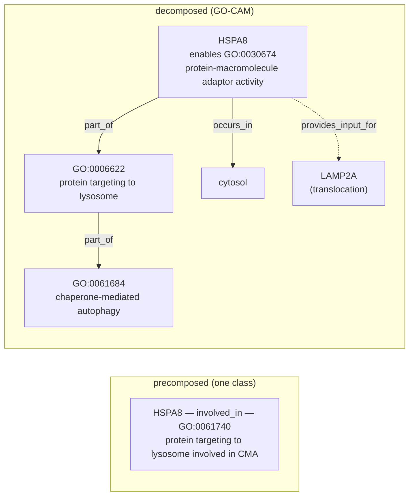

# "X involved in Y" — Precomposed GO Terms and Their Decomposition

**Bottom line:** GO contains 784 live terms whose label reads "X involved in
Y", and it has already obsoleted 1,265 more, 883 of them with a comment that
the term "is pre-composed and should be captured as a GO-CAM model". Our gene
reviews use 320 distinct such terms in 1,204 `existing_annotations` rows
across 613 genes (28 species folders); 14 of those rows sit on
obsolete terms. The schema could not say where the Y context goes when a
term is replaced by its X. This project added `decomposed_into` to MODIFY
(pointing at a module, a GO-CAM or the gene's core functions, or recording that
Y is not carried), worked the 14 obsolete-term rows and a chaperone-mediated
autophagy pilot with a new module, and set a module policy: **modules are the
reusable mechanisms (X), not the contexts (Y)**. A short-lived
annotation-extension slot was removed, because X plus `part_of(Y)` just
restates the retired class.

## What "precomposed" means, and what "replace it with a GO-CAM" means

A precomposed term packs two statements into one class. For example, for
GO:0061740 *protein targeting to lysosome involved in chaperone-mediated
autophagy*, GO's logical definition is

```
GO:0061740 ≡ GO:0006622 protein targeting to lysosome
             and part_of some GO:0061684 chaperone-mediated autophagy
```

The first part, the **genus** (X), says what the gene product does. The second
part, the **differentia** (Y, here attached by `part_of`), says what larger
process that activity serves. Annotating HSPA8 to GO:0061740 asserts both at
once. GO uses the same shape at three levels:

| Pattern | Example | Live terms |
|---|---|---|
| MF `part_of` BP | GO:1904315 *transmitter-gated monoatomic ion channel activity involved in regulation of postsynaptic membrane potential* | 46 (+2 with no logical definition whose label splits cleanly) |
| BP `part_of` BP | GO:0001658 *branching involved in ureteric bud morphogenesis* | 429 (+7) |
| regulation of a BP that is itself "X involved in Y" | GO:0090050 *positive regulation of cell migration involved in sprouting angiogenesis* | 153 |
| no logical definition | GO:0031152 *aggregation involved in sorocarp development* | 147 |

Precomposition does not scale. GO would need a term for every X crossed with
every Y. Each pair is also a little GO-CAM squeezed into a class name, and it
cannot say *which* Y instance, *which* upstream or downstream activity, or in
what cell. GO has therefore been retiring these terms. The obsolete stanzas
say so: 501 carry "obsoleted because it is a pre-composed term that should be
captured as a GO-CAM model" (e.g. GO:1902284 *neuron projection extension
involved in neuron projection guidance*, go-ontology#31330), 200 "represents
a GO-CAM model", and 40 "pre-composed and should be represented as a GO-CAM
model". A 2023 GO annotation call also noted that "BP involved in BP" and "MF
involved in BP" terms are better represented as GO-CAMs
([Annotation Conf. Call 2023-05-16](https://wiki.geneontology.org/Annotation_Conf._Call_2023-05-16);
only the search-result summary was reachable from here, not the page itself).

"Replace with a GO-CAM" means **un-packing the class back into the graph it
abbreviates**:



The decomposed form keeps every assertion the class made: HSPA8 is still
inferred `involved_in` both X and Y. It also gains what the class could not
hold, namely the MF that does the work, the location, and the causal links to
the other participants. Nothing is lost if the Y context is kept *somewhere
linked to the annotation*. The loss happens when people "decompose" by
splitting the row into two unrelated annotations (`involved_in X`,
`involved_in Y`), because that drops the fact that X happens *as part of* Y.

Where the context should go, in this framework:

1. **A module or production GO-CAM**, when the gene takes part in a
   multi-participant mechanism. This is the real replacement: it adds the
   activity that does the work, its inputs, and the causal links around it.
2. **The gene's `core_functions`**, when Y is central to the gene. These are
   already a gene-local GO-CAM (`molecular_function` + `directly_involved_in` +
   `locations` + `in_complex`).
3. **Nowhere**, recorded as `context_dropped`, when Y is peripheral (typically
   a propagated developmental phenotype) or was itself the over-annotation.

**Not an annotation extension.** `involved_in X` with `part_of(Y)` is exactly
GO's logical definition of the retired class, so writing it is
precomposition in different syntax. GO asked for these terms to be "captured
as a GO-CAM model", not re-encoded. We briefly had an extension slot and
removed it (2026-10-25); see the schema section.

GO's own pointers behave accordingly. `replaced_by` names a single term and
is applied to existing annotations automatically, so an obsoleted
precomposition necessarily keeps one half. `consider` lists both halves, but
it is advice for a curator, not an automated mapping.

## Inventory (GO release 2026-07-26)

Generated by [`scripts/inventory.py`](INVOLVED_IN_PRECOMPOSITION/scripts/inventory.py)
into [`data/`](INVOLVED_IN_PRECOMPOSITION/data/summary.yaml). No result is
hardcoded, so re-running it against a newer `go.obo` updates every number
here.

| | |
|---|---|
| live "involved in" terms in GO | 784 (BP 728, MF 53, CC 3) |
| obsolete "involved in" terms | 1,265 (883 with a GO-CAM comment) |
| review rows using one | 1,204 rows, 320 terms, 613 genes |
| rows on already-obsolete terms | 14 |
| rows on nested terms (Y is itself "… involved in …") | 254 |
| rows whose existing review already records an extension | 1 |
| rows where the gene is in any cached GO-CAM | 290 |
| rows where a GO-CAM of the same gene realizes Y | 31 |
| rows where a same-symbol GO-CAM in another species realizes Y | 22 (lower bound: the script maps 12 species folders to GO-CAM index labels, and rows in the other folders get no same-symbol hit) |
| rows whose gene is named in a module | 640 |

Figures refreshed 2026-10-27, after merging `main`; they are a snapshot, and
`data/summary.yaml` is authoritative. The first snapshot
(2026-10-18) had 1,023 rows over 519 genes. Current review actions on these
rows (after round 2): KEEP_AS_NON_CORE 582, ACCEPT 294, MODIFY 129,
MARK_AS_OVER_ANNOTATED 94, UNDECIDED 63, REMOVE 23, NEW 18, TOO_GENERAL 1. Apart from the rows this
project decomposed, the existing MODIFYs do not decompose: in the first
snapshot, one of 71 proposed the bare genus and the other 70 were lateral moves to a different term (e.g.
`DNA strand elongation involved in DNA replication` → `G1/S transition of
mitotic cell cycle` for *Drosophila* chromatin factors). Evidence: IMP 324,
IEA 265, ISS 176, IDA 128, IBA 96, IGI 79, other 136.

By organism folder (`by_organism` in `data/summary.yaml`): human 662 rows,
mouse 149, DROME 95, worm 87, DICDI 75, yeast 34, DANRE 19, other 83.

### Rows on already-obsolete terms (fix first)

| Gene | Obsolete term | Current action | GO pointer |
|---|---|---|---|
| human/GATA3 (IEA, ISS) | GO:2000607 neg. reg. of cell proliferation involved in mesonephros development | KEEP_AS_NON_CORE | consider GO:0008285 + GO:0001823 |
| human/GATA3 (IEA, ISS) | GO:2000703 neg. reg. of FGFR signaling involved in ureteric bud formation | MARK_AS_OVER_ANNOTATED | consider GO:0040037 + GO:0060676 |
| human/GATA3 (IEA, ISS) | GO:2000734 neg. reg. of GDNF receptor signaling involved in ureteric bud formation | MARK_AS_OVER_ANNOTATED | none |
| human/NOTCH1 (IEA, ISS) | GO:0003252 neg. reg. of cell proliferation involved in heart valve morphogenesis | KEEP_AS_NON_CORE | none |
| human/DNMT1, mouse/Dnmt1 (IMP, IEA, ISO) | GO:1905931 neg. reg. of VSMC differentiation involved in phenotypic switching | KEEP_AS_NON_CORE | none |
| yeast/GET3 (IMP) | GO:0000750 pheromone-dependent signal transduction involved in conjugation with cellular fusion | KEEP_AS_NON_CORE | replaced_by GO:0071507 |
| SCHPO/cps1 (IBA) | GO:0051603 proteolysis involved in protein catabolic process | MODIFY → GO:0030163 | replaced_by GO:0030163 ✓ |
| rat/Rgn (IDA) | GO:1903052 pos. reg. of proteolysis involved in protein catabolic process | MODIFY → GO:0045732 | replaced_by GO:0045732 ✓ |

The GATA3 `consider` pairs show the information loss directly. GO offers
both halves as separate terms; only a model can keep "negative regulation of
proliferation *as part of* mesonephros development", and the question is
whether that context is worth a model at all.

### Where GO-CAMs already realize the decomposition

The check looks for a cached GO-CAM activity whose BP is Y or a descendant of
Y. Examples:

- **HSPA8** (human; mouse and rat by ISO/ISS) — model `63c0ac2b00001252`:
  `protein-macromolecule adaptor activity` part_of GO:0061740. The production
  model still uses the precomposed BP itself, so obsoleting the term would
  mean nesting `protein targeting to lysosome` inside `chaperone-mediated
  autophagy` in the model as well. A GO-CAM is only "the replacement" once its
  own process nodes are decomposed.
- **SYK** (mouse rows) — human model `66c7d41500000715`: `protein tyrosine
  kinase activity` part_of `neutrophil activation involved in immune
  response`. This is an ortholog hit through the same-symbol proxy.
- **RAD51** (human; SCHPO rad51 by ortholog) — `69a0c46f00002668`:
  `single-stranded DNA binding` part_of `double-strand break repair involved
  in meiotic recombination`, which realizes Y = meiotic cell cycle for the
  row `chromosome organization involved in meiotic cell cycle`.
- **ATG7** — `6446bfcb00001774`: `Atg12 activating enzyme activity` part_of
  `autophagosome assembly`, which realizes `protein lipidation involved in
  autophagosome assembly` with a *better* MF than the precomposed BP carries.

Production GO-CAMs are themselves full of precomposed BP nodes. "Replace with
a GO-CAM" is therefore an instruction to the GO-CAM curators too, not only to
the GAF.

### Recurring Y contexts

[`data/module_candidates.yaml`](INVOLVED_IN_PRECOMPOSITION/data/module_candidates.yaml)
groups rows by Y. There are 194 contexts; 76 have three or more genes, and
57 of those are named by no module (crude test: the GO id does not appear in
any module YAML). They are **not** a module to-do list. Read them through the
module policy below: some Y's are really mechanisms (module material), most
are tissue or developmental contexts (not).

| Y context | Genes | What it is | Where rows go |
|---|---|---|---|
| GO:0061684 chaperone-mediated autophagy | 4 (HSPA8 ×3 species, CLU) | mechanism | `chaperone_mediated_autophagy` ✓ (built) |
| GO:0043162 ubiquitin-dependent catabolism via MVB sorting | 9 (TSG101, VPS28, VPS37A–D, MVB12A, UBAP1, COS9) | mechanism (ESCRT-I) | new ESCRT module, or generalize `dmel_escrt_machinery` |
| GO:0007605 sensory perception of sound | 12 (TMC1, tmc2a/b, LOXHD1, WHRN, PDZD7, ADGRV1; also MYC/KIT/Sox2) | Y is a context; the X (detection of mechanical stimulus) is the hair-cell mechanotransduction mechanism | new mechanotransduction-complex module for the MET genes; drop the context for the developmental ones |
| GO:0035773 glucose-stimulated insulin secretion | 13 | mechanism | `beta_cell_glucose_stimulated_insulin_secretion` ✓ |
| GO:0086064 electrical coupling in cardiac conduction | 9 (CALM1–3, CAV1, TBX5, HRC) | context (cardiac); mixed mechanisms | per row; no new module |
| GO:0002042 / GO:0002040 sprouting angiogenesis | 11 + 7 (VEGFA, NOTCH1, FGF2, ABL1…) | developmental context | the gene's signalling module (`vegfr_signaling`, `notch_signaling`, `fgfr_signaling`); no angiogenesis module |
| GO:0060675 / GO:0001658 ureteric bud (branching) morphogenesis | 10 + 7 (BMP4, FGF1/2, SHH, SOX9, AGT…) | developmental context | the signalling modules; no ureteric-bud module |
| GO:0003272 endocardial cushion formation | 6 (NOTCH1, RBPJ, BMP4, FGF8) | developmental context | `notch_signaling`, `bmp_signaling` |
| DICDI sorocarp development (aggregation, culmination, slug) | 69 rows | lineage stage terms (class D-i) | keep the terms; existing dicty modules |

Broad contexts such as `apoptotic process` (26 genes), `immune response`, or
`anatomical structure development` mostly mark grouping terms (class D).

## Module policy: modules are the composable parts

A precomposed term is usually **mechanism X used in context Y**:
*cell migration* in *sprouting angiogenesis*, *negative regulation of FGFR
signaling* in *ureteric bud formation*, *protein targeting to lysosome* in
*chaperone-mediated autophagy*. Modules should model the X side.

- **Build a module when X (or Y) is a reusable, multi-participant mechanism**
  with its own steps: chaperone-mediated autophagy, ESCRT-I sorting, the
  hair-cell mechanotransduction complex, caspase activation and inhibition.
  Such a module is used across many contexts.
- **Do not build a module per developmental or tissue context.** Ureteric bud
  branching, sprouting angiogenesis, heart valve morphogenesis and mesonephros
  development are not mechanisms. They are programmes that reuse mechanisms we
  already model (FGFR, GDNF/RET, Notch, VEGFR, BMP, Hedgehog signalling) in a
  particular place and order. A module per context would duplicate the
  signalling modules with a tissue label attached, and it would recreate the
  X × Y explosion that GO is removing, one level up.
- **Contexts are expressed as context, not as new mechanisms.** When a
  developmental programme is genuinely worth curating, model it as a concrete
  composition. That can be a production GO-CAM, which is instance-level and
  causal and is GO's intended home. It can also be a concrete module whose
  `context` carries the `anatomical_locations`, `developmental_stages` and
  `cell_types`, and whose parts `conforms_to` the existing signalling
  templates. Both already exist in the schema. Do this only when the programme
  is the object of curation, never just to give one annotation somewhere to
  point.
- **So a row points at its mechanism.** A VEGFA row on "positive regulation of
  cell migration involved in sprouting angiogenesis" decomposes to positive
  regulation of cell migration, with `decomposed_into` naming the
  `vegfr_signaling` element VEGFA occupies. The angiogenesis context is either
  in that module's context (if it is the module's scope) or dropped.

## Triage scheme for every row

Each row gets one **decomposition outcome**, recorded alongside the ordinary
action. Every outcome that keeps X is a MODIFY to X with `decomposed_into`
saying where Y went:

| Class | Rows | Default outcome |
|---|---|---|
| **A. MF `part_of` BP** | 77 | MODIFY to the MF. Y goes to the mechanism module or GO-CAM, or to a `core_function` (MF + `directly_involved_in: [Y]`) if core. |
| **B. BP `part_of` BP** | 586 | MODIFY to the genus BP. Y goes to a module/GO-CAM if Y is a mechanism; usually dropped if Y is a developmental context. If the gene's real contribution is an MF, record that in core_functions. |
| **C. regulation of a nested term** | 249 | Two-step unfolding to `regulation of X`. Check sign and directness. Most are IEA/ISS over-propagations from developmental phenotypes, so Y is usually dropped. |
| **D. no logical definition** | 240 | Sort into (i) lineage stage terms that are the right grain (DICDI sorocarp stages, *Drosophila* morphogenetic furrow): keep; (ii) grouping classes (`biological process involved in interaction with symbiont`, `developmental process involved in reproduction`, `anatomical structure formation involved in morphogenesis`, CC `protein complex involved in cell adhesion`): keep, and flag as uninformative where a specific term exists; (iii) undefined precompositions (`cysteine-type endopeptidase inhibitor activity involved in apoptotic process`, `mitochondrial fragmentation involved in apoptotic process`): treat as A/B and file a GO ticket for the missing logical definition. |

Outcomes:

- `DECOMPOSE_MODEL` — MODIFY to the genus; Y lives in a named GO-CAM activity or module element (`decomposed_into.gocam_associations` / `module_associations`), or in the gene's core functions (`in_core_functions`).
- `DROP_CONTEXT` — MODIFY to the genus with `context_dropped: true`, because Y is peripheral context that does not warrant a model, or was itself the over-annotation (e.g. *Drosophila* acetyltransferase complex members on `DNA strand elongation involved in DNA replication`). The reason says which.
- `KEEP_PRECOMPOSED` — the term is the right grain (D-i/D-ii) or GO is not retiring it. Record the reason.
- Ordinary `REMOVE` / `MARK_AS_OVER_ANNOTATED` when neither X nor Y holds. Decomposing does not rescue a wrong annotation.

The CLAUDE.md rules still apply. Rows sharing a term must get consistent
actions. A true precomposed term is never REMOVEd to deduplicate. Experimental
rows whose full text we have not read are not overruled. The "do not add
what curators declined" test also applies to Y: being necessary for Y (a
knockout phenotype) is not the same as doing part of Y, and many class C
rows fail that test.

## Schema: `decomposed_into` on MODIFY (implemented)

Before this project, `Review` had only `action`, `reason` and
`proposed_replacement_terms` (id and label), so a MODIFY to X could not say
where Y went except in prose.

Decisions (project owner): keep **MODIFY**, with no new action (2026-10-18);
record Y only by reference to a model, not as an annotation extension
(2026-10-25). For one week the schema also had `proposed_replacement_extensions`
(X plus `part_of(Y)`). It was removed because it restated the retired class,
added none of the structure a model adds, duplicated the module link where both
existed, and nothing in the pipeline consumed it. Its 15 rows were converted:
the 8 HSPA8 rows already linked to the GO-CAM and module; the 7 GATA3, NOTCH1
and DNMT1/Dnmt1 rows became `context_dropped`.

```yaml
review:
  action: MODIFY
  proposed_replacement_terms:
    - id: GO:0006622
      label: protein targeting to lysosome
  decomposed_into:                        # Decomposition: where Y now lives
    gocam_associations:                   # GoCamAssociation (same class modules use)
      - model: gomodel:63c0ac2b00001252
        activity: gomodel:63c0ac2b00001252/63c0ac2b00001260
    module_associations:                  # ModuleAssociation: modules/<module>.yaml + element id
      - module: chaperone_mediated_autophagy
        element: hspa8_substrate_adaptor
    in_core_functions: true               # Y recorded in core_functions[].directly_involved_in
    context_dropped: false                # true = Y deliberately not carried (peripheral, or the over-annotation)
    notes: ...
```

Validation (`src/ai_gene_review/validation/decomposition.py`, run by `just
validate`, tested in `tests/test_decomposition_validation.py`):

| check | severity |
|---|---|
| `decomposed_into` used with an action other than MODIFY | error |
| `module_associations[].module` not at `modules/<module>.yaml`, or `element` not an id in it | error |
| `gocam_associations[].model` not cached under `gocams/`, or `activity` not an activity of that model | error |
| `decomposed_into` present but empty | error |
| `context_dropped` combined with somewhere Y went | error |
| MODIFY of "X involved in Y" to X with no `decomposed_into` | warning (`decomposition_context_dropped_silently`) |

"To X" is judged against GO when `just validate` runs ontology checks: the
replacement counts if it is an `is_a` ancestor of the combined term, or if
its label or a synonym equals the label-derived genus. That catches drift
such as *cell proliferation* → *cell population proliferation*. Without the
ontology, only an exact label match counts. Module `element` ids must be
node, part or annoton ids, not cited CURIEs.

Lateral MODIFYs, where the replacement is not the genus, are not flagged.
**Known asymmetry:** `decomposed_into` records where Y went, but nothing
records a dropped X. When the genus fails and only the context survives, as
for GATA3's ureteric-bud rows, the outcome is an ordinary action
(MARK_AS_OVER_ANNOTATED, or a lateral MODIFY) with the reason saying so.
The gene-review HTML template shows `decomposed_into` as badges.

## Worked cases (round 1)

Each case is recorded in the gene review with `decomposed_into` and validates
cleanly. After round 1, 15 rows carried a recorded decomposition (16 before
human DNMT1 was retired upstream); round 2 brings `rows_decomposition_recorded`
in `data/summary.yaml` to 34.

### The obsolete-term rows

| Gene (rows) | Obsolete term | Outcome | What we did |
|---|---|---|---|
| human/GATA3 (IEA, ISS) | GO:2000607 neg. reg. of cell proliferation involved in mesonephros development | `DROP_CONTEXT` | MODIFY → GO:0008285 negative regulation of cell population proliferation, supported by Grote et al. 2008 (PMID:19112489) citing Gata3's role in pro/mesonephric proliferation control. The mesonephros context is a peripheral developmental role of a transcription factor and is not carried. GATA3 already carries GO:0008285 (IEA, ISS), so the MODIFY adds no new claim. |
| human/GATA3 (IEA, ISS ×2) | GO:2000703 / GO:2000734 neg. reg. of FGFR / GDNF-receptor signaling involved in ureteric bud formation | MARK_AS_OVER_ANNOTATED (unchanged action, new reason) | **Decomposition exposed a bad genus.** In PMID:19112489, Gata3 acts *upstream of Ret* and maintains its expression. The ectopic buds of the mutant *require* GDNF/Ret and FGF signaling, so nothing shows Gata3 inhibiting those pathways. GO's `consider` list is advice for a curator, and on reading the evidence its genus (GO:0040037) is unsupported for GATA3. The context half adds nothing either: GATA3's ureteric-bud role is already carried by its GO:0072107 *positive regulation of ureteric bud formation* rows. A first draft MODIFYed these rows to GO:0072106 *regulation of ureteric bud formation*; review on #5562 pointed out that GO:0072106 is entailed by the accepted GO:0072107 rows. |
| human/NOTCH1 (IEA, ISS) | GO:0003252 neg. reg. of cell proliferation involved in heart valve morphogenesis | `DROP_CONTEXT` | MODIFY → GO:0008285; the heart valve morphogenesis context is not carried. GO gave no replacement. The genus does not rest on the uninspected mouse source: NOTCH1 already carries GO:0008285 by IDA (PMID:20616313). Only the heart-valve context comes from the mouse annotation, and it is the part dropped. |
| human/DNMT1 (IMP), mouse/Dnmt1 (IEA, ISO) | GO:1905931 neg. reg. of VSMC differentiation involved in phenotypic switching | `DROP_CONTEXT` (mouse); retired (human) | mouse/Dnmt1: MODIFY → GO:1905064; the phenotypic switching context is not carried. GO gave no replacement. human/DNMT1: since round 1, GOA has re-annotated the source paper as two separate rows (GO:1900240 and GO:1905064), and `main` marks the old row `retired` and keeps it as KEEP_AS_NON_CORE. That migration is the split-into-two pattern, which loses the "as part of" link; here the context is peripheral anyway. The reason spells out the GO-CAM it abbreviates: DNMT1 methyltransferase activity silences *SOD2*, upstream of VSMC differentiation, which is indirect and non-core. |
| yeast/GET3 (IMP) | GO:0000750 pheromone-dependent signal transduction involved in conjugation with cellular fusion | lateral; `replaced_by` is wrong for this gene | **A real upstream problem.** `replaced_by` is applied automatically, so GOA will move this IMP annotation to GO:0071507 pheromone response MAPK cascade. That suits the kinases, not GET3. Arr4/Get3 is a non-receptor GEF for Gpa1 (PMID:18261907), upstream of the cascade. Following the GO-CAM idiom in the *S. pombe* pheromone model `693b3c0900000536` (GEF activity positively regulates the cascade), MODIFY → GO:0062038 positive regulation of pheromone response MAPK cascade. |
| SCHPO/cps1 (IBA), rat/Rgn (IDA) | GO:0051603 / GO:1903052 (pos. reg. of) proteolysis involved in protein catabolic process | no change | These already MODIFY to GO's `replaced_by`, which keeps Y (protein catabolic process). Nothing is lost, because proteolysis is annotated separately where it applies. |

### Pilot: chaperone-mediated autophagy (GO:0061740)

- **New module**
  [`modules/chaperone_mediated_autophagy.yaml`](../modules/chaperone_mediated_autophagy.yaml).
  It has two steps: (1) HSPA8 recognizes the KFERQ-motif substrate and
  delivers it to the lysosome (protein-macromolecule adaptor activity, part of
  protein targeting to lysosome); (2) LAMP-2A multimerizes into the
  translocation complex, and HSPA8 then disassembles it. It is grounded in
  PMID:2799391, PMID:11559757, PMID:18644871 and PMID:26212789, and linked to
  production GO-CAM `63c0ac2b00001252`. The LAMP-2A function carries no GO
  id. The GO-CAM's *signaling adaptor activity* describes a relay rather
  than substrate binding. *Transmembrane protein transporter activity* would
  claim LAMP-2A is the conduit, which is not established. *Cargo receptor
  activity* is defined for delivery to transport vesicles.
- **HSPA8** (human IDA ×2, IMP, TAS; mouse ISO, ISS; rat ISS, ISO; 8 rows):
  `DECOMPOSE_MODEL`. MODIFY → GO:0006622 protein targeting to lysosome, with
  `decomposed_into` pointing at the GO-CAM activity (the human ortholog's, for mouse and rat), the module annoton
  `hspa8_substrate_adaptor`, and `in_core_functions`. Each core function's
  `directly_involved_in` swaps GO:0061740 for GO:0006622 and keeps CMA.
- **CLU** (IDA, PMID:9228033): `DROP_CONTEXT`. **Decomposition exposed a wrong
  Y.** The evidence is LRP2/megalin receptor-mediated endocytosis of
  extracellular CLU–Aβ complexes, followed by lysosomal degradation. That is
  not CMA, which translocates *cytosolic* KFERQ proteins through LAMP-2A.
  MODIFY → GO:0006622 with `context_dropped: true`. The CLU core function now
  lists protein targeting to lysosome instead of the CMA-specific term.

## Worked cases (round 2): caspase regulation

The MF terms GO:0043027 *cysteine-type endopeptidase inhibitor activity
involved in apoptotic process*, GO:0008656 *… activator activity involved in
apoptotic process* and GO:0043028 *… regulator activity involved in apoptotic
process*, across 22 genes. Each one's X is a genuine molecular function:
GO:0004869 *cysteine-type endopeptidase inhibitor activity* or GO:0140608
*cysteine-type endopeptidase activator activity*. Y (apoptotic process) is
modelled by the apoptosis modules.

**Ontology note.** GO places neither combined term under its genus.
GO:0043027 is_a only GO:0043028, and GO:0008656 is_a GO:0016505 and GO:0043028.
Neither is_a GO:0004869 or GO:0140608, so annotations to the combined term do
not reach the genus by reasoning. Ticket 3 in
[`upstream-tickets.md`](INVOLVED_IN_PRECOMPOSITION/upstream-tickets.md) asks
for this to be fixed.

| What | Genes | Outcome |
|---|---|---|
| Rows on the combined term that a reviewer had accepted | Diap1 (IBA, IEA), Diap2 (IBA, IDA, IEA; plus the GO:0043028 IMP row), XIAP, mouse Xiap (IBA), APAF1, CASP8, mouse Casp8, ced-4, and ced-4's GO:0016505 row | `DECOMPOSE_MODEL`: MODIFY to the genus, with `decomposed_into` naming the module element (`dmel_rhg_apoptosome_caspase_activation#diap1_diap1`, `apoptotic_execution_phase#xiap_caspase_inhibitor`, `intrinsic_apoptotic_signaling#apaf1_apaf1_apoptosome_scaffold`, `death_receptor_apoptotic_signaling#casp8_caspase_8_initiator_protease`, `c_elegans_core_apoptosis#ced4_caspase_activator`) and/or `in_core_functions`. Diap2 gained a core function for DrICE inhibition (PMID:16485033), because no module holds it. |
| Rows on the genus that an earlier pass had MODIFYed *to* the combined term | Diap1 ×2, Diap2, XIAP ×5, mouse Xiap ×2, APAF1 ×2, ced-4 ×2 | Reversed to ACCEPT. The genus was already right. |
| MODIFYs from a broad term (protein binding, enzyme activator activity, positive regulation of protein processing…) that targeted the combined term | XIAP ×11, mouse Xiap, Dronc ×2, CASP9 ×2, ced-4 ×4 | The replacement is now the genus. The four extra XIAP rows and all of mouse Xiap's rows arrived with `main`'s #5558 during this round and were brought into line (mouse Xiap's core function too), which also clears a `REVIEW_DISAGREEMENT` on `apoptotic_execution_phase#xiap_caspase_inhibitor`. |
| Reviewer-proposed NEW rows on the combined term | Dark, API5, BCL2L12, CFLAR | The NEW row now uses the genus. |
| Core-function MFs on the combined term | Dark, Diap1, Dronc, APAF1, API5, BCL2L12, CASP9, CFLAR, CYCS, XIAP, ced-4 | MF changed to the genus. `directly_involved_in` already names the apoptotic process. |
| Module annotons on the combined term | `apoptotic_execution_phase` (XIAP), `c_elegans_core_apoptosis` (CED-4), `dmel_rhg_apoptosome_caspase_activation` (Dark target), `trail_apoptotic_signaling` (CFLAR; the module reached `main` during this round) | Function changed to the genus. The module itself is the context. CFLAR's two isoform-specific terms moved with its GOA row and core function. |
| CASP1 (TAS) | 1 | **The genus is unsupported.** The source says the caspase-1 prodomain enhances Fas-mediated apoptosis "most probably" by facilitating caspase-8 activation, a hedged and indirect effect. KEEP_AS_NON_CORE becomes MARK_AS_OVER_ANNOTATED, consistent with BCL2L13. |
| **hid** (IDA + 5 IGI on GO:0043028) | 1 | **Decomposition exposed a wrong genus.** Hid binds DIAP1 and blocks its caspase inhibition (PMID:10481910); it does not bind caspases, which GO:0043028's definition requires. Changed laterally to GO:0140311 *protein sequestering activity*, which hid already carries by IDA (PMID:15107838) and as a core function, linked to `dmel_rhg_apoptosome_caspase_activation#rhg_iap_antagonists_hid`. A first draft used the broader GO:0140678 *molecular function inhibitor activity*; review on #5565 pointed to the gene's own, more specific term. |
| **BCL2L13** (NAS) | 1 | **The genus is unsupported.** The evidence is overexpression-induced, caspase-dependent apoptosis, so KEEP_AS_NON_CORE becomes MARK_AS_OVER_ANNOTATED. |
| CD27, GAS6 (human, mouse), ced-3 | — | No change. These were already marked over-annotated, or lateral MODIFYs away from the term. |
| Diap1 IDA and IGI rows marked UNDECIDED | — | No change. They are undecided because the cached evidence does not show the assay, a separate question from decomposition. |

**Non-core rows.** MODIFY carries no core/non-core flag. When a KEEP_AS_NON_CORE
row on a combined term is decomposed, the non-core judgment survives only in
`reason`, or in whether a core function names the genus. Where the genus itself
is doubtful, prefer MARK_AS_OVER_ANNOTATED (CASP1, BCL2L13) to a MODIFY that
would silently promote it.

The inventory now also counts **reviewer-authored combined terms**: replacement
terms, core-function terms and isoform-specific terms that a review
introduced, rather than GOA rows it reviewed, plus combined terms used
anywhere in a module annoton (function, processes, targets). These are in
[`data/authored_precomposed.yaml`](INVOLVED_IN_PRECOMPOSITION/data/authored_precomposed.yaml).
After this round there are 304 uses: 281 across 165 genes (152 in
`directly_involved_in`, 116 as MODIFY replacements, 11 as core-function MFs
and 2 as isoform-specific terms) and 23 in 12 modules (22 as annoton
processes, led by GO:1901029/GO:1901030 in `bcl2_family_momp_control`, and 1
as an annoton function, GO:0099626 in `synaptic_vesicle_exocytosis`). This is a second work stream:
reviews have been actively moving annotations *toward* these terms.

### Lessons from round 1

1. **`replaced_by` is automated by design, so a wrong one is a GO bug, not a
   curator choice.** For GO:0000750, the automated migration moves an upstream
   GEF (Arr4/Get3) onto the MAPK cascade itself. A precomposed term's
   `replaced_by` is only safe when one term is true of *every* annotated
   participant. Otherwise the term should carry `consider` only.
   `consider` is a different thing: it is curator advice and is never applied
   automatically. The GATA3 case (its `consider` genus is unsupported for this
   gene) is that advice working as intended.
2. **Decomposing is a review, not a reformat.** Splitting the term into X and
   Y forces each half to be justified separately. In 2 of 7 genes (GATA3
   ureteric bud, CLU), one half failed. The precomposed class had hidden that.
3. **Same-term rows move together.** The IEA, ISS and ISO copies of a claim get
   the same decomposition, as the action-consistency rules require.
4. **Production GO-CAMs still use precomposed terms** (the CMA model's HSPA8
   node is GO:0061740), so a module is often the cleaner decomposition target.
5. **Most Y contexts are not worth carrying.** In round 1 only HSPA8's Y
   (chaperone-mediated autophagy) was a mechanism with a model. GET3's context
   survived inside a lateral replacement term. The other Y's were
   developmental contexts on propagated rows (GATA3, NOTCH1, DNMT1) or wrong
   (CLU).

## Plan

1. ~~**Schema**~~ — done: `decomposed_into`, a validator, tests, and template
   rendering (the extension slot was added and then removed).
2. ~~**Obsolete-term rows**~~ — done (see above).
3. ~~**Pilot**~~ — done: HSPA8 in human, mouse and rat, CLU, and the CMA module.
4. **Next cases** — the clean, high-yield clusters:
   - ~~**Caspase regulation**~~: done in round 2, above.
   - **ESCRT-I** (`protein transport to vacuole involved in ubiquitin-dependent
     protein catabolic process via the multivesicular body sorting pathway`,
     10 rows, TSG101/VPS28/VPS37A–D/MVB12A/UBAP1). First check whether
     `dmel_escrt_machinery` can be generalized into a species-neutral ESCRT
     module rather than adding a parallel one.
   - **hair-cell mechanotransduction** (`detection of mechanical stimulus
     involved in sensory perception of sound`, 18 rows). A module for the MET
     complex (TMC1/2, LHFPL5, TMIE, PCDH15, CDH23), not for hearing.
5. **Authored combined terms** — work through
   `data/authored_precomposed.yaml`. Largest groups: GO:1901030 *positive
   regulation of mitochondrial outer membrane permeabilization involved in
   apoptotic signaling pathway* (30 replacement uses; the BCL-2 family, with
   `bcl2_family_momp_control`), GO:0106074 *aminoacyl-tRNA metabolism involved
   in translational fidelity* (aminoacyl-tRNA editing) and GO:0006271 *DNA
   strand elongation involved in DNA replication*.
6. **Full pass** — walk `data/annotations.yaml` gene by gene, from class A to
   B, C and D. Check `gocam_same_gene` and `gocam_same_symbol_other_species`
   first, and confirm orthology before citing the symbol-matched hits.
7. **Modules** — only for mechanisms, per the module policy. Developmental
   contexts (sprouting angiogenesis, ureteric bud branching, endocardial
   cushion, cardiac conduction) get no new modules; their rows point at the
   existing signalling modules or drop the context.
8. **Upstream** — drafts are in
   [`upstream-tickets.md`](INVOLVED_IN_PRECOMPOSITION/upstream-tickets.md).
   Collect class D-iii terms and GO-CAM process nodes that
   still use precomposed BPs for go-ontology tickets. From round 1, file a
   ticket on GO:0000750: its automated `replaced_by` GO:0071507 moves
   non-kinase participants such as the Gpa1 GEF Arr4/Get3 onto the MAPK
   cascade. Ask for those annotations to go to GO:0062038 positive regulation
   of pheromone response MAPK cascade, or for the `replaced_by` to become
   `consider`. More generally, ask GO to check that a precomposed term's
   `replaced_by` holds for all annotated participants before obsoletion.

## Reproducing

```bash
curl -sSL -o go.obo http://purl.obolibrary.org/obo/go.obo   # full edition: needs intersection_of
uv run python projects/INVOLVED_IN_PRECOMPOSITION/scripts/inventory.py \
    --go go.obo --out projects/INVOLVED_IN_PRECOMPOSITION/data
```

Outputs: `go_terms.yaml` (every "involved in" term, live or obsolete, with
its decomposition and obsoletion pointers), `annotations.yaml` (every review
row, with action, decomposition, GO-CAM and module hits),
`authored_precomposed.yaml` (combined terms that reviews introduced, as MODIFY
replacements, in core functions or as isoform-specific terms, and combined
terms used in module annotons; small, so committed),
`module_candidates.yaml`, and `summary.yaml`. The two large files,
`go_terms.yaml` and `annotations.yaml` (about 1 MB each), are git-ignored;
regenerate them locally before a full pass. Decompositions marked `source:
label_split` come from splitting the label into two exact GO labels when GO
asserts no logical definition. They are a heuristic, not a GO assertion.
