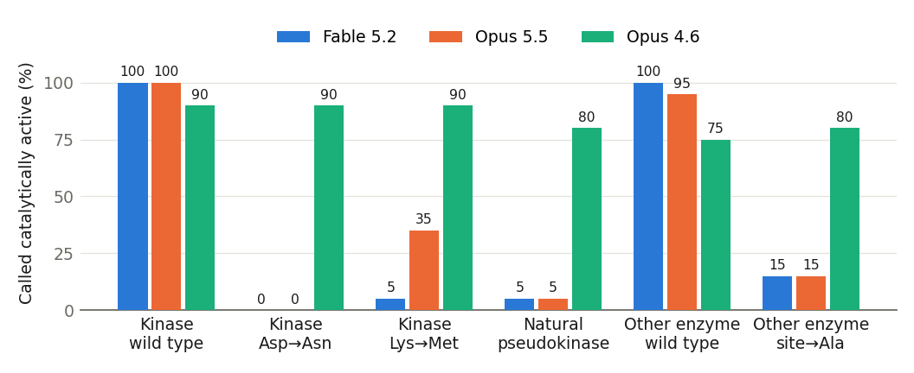
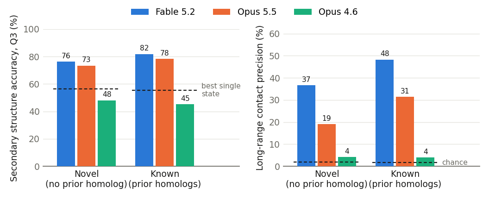

# Reading protein sequence directly with a general language model

**Bottom line:** given only an amino-acid sequence and no tools, Claude Fable 5.2
and Claude Opus 5.5 name Pfam families with near-correct boundaries, notice a
single catalytic-residue substitution in an otherwise normal kinase, and predict
secondary structure and long-range contacts well above chance for structures
released after their training. Claude Opus 4.6 does none of this. The calls are
good enough for triage and for catching pseudoenzyme over-annotation, but they
are uncited model output, they are wrong in a confident voice often enough to
matter, and they are not evidence for an annotation.

This page records four small tests run on 2026-11-18. They were prompted by a
blog post by Xinming Tu and Leo Tianlai Chen, "Claude was trained on protein
sequences at scale" (November 2026), whose code and test set are public
(`github.com/XinmingTu/LLM-bioseq-probe`, commit `0d8d086`).

## How the tests were run

- **Models:** `claude-fable-5-2`, `claude-opus-5-5`, and `claude-opus-4-6` as an
  older comparison.
- **Access:** the local `claude` command-line tool in print mode, with no tools
  and an empty system prompt. Every call was confirmed to be a single turn with
  no web search or fetch.
- **Two limits of that route:** the tool does not expose temperature, so answers
  are sampled, not greedy. It also adds about 1,400 tokens of its own context to
  each call.
- **Effort:** stated per test. Opus 4.6 ran at low effort in tests 2 to 4 because
  it was too slow at high effort to finish, so its comparison is confounded by
  effort.
- **Sample sizes are small** (20 to 68 items per cell). Treat every number as a
  first estimate.

All scripts, test sets and raw model outputs are in
[`LLM_SEQUENCE_PROBE/`](LLM_SEQUENCE_PROBE/). Each test folder has a script that
builds the test set, one that asks the models and one that scores the answers.

A short preprint is being drafted from these results. The draft and its LaTeX
source live in a separate repository, `ai4curation/fable-sequence-to-function`,
which is private while the draft is in progress; ask the authors for access.

## Test 1: next amino acid (replication of the blog post)

The model sees the start of a protein and writes the next ten residues; only the
first is scored. The control is the same question on the shuffled sequence. The
sample is 68 of the authors' 167 domain-of-unknown-function families, one
protein each, two cut points, using the authors' prompt. A third condition, the
real sequence reversed, was added here.

| Model | Effort | Real | Shuffled | Reversed | Gap, real minus shuffled (95% CI) | Authors' run, same real questions |
|---|---|---|---|---|---|---|
| Fable 5.2 | low | 25.0% | 7.4% | 8.8% | +17.6 (+9.6 to +26.5) | 58.8% |
| Fable 5.2 | high | 41.2% | 11.8% | not run | +29.4 (+18.4 to +40.4) | 58.8% |
| Opus 5.5 | low | 16.9% | 9.6% | 12.5% | +7.4 (-1.5 to +16.2) | 39.7% |
| Opus 5.5 | high | 18.9% | 7.6% | not run | +11.4 (+3.0 to +20.5) | 40.9% |
| Opus 4.6 | low | 5.1% | 7.4% | 5.9% | -2.2 (-7.4 to +2.9) | 6.6% |

- **The direction replicates.** The two new models predict real sequence better
  than shuffled sequence, and Opus 4.6 does not.
- **The size does not.** Both new models score well below the authors' numbers
  on the identical questions. Sampled answers and the extra context are the
  likely reasons, but that was not tested.
- **Thinking matters here, which the post says it does not.** At low effort
  Fable 5.2 scored 57.9% on real cut points when it chose to think (38
  questions) and 12.2% when it did not (98). At high effort Opus 5.5 scored
  39.0% with thinking (41) and 9.9% without (91). On shuffled sequence thinking
  did not help. The thinking text is not visible, so what it does is unknown.
- **The signal is direction-specific.** Reversed sequence scores like shuffled
  sequence for Fable 5.2.
- **It is not a trivial order effect.** Four no-model heuristics score 7 to 10%
  on real, shuffled and reversed sequence alike across all 3,340 cut points
  (`next_residue/baselines.py`).
- The Opus 5.5 high-effort run covers 132 of 136 questions; a container restart
  stopped it.

## Test 2: domains, membrane helices and signal peptides

The model returns Pfam domains with coordinates, transmembrane helices, a signal
peptide call, a name and a function. The test set is 45 unreviewed bacterial and
archaeal UniProt proteins (a haphazard draw, not a uniform sample) and 15 of the
blog's obscure domain-of-unknown-function proteins. Each protein was also asked
shuffled, to count invented domains. Truth is InterPro's Pfam matches and
UniProt's transmembrane and signal features.

| | Fable 5.2 (high) | Opus 5.5 (high) | Opus 4.6 (low) |
|---|---|---|---|
| Sampled proteins with at least one correct Pfam family | 39/45 | 35/45 | 5/43 |
| Obscure DUF proteins with at least one correct Pfam family | 8/15 | 3/15 | 0/15 |
| Predicted domains carrying the right Pfam accession | 62/70 | 45/51 | 5/22 |
| Boundary overlap (IoU) when the family is right | 0.87 | 0.86 | 0.61 |
| Transmembrane helices recovered | 74/74 | 74/74 | 51/73 |
| Signal peptide, true positives / false positives | 9 / 0 | 9 / 0 | 9 / 6 |
| Shuffled sequences given any Pfam domain | 1/60 | 0/60 | 4/59 |

- **Abstention works.** The new models almost never invent a domain for a
  shuffled sequence, and they answer "uncharacterized protein" for families they
  do not know.
- **Errors look like successes.** Fable 5.2 assigned one DUF968 protein to a
  different family (YbcO) with the same confidence as its correct calls. Both
  models over-split helices in multi-pass transporters (85 and 87 predicted
  against 74 annotated).
- **Function follows the family call.** Names such as "2-octaprenylphenol
  hydroxylase UbiI" track the domain; this is family-level transfer, not
  independent discovery. Function text was read by eye, not scored.
- **Submitter names were not repeated.** Two DUF proteins carry implausible
  UniProt names ("Glycerol dehydrogenase" on a 128-residue DUF3119 membrane
  protein, "Methylthioribose kinase" on a DUF7147 protein). Neither model
  reproduced them.
- The transmembrane and signal-peptide truth in unreviewed entries is itself
  predicted, so those rows measure agreement with standard predictors.

## Test 3: can it be tricked by a pseudoenzyme?

The model is asked whether the protein is catalytically active and which
catalytic residues are present or substituted. The same prompt is used for every
sequence. Three groups, all from Swiss-Prot and excluding human, mouse and rat:

- **20 active protein kinases**, each also as two single-residue mutants made
  here: the catalytic aspartate to asparagine, and the ATP-binding lysine to
  methionine. The mutants cannot have been memorised.
- **20 natural pseudokinases**, selected because their Swiss-Prot name says
  "inactive".
- **20 other enzymes** with a curated active site, each also with that residue
  changed to alanine.

| Called catalytically active | Fable 5.2 (high) | Opus 5.5 (high) | Opus 4.6 (low) |
|---|---|---|---|
| Kinase, wild type | 20/20 | 20/20 | 18/20 |
| Kinase, catalytic Asp to Asn | 0/20 | 0/20 | 18/20 |
| Kinase, ATP Lys to Met | 1/20 | 7/20 | 18/20 |
| Natural pseudokinase | 1/20 | 1/20 | 16/20 |
| Other enzyme, wild type | 20/20 | 19/20 | 15/20 |
| Other enzyme, active site to Ala | 3/20 | 3/20 | 16/20 |
| Mutated position reported as substituted (60 mutants) | 57/60 | 47/60 | 0/60 |



- **The new models read the residues.** They flip from active to inactive on a
  one-residue change and name the changed position. Opus 4.6 answers from the
  family and never notices.
- **Opus 5.5 is weaker on the lysine.** It missed 7 of 20 lysine-to-methionine
  mutants, against 0 of 20 for the aspartate.
- **Failure mode 1, sliding to a neighbour.** With Glu318 of a
  glucuronosyltransferase (Q9VLA1) changed to alanine, both models named the
  adjacent Glu317 as the catalytic base and called the enzyme active. On the
  wild type Fable 5.2 had named Glu318.
- **Failure mode 2, rationalising.** For the *Toxoplasma* kinase ROP17 (Q2PAY3)
  Fable 5.2 reported the methionine at the lysine position, then argued that a
  nearby lysine would substitute and called it active.
- **Two misses may be the reference, not the model.** For ENV9 (Q08651) and YrfG
  (P64636) both models place the catalytic residue beside UniProt's position
  (Ser173 against Ser172; Asp16 in a `DMDGT` motif against Asp9), on the wild
  type as well as the mutant. That was not adjudicated and is recorded only as a
  lead.
- **The natural pseudokinases mostly test recall.** In 17 or 18 of 20 answers
  the model's own protein name already said "inactive" or "pseudokinase", so it
  recognised the entry. The mutants are the evidence that it reads residues.
- **One disagreement with the reference name.** Both models called *C. elegans*
  kin-32 (Q95YD4, "Inactive tyrosine-protein kinase kin-32") active, citing an
  intact glycine loop, VAVK lysine, HRD and DFG. The sequence does contain those
  motifs. The basis for the Swiss-Prot name was not checked.

## Test 4: sequence to structure to function

The model predicts helices, strands, a fold, 20 long-range residue contacts
(sequence separation of at least 24, C-alpha atoms within 8 angstroms), then a
function. The test set is 30 X-ray structures released in the PDB on or after
2026-08-01, after the models' training. Fifteen are "novel": no PDB entity at 30%
identity or more was released before 2026-06-01. Fifteen are "known": at least
20 such entities. Truth is the deposited structure.

| | Fable 5.2 (high) | Opus 5.5 (high) | Opus 4.6 (low) |
|---|---|---|---|
| Three-state secondary structure, novel | 75.8% | 73.1% | 45.3% |
| Three-state secondary structure, known | 81.8% | 78.3% | 45.1% |
| Long-range contact precision, novel | 39.7% | 21.5% | 3.3% |
| Long-range contact precision, known | 48.3% | 31.4% | 4.0% |
| Top-5 contact precision, novel | 57.3% | 37.3% | 6.7% |
| Says it recognises the protein, novel | 5/15 | 0/15 | 3/15 |

Baselines: the best single-state guess scores 54 to 55% on secondary structure,
and a random long-range pair is in contact about 2% of the time.



The figure counts ASPRV1 once, so its novel bars differ slightly from the table.

- **Structure is predicted well above chance without a structural homolog.**
  The novel stratum loses only a few points against the known one.
- **One protein was drawn four times.** Human ASPRV1 accounts for four of the 15
  novel entries. Counting it once (12 proteins), Fable 5.2 scores 76.3% and
  36.6%, Opus 5.5 73.4% and 19.0%.
- **The hop to function works when the fold carries a recognisable catalytic
  signature.** For the 12 distinct novel proteins, graded by hand in
  `structure/function_grading.yaml`: Fable 5.2 was correct on 6, abstained on 5
  and was wrong on 1; Opus 5.5 was correct on 4, abstained on 7 and was wrong
  on 1.
- **Best case.** For the Arabidopsis AtDUC1 domain (9T71), whose deposited molecule
  name is only "EEIG1/EHBP1 protein amino-terminal domain protein", Fable 5.2
  predicted a papain-like cysteine peptidase with a Cys-His-Asp triad, "possibly
  a deubiquitinase". The structure is of its deubiquitinase domain.
- **Worst case.** Fable 5.2 called the guanidine prenyltransferase NosH (9TGX) a
  TenA-family thiaminase. Neither model identified the RNase P subunit Rpp30
  (10CW) or the designed cysteine protease HC34 (9YP0).
- **An unprompted pseudoenzyme call.** One ASPRV1 entry (27IQ) is a construct
  with the catalytic `DSG` motif changed to `NSG`. Both models said, without
  being asked, that the catalytic aspartate was replaced and the construct was
  likely inactive.
- The function grading is one unblinded grader against the deposited title.
- Truth for secondary structure is the depositors' helix and sheet records, not
  a uniform DSSP run.

## What this means for gene reviews

- **Useful as a first pass.** A sequence-only read can flag a likely
  pseudoenzyme before a catalytic term is accepted, and can question an
  implausible submitter name. Both are recurring problems in function
  prediction reviews (`PSEUDOENZYME_OVERANNOTATION`).
- **Not citable.** A model's reading of a sequence is a prediction with no
  provenance. It can prompt a check against InterPro, a curated active-site
  feature or a paper; it cannot support an `ACCEPT`, a `NEW` row or a core
  function.
- **Check the residue, not the verdict.** The two failure modes above both
  produce a confident "active". When a model names a catalytic position, confirm
  it against the sequence and a curated feature.
- **Use a model that can do it.** Opus 4.6 fails every part of this, so results
  depend entirely on which model answers.

## Not tested

- Greedy decoding, or any call route other than the command-line tool.
- Eukaryotic multi-domain proteins in test 2, and any membrane protein in test 4.
- Variant effect prediction, binding-site prediction and full three-dimensional
  coordinates.
- Whether thinking improves tests 2 to 4, which were run at one effort level.
- Repeat runs. Each question was asked once.

## Reproducing

Run from `projects/LLM_SEQUENCE_PROBE/`. `CLONE` is a checkout of the blog's
repository; only its `data/confirm_sequences.tsv` is read.

```bash
python3 next_residue/run.py CLONE claude-fable-5-2 high 2
python3 next_residue/analyze.py CLONE high
python3 features/build.py CLONE && python3 features/ask.py claude-fable-5-2 high && python3 features/score.py
python3 pseudo/build.py && python3 pseudo/ask.py claude-fable-5-2 high && python3 pseudo/score.py
python3 structure/build.py && python3 structure/ask.py claude-fable-5-2 high && python3 structure/score.py
```

The `build.py` scripts query live UniProt, InterPro and RCSB services, so
re-running them draws a different test set; the committed `truth.json` files are
the sets used here. The model calls for this page cost about 80 US dollars at
list price.
