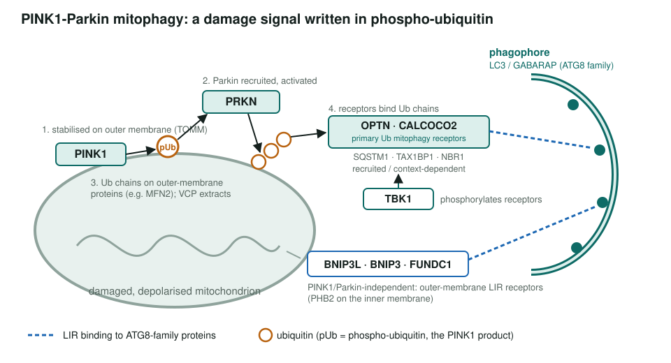
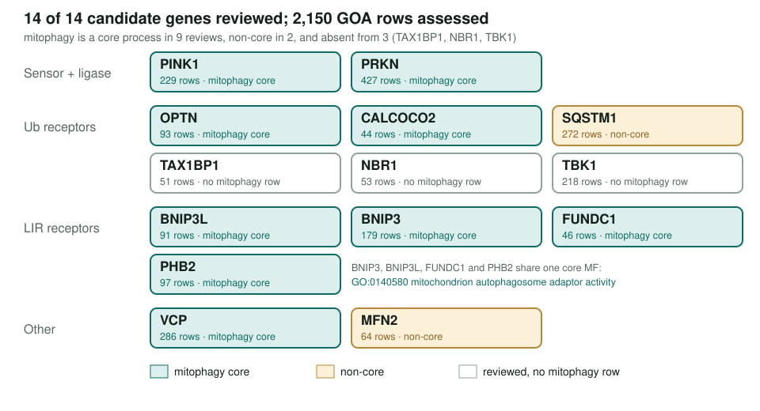

<!-- _class: lead -->

# PINK1-Parkin mitophagy

Selective autophagy of damaged mitochondria in human: the seed reviews and the module

AI Gene Review · projects/MITOPHAGY · IN_PROGRESS · 2026

---

<!-- _class: bluf -->

## Bottom line

- **Seed review work is done.** All **14 of 14** listed candidates have completed reviews (**2,150** GOA rows assessed), and `modules/mitophagy.yaml` models the pathway across human and *C. elegans*.
- Mitophagy is **core** for PINK1, PRKN, OPTN, CALCOCO2, BNIP3, BNIP3L, FUNDC1, PHB2 and VCP; **non-core** for SQSTM1 and MFN2; and **TAX1BP1, NBR1 and TBK1 carry no mitophagy row at all**.
- The clearest molecular-function result: the four integral membrane receptors converge on **one** term, `GO:0140580`.

---

## The pathway

Schematic from the pathway architecture on the project page.

---

## Why this is worth doing

- The best-characterised mitophagy pathway, with **Parkinson's disease** (PINK1, PRKN) and **ALS** (OPTN, TBK1) genetics.
- Receptors are shared with xenophagy and aggrephagy, so **which selective-autophagy process is core** is the real curation question.
- A worm counterpart, **CAEEL_MITOPHAGY**, is already mature and can now be compared ortholog by ortholog.

---

## Where the candidate genes stand

---

## Mitophagy as a core process: nine of the 14

| Gene | Representative mitophagy row | Evidence | Action |
|---|---|---|---|
| PINK1 | GO:1905091 positive regulation of type 2 mitophagy | IMP | ACCEPT |
| PRKN | GO:0061734 type 2 mitophagy | IDA | ACCEPT |
| OPTN | GO:0061734 type 2 mitophagy | IMP | ACCEPT |
| CALCOCO2 | GO:0000423 mitophagy | IMP | NEW |
| BNIP3 | GO:0000423 mitophagy | IMP | ACCEPT |
| BNIP3L | GO:1901524 regulation of mitophagy | IEA | ACCEPT |
| FUNDC1 | GO:0000423 mitophagy | IGI | ACCEPT |
| PHB2 | GO:0000423 mitophagy | IDA | ACCEPT |
| VCP | GO:0000423 mitophagy | IDA | ACCEPT |

One row per gene; several genes carry more. The one mitophagy row the reviews pushed back on is PINK1's GO:1901525 <em>negative</em> regulation of mitophagy (IMP), marked over-annotated.

---

## …and the five where it is not

- **Non-core.** SQSTM1 (`GO:0000423`, IGI + IBA) and MFN2 (`GO:0061734`, IEA + ISS) keep their mitophagy rows as `KEEP_AS_NON_CORE`: p62 is an aggrephagy reader, MFN2 a fusion GTPase and Parkin substrate.
- **No mitophagy row at all.** TAX1BP1, NBR1 and TBK1 are placed in the pathway through their **adaptor** (`GO:0160247`) and **kinase** (`GO:0004674`) functions, not a mitophagy process term — and a corpus-wide sweep confirms none of the three carries one.
- Being *required for* mitophagy is not the same as *doing* mitophagy; the reviews keep that line.

---

## The molecular-function result

- **BNIP3, BNIP3L, FUNDC1 and PHB2** all take **`GO:0140580` mitochondrion autophagosome adaptor activity** as a core molecular function — outer- and inner-membrane receptors alike.
- That is also the core MF of the worm receptors **dct-1** and **fndc-1** in **CAEEL_MITOPHAGY**, so the term is doing real cross-species work.
- The ubiquitin-reading arm sits elsewhere: OPTN on `GO:0030674` + `GO:0070530`, CALCOCO2 and TAX1BP1 on `GO:0160247`, SQSTM1 on `GO:0140036`.

---

## The module

`modules/mitophagy.yaml` — `MODULE:mitophagy`, `DRAFT`, `CONCRETE`, Eumetazoa, five parts:

1. **PINK1/Parkin ubiquitin signalling** on damaged mitochondria (`GO:0061734` type 2 mitophagy)
2. **Receptor recognition**, a `ONE_OR_MORE` variant set over OPTN/CALCOCO2, BNIP3/NIX, FUNDC1 and the nematode ALLO-1
3. **Atg8-family capture** on the phagophore (MAP1LC3B, GABARAP, worm LGG-1)
4. The nematode **FIS-1/FIS-2** step completing disposal of fission-derived fragments
5. **Basal restraint** by SCF-FBXL4, which degrades BNIP3 and NIX

Autophagosome biogenesis is out of boundary (`MODULE:metazoan_autophagosome_biogenesis`); the module `notes` record why SQSTM1, TAX1BP1, NBR1 and TBK1 are left out as members.

---

## Next steps

1. **Fold PHB2 into part 2** — the inner-membrane route was reviewed after the module was written, so the variant set still covers only outer-membrane and ubiquitin-reading receptors.
2. **Decide whether VCP and MFN2 are parts or context**, and record the decision in the module `notes` either way.
3. **Cross-check the production GO-CAMs** that model parts of this pathway against the curated reviews.
4. **Move the module off `DRAFT`** once the above are settled.

**Read more:** `projects/MITOPHAGY.md` · `modules/mitophagy.yaml` · `projects/CAEEL_MITOPHAGY.md`
