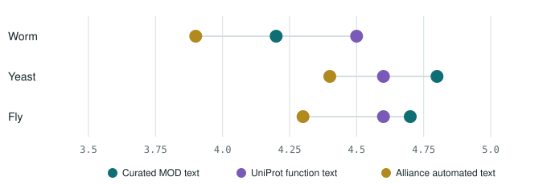

<!-- _class: lead -->

# MOD gene descriptions as a review source

What 1,609 hand-written gene descriptions from WormBase, SGD and FlyBase told us about our reviews, and about themselves

AI Gene Review · projects/MOD_DESCRIPTIONS · November 2026

---

<!-- _class: bluf -->

## Bottom line

- **A recall checklist, not an authority.** The MOD text kept naming roles our reviews had missed, but our reviews were usually more mechanistic and more current.
- **272 errors recorded** in MOD and UniProt description text (162 MOD, 110 UniProt): **186 wrong or outdated statements** and **85 omissions**, plus one wrong citation. Each quotes the offending sentence; 252 cite a paper as evidence.
- **SGD and FlyBase beat UniProt on accuracy; WormBase does not.** The Alliance automated text is last everywhere.
- **794 gaps and conflicts → 4 new annotations.** Most gaps are mutant phenotypes, which became description sentences instead.

---

## What a MOD description looks like

**SGD · CAT2** — short and dense
> Carnitine acetyl-CoA transferase; present in both mitochondria and peroxisomes; transfers activated acetyl groups to carnitine to form acetylcarnitine which can be shuttled across membranes

**FlyBase · disp** — a few sentences of prose
> dispatched (disp) encodes a multipass transmembrane protein and a member of the RND transporter family. It is required for the release and long-range activity of the lipid-modified product of hh from producing cells. …

**WormBase · rab-11.1** — long, phenotype-heavy, sometimes decades old
> rab-11.1 encodes a small GTPase homologous to the Rab GTPases that function in endocytosis, membrane fusion, and vesicular trafficking events; RAB-11.1 activity is required for completion of the final stages of cytokinesis …

---

## The pipeline

1. **Fetch** the `MOD_provided_gene_description` note from the Alliance API and save it verbatim as `GENE-deep-research-<mod>.md`.
2. **Score** it, UniProt's function text and the Alliance automated text against the curated review: correctness, utility, compactness, completeness, specificity (1–5).
3. **Record findings**: gaps (a claim the review lacks) and discrepancies (a claim that conflicts).
4. **Check each finding against the literature**, then either fix the review, add a description sentence, or record the error in the source text as a `source_defect`.
5. **Export** per-database reports with `just export-source-defects`.

Scoring and follow-up were done by parallel AI agents under the repository's curation rules, with spot checks by hand.

---

## Results by species

| | Worm · WormBase | Yeast · SGD | Fly · FlyBase |
|---|---:|---:|---:|
| Gene reviews (at each run) | 432 | 890 | 539 |
| With a curated MOD description | 374 (87%) | 890 (100%) | 345 (64%) |
| Median MOD text length, words | 75 | 33 | 37 |
| Gaps and conflicts checked | 244 | 345 | 205 |
| Errors recorded (MOD + UniProt) | 105 (76 + 29) | 92 (47 + 45) | 75 (39 + 36) |
| Cite a quoted paper as evidence | 96 | 84 | 72 |
| Recorded as `CONFIRMED` | 33 | 40 | 27 |
| Reviews edited | about 60 | 249 | 124 |
| New GO annotations | 1 | 2 | 1 |

Error counts as of 2026-11-15, from <code>defect_tally.py</code>.

---

## How accurate is each source?

Mean correctness, 1–5; the axis starts at 3.5. **SGD (4.8) and FlyBase (4.7) beat UniProt; WormBase (4.2) does not.** Much of WormBase's text predates the characterisation of its genes.

---

## One gene, start to finish: fly Pxd

**FlyBase says**
> Peroxidase (Pxd) encodes an enzyme that converts hydrogen peroxide to water and molecular oxygen, in the process oxidizing glutathione to glutathione disulfide.

Scored **2/5** for correctness; UniProt and the automated text both describe the chorion peroxidase (5/5).

**The literature says** (PMID:15979004)
> in the presence of H2O2 was able to convert tyrosine residues to di-tyrosine moieties

Pxd is the follicle-cell heme peroxidase that cross-links chorion proteins. The FlyBase text mixes catalase and glutathione peroxidase chemistry. Recorded as a `WRONG_STATEMENT` on `FB:FBgn0004577`, ready for FlyBase.

---

## Errors 1 · Stale “no obvious function” text

<b>lgg-2</b> (WormBase) <blockquote>LGG-2 has no obvious function in RNAi assays</blockquote> LGG-2 controls autophagosome maturation through the HOPS subunit VPS-39 (PMID:24374177).

<b>ced-4</b> (WormBase) <blockquote>ced-4 encodes a novel protein</blockquote> CED-4 is the Apaf-1 homolog that assembles the apoptosome (PMID:20434985).

<b>pef-1</b> (WormBase) <blockquote>pef-1 has no known mutant phenotype</blockquote> Mutants are defective in thermotaxis, chemotaxis, CO2 and UV avoidance.

<b>PPH21</b> (UniProt) <blockquote>Exact function not known, phosphatase 2A performs an essential cellular function.</blockquote> The PP2A catalytic subunit, in Cdc55, Rts1 and Tap42 complexes.

---

## Errors 2 · Claims later overturned

<b>Gen</b> (UniProt) <blockquote>Does not cleave bubble-like or Holliday junction substrates.</blockquote> Gen cleaves Holliday junctions symmetrically (PMID:28369583).

<b>Dcp-1</b> (UniProt) <blockquote>Loss of zygotic DCP-1 function causes larval lethality and melanotic tumors.</blockquote> Single dcp-1 mutants are viable; the original alleles also disrupt the neighbouring gene pita (PMID:14704173).

<b>amon</b> (FlyBase) <blockquote>amon product directly cleaves sli protein …</blockquote> Not reproduced; Tolkin is the Slit protease (PMID:32994163).

<b>DFG10</b> (SGD) <blockquote>Probable polyprenol reductase; catalyzes conversion of polyprenol to dolichol …</blockquote> Dfg10 reduces polyprenal, not polyprenol (PMID:38821050).

---

## Errors 3 · Text carried over from another species

<b>SCAP</b> (UniProt, fly) <blockquote>Escort protein required for cholesterol as well as lipid homeostasis.</blockquote> Flies cannot make sterols; fly SREBP processing responds to phosphatidylethanolamine (PMID:11988566).

<b>cact</b> (UniProt, fly) <blockquote>Cact is degraded by IKKbeta, this is essential for NF-kappa-B (rel) activation.</blockquote> Fly IKK does not act in the Toll pathway; Pelle phosphorylates Cactus.

<b>ACP1</b> (UniProt, yeast) <blockquote>Accessory and non-catalytic subunit of the mitochondrial membrane respiratory chain NADH dehydrogenase (Complex I) …</blockquote> S. cerevisiae has no Complex I.

<b>ift-20</b> (UniProt, worm) <blockquote>… required for transport of proteins in the motile cilium</blockquote> C. elegans hermaphrodites have only non-motile sensory cilia (PMID:21124868).

---

## Errors 4 · The wrong activity or protein type

<b>RIB7</b> (SGD) <blockquote>Diaminohydroxyphoshoribosylaminopyrimidine deaminase</blockquote> Rib7 is the reductase step of riboflavin synthesis; Rib2 is the deaminase.

<b>sdf-9</b> (WormBase) <blockquote>sdf-9 encodes a protein tyrosine phosphatase</blockquote> A pseudophosphatase: the catalytic cysteine is a serine.

<b>KDX1</b> (SGD and UniProt) <blockquote>Protein kinase; implicated in Slt2p mitogen-activated (MAP) kinase signaling pathway</blockquote> A catalytically inactive pseudokinase.

<b>Roc1a</b> (FlyBase) <blockquote>… encodes a C2H2 type zinc finger protein …</blockquote> Its zinc finger is a RING-H2, the E3-ligase domain.

---

## Errors 5 · Copy and citation errors

<b>GTT2</b> (SGD) <blockquote>Glutathione S-transferase capable of homodimerization; functional overlap with Gtt2p, Grx1p, and Grx2p …</blockquote>

<b>IRC24</b> (SGD) <blockquote>putative paralog of IRC24</blockquote>

<b>spi</b> (UniProt) <blockquote>Ligand for the EGF receptor (Gurken).</blockquote> Gurken is another EGFR ligand; the receptor is Egfr.

<b>nlp-29</b> (UniProt) <blockquote>Through the neuropeptide receptor nlp-29, induces sleep …</blockquote> NLP-29 is the neuropeptide; its receptor is NPR-12 (PMID:33259791).

<b>borr</b> (UniProt) <blockquote>There is no function in meiotic histone phosphorylation or spindle formation.</blockquote> Copied from the Australin paper; the borr paper the entry cites reports the opposite.

---

## Errors 6 · Central roles left out

Accurate text that omits the gene's best-established function. Recorded as `MISSING_STATEMENT` with a request to add.

- <b>EAT1</b> (SGD): omits that Eat1 makes ethyl acetate from ethanol and acetyl-CoA.
- <b>TDA5</b> (SGD and UniProt): "Protein of unknown function"; it is the yeast DHRSX ortholog in dolichol synthesis (PMID:42201967).
- <b>abi-1</b> (WormBase): omits its role as a WAVE regulatory complex subunit.
- <b>fz2</b> (UniProt): generic Frizzled text; omits that Fz2 is a Wingless receptor, redundant with Fz.

All 272 errors, with quotes and evidence, are in the project brief and in <code>defect-tally.yaml</code>.

---

## Gaps: what the MOD text knew that the review did not

- <b>fshr-1</b> (worm): a role in synaptic acetylcholine release, confirmed by PMID:39561202 and placed in the intestine.
- <b>rab-11.1</b> (worm): plasma membrane repair after Cry5B toxin (PMID:21320697).
- <b>HSF1</b> (yeast): transcriptional condensates, activation by acidification, and RQC stress sensing.
- <b>Fer1HCH</b> (fly): protection from ferroptosis, and an effect on lymph gland blood cell differentiation.
- <b>Dif</b> (fly): melanization through Spn27A, and elimination of loser cells in cell competition.
- <b>Cul1</b> (fly): scolopidial attachment in Johnston's organ, restrained by Ubr3.

Each was traced to its paper and added to the review's description with the citation. Untraceable claims were noted and changed nothing.

---

## Four new annotations from 794 findings

| Gene | Term | Evidence |
|---|---|---|
| fshr-1 (worm) | GO:1900075 positive regulation of neuromuscular synaptic transmission | IMP, PMID:39561202 |
| MIH1 (yeast) | GO:1905279 regulation of retrograde transport, endosome to Golgi | IDA, PMID:28362258 |
| HOG1 (yeast) | GO:0071243 cellular response to arsenic-containing substance | IMP |
| Tango5 (fly) | GO:0000045 autophagosome assembly | IMP, PMID:34019822 |

The bar: the gene product must do some of the work. Mih1 dephosphorylates Vps26; Tango5 is the ER scramblase feeding the phagophore. Fly Buffy, Caf1-105 and koi were declined: a phenotype or a single study, not an activity.

---

## When our review was the one that was wrong

- <b>pek-1</b> (worm): the review said pek-1 with atf-6 loss causes larval arrest; that double knockdown has no obvious phenotype (PMID:16184190).
- <b>gcy-8</b> (worm): the review gave GCY-18 primacy; GCY-8 alone drives rapid AFD responses (PMID:21315599).
- <b>lys-1</b> (worm): the review called it a DAF-16 target; the cited screen never tested that.
- <b>DCI1</b> (yeast): the review credited the Eci1p route; in PMID:19830908 Eci1p creates the block and the Pte1p thioesterase clears it. Its isomerase rows became UNDECIDED.
- <b>lrx-1</b> (worm): the review had rejected LDL-A repeats that Pfam, SMART and CDD all detect.

---

## The Alliance automated text

Generated from the GO annotations under review, so never cited as evidence, and lowest-scoring in every species. Comparing it with the RefSeq copy of an earlier release shows content disappearing.

**worm ced-5**, RefSeq copy:
> Enables SH3 domain binding activity … Involved in … engulfment of apoptotic cell …

Current text: expression, disease and orthology only.

**Doubtful orthologs**, from Alliance orthology data:
> Orthologous to human PAX4 (paired box 4).

for fly **ey**, the Pax6 ortholog.

> Orthologous to human NKX2-2 (NK2 homeobox 2).

for fly **tin**, the Nkx2-5 ortholog.

---

## Mouse: sampled and dropped

MGI's note summarises mutant phenotypes. 22 of 22 notes in a seeded sample of 25 genes read like this:

<b>Src</b> <blockquote>Homozygotes for a targeted null mutation exhibit growth retardation, failure of tooth eruption, osteopetrosis with lack of secondary bone resorption, and lethality at 3-4 weeks.</blockquote>
<b>Ccne1</b> <blockquote>Mice homozygous for disruptions in this gene display no abnormal phenotype.</blockquote>
<b>Cd79a</b> and <b>Cd79b</b>, outside the sample, word for word: <blockquote>Homozygotes for targeted null mutations exhibit arrested development of B cells at the pro-B cell stage due to diminished signaling of the B cell receptor.</blockquote>

Phenotypes show necessity, not function, so the tool now skips MGI. Rat has only automated text; zebrafish and frog have none.

---

## Bugs the run found in our own pipeline

- The fetcher had **silently stopped**: the Alliance API moved descriptions into `relatedNotes`.
- Worm genes were looked up by **transcript id** instead of WBGene id.
- Re-fetching **erased hand-written scores**; existing reviews are now carried forward.
- RGD files **automated text as curated**; the filter for it first rejected SGD's CAF120 by mistake.
- **8 fly genes skipped**: unreviewed UniProt entries link to FlyBase only through an `AGR` line.
- FlyBase writes **"α-Man-Ia"**; the identity check now spells Greek letters out.
- MGI ids were **doubled** (`MGI:MGI:106913`).

---

## Next steps

- **File the reports** with WormBase, SGD, FlyBase and UniProt (manual): 272 errors, 252 of them with a quoted paper as evidence.
- **Merge the duplicate yeast folders** MVD1 and ERG19 (issue #5837).
- **Use the MOD text on every new worm, yeast and fly review**: `just mod-description-deep-research SPECIES GENE`.

PRs: ai4curation/ai-gene-review #5736 (worm, yeast), #5844 (fly), #5902 (mouse decision, fixes). Detailed brief with all 272 errors: linked from the project page.
