# *Variovorax*: Rhizosphere Plant–Microbe Interactions & Critical Metal Recovery

## Overview

Members of the betaproteobacterial genus ***Variovorax*** (`NCBITaxon:34072`, family *Comamonadaceae*) are metabolically versatile "hub" bacteria in terrestrial and rhizosphere ecosystems. Across synthetic community (SynCom) plant microbiome studies and bio-mining/bioremediation surveys, *Variovorax* stands out for two tightly linked capabilities:

1. **Keystone Rhizosphere Chemical Signaling & Plant Growth Promotion:**
   - **Auxin (IAA) Homeostasis (`iad` Operon):** In complex root microbiomes, diverse bacteria secrete indole-3-acetic acid (IAA) or stimulate host auxin/ethylene signaling, triggering severe root growth inhibition (RGI). A single genus — *Variovorax* — is both necessary and sufficient to reverse microbiome-induced RGI across phylogenetically diverse bacterial communities via a conserved **indole-3-acetic acid degradation (`iad`) operon** (Finkel et al. 2020, PMID:32999461; Conway et al. 2022, PMID:36266335; Ma et al. 2023, PMID:37459330).
   - **Ethylene Stress Buffering (`acdS`) & Nitrile/Amide Crosstalk (`amiE`):** *Variovorax* strains co-express pyridoxal 5'-phosphate (PLP)-dependent **1-aminocyclopropane-1-carboxylate (ACC) deaminase (`acdS`)**, which cleaves the immediate precursor of plant ethylene into 2-oxobutanoate and ammonia, dampening stress-induced ethylene spikes in colonized roots (Han et al. 2011, PMID:21183664; Finkel et al. 2020, PMID:32999461). Concurrently, aliphatic amidase (`amiE`) hydrolyzes rhizosphere short-chain aliphatic amides into organic acids and bioavailable ammonium.
   - **Organosulfur & Nutrient Mobilization (`ssuD`, `acd`):** Under sulfate limitation in the rhizosphere, *Variovorax* mineralizes aliphatic sulfonates via the $\text{FMNH}_2$-dependent alkanesulfonate monooxygenase (`ssuD`) and cleaves 3-sulfinopropanoyl-CoA via 3-sulfinopropanoyl-CoA desulfinase (`acd`, EC 3.13.1.4) to supply inorganic sulfite and propionyl-CoA (Bruland et al. 2009, PMID:19001372; Schürmann et al. 2013, PMID:24317404).

2. **Periplasmic Glucose Oxidation, Intracellular Iron Trafficking, Polyphosphate Synthesis & RND Cation Efflux:**
   - **Periplasmic PQQ-Dependent Glucose Oxidation (`gcd`):** Membrane-bound quinoprotein glucose dehydrogenase (`gcd`, `VPARA_65850`, `A0A0H2LUW4`) oxidizes periplasmic D-glucose to D-glucono-1,5-lactone (which hydrolyzes to D-gluconate/gluconic acid) coupled to membrane ubiquinone reduction, representing a candidate organic-acid mineral-solubilization mechanism for comparative investigation with [REE](REE.md) and [METEA_MLL_CLUSTER](METEA_MLL_CLUSTER.md).
   - **Cytosolic Iron Trafficking (`fetP`):** *Variovorax paradoxus* S110 encodes the 90-residue cytosolic YggX-family probable $\text{Fe}^{2+}$-trafficking protein (`fetP`, `Vapar_2982`, `C5CNX5`), predicted to mediate intracellular $\text{Fe}^{2+}$ transactions for iron-sulfur cluster assembly and repair (distinct from the uncurated periplasmic FetP-like cupredoxin `Vapar_3862` / `C5CUI1` encoded adjacent to the variobactin siderophore locus).
   - **Intracellular Polyphosphate Synthesis (`ppk`) & Inner-Membrane RND Cation Efflux (`czcA3`):** Polyphosphate kinase 1 (`ppk`, `VPARA_28600`, `A0A0H2M4T4`) polymerizes the terminal $\gamma$-phosphate of ATP into long-chain inorganic polyphosphate (`polyP`), while the inner-membrane HME-RND proton/cation antiporter subunit (`czcA3`, `VPARA_44890`, `A0A0H2MBF7`) partners with periplasmic adaptor and outer-membrane channel subunits to drive transmembrane export of monoatomic metal cations.

---

## System Architecture

```mermaid
flowchart TD
    subgraph Rhizosphere["Plant Root Exudates & Soil Minerals"]
        IAA["Microbial & Plant Auxin (IAA)"]
        ACC["Plant Ethylene Precursor (ACC)"]
        Amides["Rhizosphere Amides & Nitriles"]
        Sulfonates["Aliphatic Sulfonates & 3-Sulfinopropanoate"]
        Minerals["Phosphate & Metal-Bearing Minerals"]
    end

    subgraph Variovorax["Variovorax paradoxus (VARPS / VARPD)"]
        subgraph AuxinOperon["iad Auxin Catabolism Operon (VARPS)"]
            IadR["IadR (C5CSP2)<br/>MarR-Family IAA Sensor/Repressor"]
            IadC["IadC (C5CSP5)<br/>Class IA FMN/[2Fe-2S] Reductase"]
            IadDE["IadD/IadE (C5CSP6 / C5CSP7)<br/>Rieske Non-Heme Fe IAA Dioxygenase"]
        end

        subgraph PhytohormoneCrosstalk["Ethylene & Amide Assimilation"]
            AcdS["AcdS (Q6J256)<br/>PLP-Dependent ACC Deaminase"]
            AmiE["AmiE (C5CWZ4)<br/>Aliphatic Amidase"]
        end

        subgraph SulfurMobilization["Organosulfur Mineralization"]
            SsuD["SsuD (C5CNW9)<br/>FMNH2 Alkanesulfonate Monooxygenase"]
            Acd["Acd (B9U6P5)<br/>3-Sulfinopropanoyl-CoA Desulfinase"]
        end

        subgraph MetalHomeostasis["Mineral Acidolysis, Iron Trafficking & Metal Homeostasis"]
            Gcd["Gcd (A0A0H2LUW4)<br/>PQQ Glucose Dehydrogenase"]
            FetP["FetP (C5CNX5)<br/>Cytosolic YggX-Family Fe(2+) Trafficking"]
            Ppk["Ppk (A0A0H2M4T4)<br/>Polyphosphate Kinase"]
            CzcA["CzcA3 (A0A0H2MBF7)<br/>Inner-Membrane HME-RND Efflux Subunit"]
        end
    end

    IAA -->|"Binds & derepresses"| IadR
    IadR -.->|"Releases repression"| IadDE
    IadC -->|"Electron transfer"| IadDE
    IAA -->|"O2 incorporation & ring cleavage"| IadDE
    IadDE -->|"2-Oxindole-3-acetic acid / Anthranilate<br/>(Reverses Root Growth Inhibition)"| PlantBenefit["Balanced Root Growth & Stress Resilience"]

    ACC -->|"Cleaved to 2-oxobutanoate + NH3"| AcdS
    AcdS -->|"Lowers stress ethylene"| PlantBenefit
    Amides -->|"Hydrolyzed to carboxylate + NH3"| AmiE

    Sulfonates -->|"Desulfonation to sulfite"| SsuD
    Sulfonates -->|"3SP-CoA cleavage to propanoyl-CoA + sulfite"| Acd
    SsuD --> PlantBenefit

    Gcd -->|"Periplasmic D-glucono-1,5-lactone / D-gluconate"| Minerals
    Minerals -->|"Cytosolic Fe2+ trafficking"| FetP
    Minerals -->|"Intracellular polyP synthesis"| Ppk
    Minerals -->|"Inner-membrane monoatomic cation H+ antiport"| CzcA
```

---

## Curated Gene Reviews & Modules

### Pathway Modules

- **[`bacterial_iad_auxin_catabolism`](../modules/bacterial_iad_auxin_catabolism.html)** — *Variovorax* `iad` operon-mediated oxidative indole-3-acetic acid (IAA) catabolism (`iadR`, `iadC`, `iadD`, `iadE`) and microbiome root growth inhibition reversal.
- **[`variovorax_metallophore_metal_homeostasis`](../modules/variovorax_metallophore_metal_homeostasis.html)** — Functional grouping (`BIOLOGICAL_PROCESS`) of four independent *Variovorax* metabolic and metal-homeostasis activities: periplasmic PQQ-dependent D-glucose oxidation (`gcd`), cytosolic YggX-family iron trafficking (`fetP`), cytoplasmic inorganic polyphosphate synthesis (`ppk`), and inner-membrane HME-RND monoatomic metal cation efflux (`czcA3`).

### Curated *Variovorax* Genes

| Organism | Gene Symbol | UniProt ID | Locus Tag | Protein / Function | Batch | Review Link |
| :--- | :--- | :--- | :--- | :--- | :--- | :--- |
| `VARPS` | `iadD` | `C5CSP6` | `Vapar_1493` | Indole-3-acetic acid Rieske dioxygenase $\alpha$ subunit | 1A (Auxin Catabolism) | [VARPS/iadD](../genes/VARPS/iadD/iadD-ai-review.html) |
| `VARPS` | `iadE` | `C5CSP7` | `Vapar_1494` | Indole-3-acetic acid dioxygenase $\beta$ subunit | 1A (Auxin Catabolism) | [VARPS/iadE](../genes/VARPS/iadE/iadE-ai-review.html) |
| `VARPS` | `iadC` | `C5CSP5` | `Vapar_1492` | Class IA FMN/`[2Fe-2S]` ferredoxin-$\text{NAD}^+$ reductase | 1A (Auxin Catabolism) | [VARPS/iadC](../genes/VARPS/iadC/iadC-ai-review.html) |
| `VARPS` | `iadR` | `C5CSP2` | `Vapar_1489` | MarR-family IAA-sensing transcriptional repressor | 1A (Auxin Catabolism) | [VARPS/iadR](../genes/VARPS/iadR/iadR-ai-review.html) |
| `VARPD` | `acdS` | `Q6J256` | `acdS` | 1-aminocyclopropane-1-carboxylate deaminase (EC 3.5.99.7) | 1B (Ethylene Buffering) | [VARPD/acdS](../genes/VARPD/acdS/acdS-ai-review.html) |
| `VARPS` | `amiE` | `C5CWZ4` | `Vapar_0135` | Aliphatic amidase (EC 3.5.1.4) | 1B (Amide Assimilation) | [VARPS/amiE](../genes/VARPS/amiE/amiE-ai-review.html) |
| `VARPS` | `fetP` | `C5CNX5` | `Vapar_2982` | Cytosolic YggX-family probable $\text{Fe}^{2+}$-trafficking protein | 2A (Iron Trafficking) | [VARPS/fetP](../genes/VARPS/fetP/fetP-ai-review.html) |
| `VARPD` | `gcd` | `A0A0H2LUW4` | `VPARA_65850` | PQQ-dependent glucose dehydrogenase (EC 1.1.5.2) | 2A (Mineral Acidolysis) | [VARPD/gcd](../genes/VARPD/gcd/gcd-ai-review.html) |
| `VARPD` | `ppk` | `A0A0H2M4T4` | `VPARA_28600` | Polyphosphate kinase (EC 2.7.4.1) | 2A (PolyP Synthesis) | [VARPD/ppk](../genes/VARPD/ppk/ppk-ai-review.html) |
| `VARPD` | `czcA3` | `A0A0H2MBF7` | `VPARA_44890` | Inner-membrane HME-RND cation efflux transporter subunit CzcA3 | 2B (Heavy-Metal Efflux) | [VARPD/czcA3](../genes/VARPD/czcA3/czcA3-ai-review.html) |
| `VARPS` | `ssuD` | `C5CNW9` | `Vapar_2976` | Alkanesulfonate monooxygenase (EC 1.14.14.5) | 2B (Sulfur Mobilization) | [VARPS/ssuD](../genes/VARPS/ssuD/ssuD-ai-review.html) |
| `VARPD` | `acd` | `B9U6P5` | `VPARA_05440` | 3-sulfinopropanoyl-CoA desulfinase (EC 3.13.1.4) | 2B (Sulfur Mobilization) | [VARPD/acd](../genes/VARPD/acd/acd-ai-review.html) |

---

## Cross-Project Connections

- **[Rare Earth Elements (REE) & Lanthanide Metabolism](REE.md):** *Variovorax* strains co-isolated with methylotrophs and lanthanide-accumulating rhizosphere communities encode PQQ-dependent glucose dehydrogenase (`gcd`) and polyphosphate kinase (`ppk`) enzymes whose potential roles in organic-acid mineral solubilization and intracellular polyphosphate cation sequestration represent prospective experimental hypotheses.
- **[METEA MLL Cluster](METEA_MLL_CLUSTER.md):** Complements the lanthanophore (`mll`) and XoxF/ExaF systems of *Methylorubrum extorquens* AM1 with betaproteobacterial rhizosphere co-habitant phytohormone-buffering and metal-homeostasis pathways.
- **[Pseudomonas putida Genome-Wide Curation](P_PUTIDA.md) & [`bacterial_alkanesulfonate_uptake_desulfonation`](../modules/bacterial_alkanesulfonate_uptake_desulfonation.html):** `VARPS/ssuD` (`C5CNW9`, `Vapar_2976`) is curated as a standalone Betaproteobacterial comparator to the Gammaproteobacterial (`ECOLI`/`PSEPK`) `ssuEADCB` alkanesulfonate desulfonation module [`bacterial_alkanesulfonate_uptake_desulfonation`](../modules/bacterial_alkanesulfonate_uptake_desulfonation.html).
- **[Module & Batch Curation Plan](VARIOVORAX/VARIOVORAX_MODULE_PLAN.html):** Detailed breakdown of target batches, UniProt proteome coverage, and GO term conventions.
