# *Variovorax*: Rhizosphere Plant–Microbe Interactions & Critical Metal Recovery

## Overview

Members of the betaproteobacterial genus ***Variovorax*** (`NCBITaxon:34072`, family *Comamonadaceae*) are metabolically versatile "hub" bacteria in terrestrial and rhizosphere ecosystems. Across synthetic community (SynCom) plant microbiome studies and bio-mining/bioremediation surveys, *Variovorax* stands out for two tightly linked capabilities:

1. **Keystone Rhizosphere Chemical Signaling & Plant Growth Promotion:**
   - **Auxin (IAA) Homeostasis (`iad` Operon):** In complex root microbiomes, diverse bacteria secrete indole-3-acetic acid (IAA) or stimulate host auxin/ethylene signaling, triggering severe root growth inhibition (RGI). A single genus — *Variovorax* — is both necessary and sufficient to reverse microbiome-induced RGI across phylogenetically diverse bacterial communities via a conserved **indole-3-acetic acid degradation (`iad`) operon** (Finkel et al. 2020, PMID:32999461; Conway et al. 2022, PMID:36266335; Ma et al. 2023, PMID:37459330).
   - **Ethylene Stress Buffering (`acdS`) & Nitrile/Amide Crosstalk (`amiE`):** *Variovorax* strains co-express pyridoxal 5'-phosphate (PLP)-dependent **1-aminocyclopropane-1-carboxylate (ACC) deaminase (`acdS`)**, which cleaves the immediate precursor of plant ethylene into 2-oxobutanoate and ammonia, dampening stress-induced ethylene spikes in colonized roots (Han et al. 2011, PMID:21183664; Finkel et al. 2020, PMID:32999461). Concurrently, aliphatic amidase (`amiE`) hydrolyzes rhizosphere short-chain aliphatic amides into organic acids and bioavailable ammonium.
   - **Organosulfur & Urea Nutrient Mobilization (`ssuA2`, `ssuB2`, `ssuC5`, `ssuD`, `ssuE`, `tauA`, `tauB1`, `tauC`, `tauD1`, `acd`, `ureA`, `ureB`, `ureC`, `ureD`, `ureE`, `ureF`, `ureG`):** Under sulfate limitation in the rhizosphere, *Variovorax paradoxus* TBEA6 (`VARPD`) imports aliphatic sulfonates via the SsuABC ABC transporter (`ssuA2` `VPARA_09270`, `ssuB2` `VPARA_09230`, `ssuC5` `VPARA_09240`) and mineralizes them via the $\text{FMNH}_2$-dependent alkanesulfonate monooxygenase (`ssuD` `VPARA_09250` in TBEA6; curated Swiss-Prot ortholog `ssuD` `Vapar_2976` / `C5CNW9` in *V. paradoxus* S110 `VARPS`) paired with the NAD(P)H-dependent FMN reductase (`ssuE` `VPARA_09290`), while importing taurine via the TauABC ABC transporter (`tauA` `VPARA_03650`, `tauB1` `VPARA_03660`, `tauC` `VPARA_03670`) for oxidative cleavage by the $\text{Fe(II)}$/2-oxoglutarate-dependent taurine dioxygenase (`tauD1` `VPARA_23370`, EC 1.14.11.17) and cleaving 3-sulfinopropanoyl-CoA via 3-sulfinopropanoyl-CoA desulfinase (`acd` `VPARA_05440`, EC 3.13.1.4) to supply inorganic sulfite and propionyl-CoA (van der Ploeg et al. 1996, PMID:8808933; Eichhorn et al. 1997, PMID:9287300; Eichhorn et al. 1999, PMID:10498703; Bruland et al. 2009, PMID:19001372; Schürmann et al. 2013, PMID:24317404). Simultaneously, cytoplasmic nickel-dependent urease — assembled as a $(\text{UreABC})_3$ trimer of heterotrimers (`ureA` `Vapar_4240`, `ureB` `Vapar_4242`, `ureC` `Vapar_4243`, EC 3.5.1.5) and matured by the `UreD`-`UreF`-`UreG` activation complex (`ureD` `Vapar_3971`, `ureF` `VPARA_50930`, `ureG` `Vapar_4248`) and nickel metallochaperone `UreE` (`ureE` `VPARA_50940`) — hydrolyzes urea into ammonium and carbonate/bicarbonate, supplying assimilable nitrogen and elevating local pH to promote microbially induced carbonate precipitation (Park et al. 1994, PMID:7909161; Soriano & Hausinger 1999, PMID:10500143; Carter et al. 2009, PMID:20046957; Han et al. 2011, PMID:21183664).

2. **PQQ Biosynthesis, Quinoprotein Oxidation, TonB-ExbB-ExbD Siderophore Import & Heavy-Metal Homeostasis:**
   - **Coenzyme PQQ Biosynthesis (`pqqA`, `pqqB`, `pqqC`, `pqqD`, `pqqE`) & Periplasmic Quinoprotein Dehydrogenases (`gcd`, `VPARA_00790`):** *Variovorax paradoxus* synthesizes pyrroloquinoline quinone (PQQ) de novo from a ribosomally synthesized precursor peptide (`pqqA`, `Vapar_3057`) via the radical SAM peptide cross-linker `pqqE` (`VPARA_00920`) and its peptide chaperone `pqqD` (`VPARA_00930`), the $\text{Fe(II)}$-dependent oxygenase/hydroxylase `pqqB` (`VPARA_00950`), and the cofactorless ring-closing oxidase `pqqC` (`VPARA_00940`) (Klinman & Bonnot 2014, PMID:24050525; Latham et al. 2015, PMID:25667491). PQQ powers membrane-bound glucose dehydrogenase (`gcd`, `VPARA_65850`) for periplasmic D-gluconate production (mineral acidolysis) as well as periplasmic PQQ-dependent alcohol/methanol dehydrogenase (`VPARA_00790`, EC 1.1.2.7), a candidate lanthanide-associated XoxF/ExaF-like dehydrogenase (Keltjens et al. 2014, PMID:24912846; Good et al. 2016, PMID:27285220).
   - **TonB-ExbB-ExbD-Energized Ferric-Siderophore Import (`exbD5`, `exbB4`, `tonB`, `bfrD1`), Ferric Uptake Regulation (`fur1`) & Cytosolic Iron Trafficking (`fetP`):** Encoded in the syntenic four-gene `exbD5-exbB4-tonB-bfrD1` (`VPARA_25800-VPARA_25830`) operon, the inner-membrane pentameric proton-channel stator `exbB4` (`VPARA_25810`, `A0A0H2MHH3`) and dimeric proton-coupling Asp23 rotor `exbD5` (`VPARA_25800`, `A0A0H2M1F3`) harvest the cytoplasmic-membrane proton-motive force and energize the periplasm-spanning transducer `tonB` (`VPARA_25820`, `A0A0H2M2E3`) to open the outer-membrane TonB-dependent ferric-siderophore receptor `bfrD1` (`VPARA_25830`, `A0A0H2M677`) for uptake of ferric-siderophore chelates (Noinaj et al. 2010, PMID:20420522; Johnston et al. 2015, PMID:26412281; Braun et al. 2023, PMID:37219427), while the cytosolic $\text{Fe}^{2+}$-sensing metalloregulator `fur1` (`VPARA_18200`, `A0A0H2M8T9`) represses iron-acquisition operons under iron sufficiency and the YggX-family protein `fetP` (`Vapar_2982`, `C5CNX5`) mediates intracellular $\text{Fe}^{2+}$ trafficking.
   - **Intracellular Polyphosphate Turnover (`ppk`, `ppx`) & Heavy-Metal Efflux and Two-Component Regulation (`czcA3`, `czcB`, `czcC`, `czcD`, `cadA2`, `czcI`, `czcR`, `cusS`):** Polyphosphate kinase 1 (`ppk`, `VPARA_28600`, `A0A0H2M4T4`) polymerizes the terminal $\gamma$-phosphate of ATP into long-chain inorganic polyphosphate (`polyP`) while exopolyphosphatase (`ppx`, `VPARA_10490`, `A0A0H2MBK5`, EC 3.6.1.11) processively hydrolyzes terminal orthophosphate residues to balance intracellular polyP turnover (Nikel et al. 2013, PMID:23687963). Across the cell envelope, the inner-membrane CDF antiporter `czcD` (`VPARA_15480`, `A0A0H2M558`) and the P1B-2-type $\text{Zn}^{2+}$/$\text{Cd}^{2+}$-exporting ATPase `cadA2` (`VPARA_44980`, `A0A0H2LVW9`, EC 7.2.2.12) export cytoplasmic heavy-metal cations into the periplasm, while the tripartite HME-RND efflux complex — inner-membrane RND antiporter `czcA3` (`VPARA_44890`, `A0A0H2MBF7`), periplasmic 10-His membrane-fusion adaptor `czcB` (`VPARA_44900`, `A0A0H2LX82`), and outer-membrane factor channel `czcC` (`VPARA_44910`, `A0A0H2M0U4`) — extrudes divalent heavy-metal cations across the outer membrane under the control of the periplasmic modulator `czcI` (`VPARA_44920`, `A0A0H2LVR9`) and the `czcR`-`cusS` (`VPARA_44930`-`VPARA_44940`, `A0A0H2LVW5`/`A0A0H2MBG2`) two-component regulatory system (Grosse et al. 1999, PMID:10198000; Anton et al. 1999, PMID:10559151; Legatzki et al. 2003, PMID:12867443; Nies 2003, PMID:12829273).

---

## System Architecture

```mermaid
flowchart TD
    subgraph Rhizosphere["Plant Root Exudates & Soil Minerals"]
        IAA["Microbial & Plant Auxin (IAA)"]
        ACC["Plant Ethylene Precursor (ACC)"]
        AmidesUrea["Rhizosphere Amides & Urea"]
        Sulfonates["Taurine, Aliphatic Sulfonates & 3SP"]
        Minerals["Phosphate, Iron & Metal-Bearing Minerals"]
    end

    subgraph Variovorax["Variovorax paradoxus (VARPS / VARPD)"]
        subgraph AuxinOperon["iad Auxin Catabolism Operon (VARPS)"]
            IadR["IadR (C5CSP2)<br/>MarR-Family IAA Sensor/Repressor"]
            IadC["IadC (C5CSP5)<br/>Class IA FMN/[2Fe-2S] Reductase"]
            IadDE["IadD/IadE (C5CSP6 / C5CSP7)<br/>Rieske Non-Heme Fe IAA Dioxygenase"]
        end

        subgraph PhytohormoneCrosstalk["Ethylene, Amide & Urea Assimilation"]
            AcdS["AcdS (Q6J256)<br/>PLP-Dependent ACC Deaminase"]
            AmiE["AmiE (C5CWZ4)<br/>Aliphatic Amidase"]
            UreC["UreC (C5CY00)<br/>Ni(2+)-Dependent Urease Alpha Subunit"]
        end

        subgraph SulfurMobilization["Organosulfur Mineralization"]
            SsuD["SsuD (C5CNW9)<br/>FMNH2 Alkanesulfonate Monooxygenase"]
            TauD1["TauD1 (A0A0H2MHV8)<br/>Fe(II)/2OG Taurine Dioxygenase"]
            Acd["Acd (B9U6P5)<br/>3-Sulfinopropanoyl-CoA Desulfinase"]
        end

        subgraph PQQandQuinoproteins["PQQ Biosynthesis & Periplasmic Quinoproteins"]
            PQQ["PqqA/B/C/D/E<br/>De Novo PQQ Biosynthesis"]
            Gcd["Gcd (A0A0H2LUW4)<br/>PQQ Glucose Dehydrogenase"]
            V00790["VPARA_00790 (A0A0H2MDH4)<br/>Periplasmic PQQ Alcohol Dehydrogenase"]
        end

        subgraph MetalHomeostasis["Siderophore Import, Iron Trafficking & Metal Homeostasis"]
            TonBBfrD["TonB (A0A0H2M2E3) + BfrD1 (A0A0H2M677)<br/>TonB-Dependent Siderophore Import"]
            FetP["FetP (C5CNX5)<br/>Cytosolic YggX-Family Fe(2+) Trafficking"]
            Ppk["Ppk (A0A0H2M4T4)<br/>Polyphosphate Kinase"]
            CzcA["CzcA3 (A0A0H2MBF7)<br/>Inner-Membrane HME-RND Efflux Subunit"]
        end
    end

    IAA -->|"Binds & derepresses"| IadR
    IadR -.->|"Releases repression"| IadDE
    IadC -->|"Electron transfer"| IadDE
    IAA -->|"O2 incorporation & ring cleavage"| IadDE
    IadDE -->|"2-Oxindole-3-acetic acid / Anthranilate<br/>(Reverses Root Growth Inhibition)"| PlantBenefit["Balanced Root Growth & Stress Resilience"]

    ACC -->|"Cleaved to 2-oxobutanoate + NH3"| AcdS
    AcdS -->|"Lowers stress ethylene"| PlantBenefit
    AmidesUrea -->|"Amide hydrolysis to NH3"| AmiE
    AmidesUrea -->|"Urea hydrolysis to 2 NH4+ + HCO3-"| UreC

    Sulfonates -->|"Alkanesulfonate desulfonation"| SsuD
    Sulfonates -->|"Taurine desulfonation"| TauD1
    Sulfonates -->|"3SP-CoA cleavage to propanoyl-CoA + sulfite"| Acd
    SsuD --> PlantBenefit
    TauD1 --> PlantBenefit

    PQQ -->|"Supplies PQQ cofactor"| Gcd
    PQQ -->|"Supplies PQQ cofactor"| V00790
    Gcd -->|"Periplasmic D-glucono-1,5-lactone / D-gluconate"| Minerals
    Minerals -->|"Outer-membrane Fe-siderophore uptake"| TonBBfrD
    TonBBfrD -->|"Cytosolic Fe2+ trafficking"| FetP
    Minerals -->|"Intracellular polyP synthesis"| Ppk
    Minerals -->|"Inner-membrane monoatomic cation H+ antiport"| CzcA
```

---

## Curated Gene Reviews & Modules

### Pathway Modules

- **[`bacterial_iad_auxin_catabolism`](../modules/bacterial_iad_auxin_catabolism.html)** — *Variovorax* `iad` operon-mediated oxidative indole-3-acetic acid (IAA) catabolism (`iadR`, `iadC`, `iadD`, `iadE`) and microbiome root growth inhibition reversal.
- **[`variovorax_metallophore_metal_homeostasis`](../modules/variovorax_metallophore_metal_homeostasis.html)** — Functional grouping (`BIOLOGICAL_PROCESS`) of four independent *Variovorax* metabolic and metal-homeostasis subsystems: periplasmic PQQ-dependent D-glucose oxidation (`gcd`), cytosolic YggX-family iron trafficking and Fe(2+)-dependent transcriptional regulation (`fetP`, `fur1`), cytoplasmic inorganic polyphosphate polymerization and hydrolytic turnover (`ppk`, `ppx`), and trans-envelope tripartite HME-RND (`czcA3`, `czcB`, `czcC`), inner-membrane CDF (`czcD`), P1B-type ATPase (`cadA2`), and CzcI/CzcR/CusS-regulated (`czcI`, `czcR`, `cusS`) heavy-metal cation efflux.
- **[`bacterial_tonb_siderophore_import`](../modules/bacterial_tonb_siderophore_import.html)** — Conserved Gram-negative three-part transport pathway (`BIOLOGICAL_PROCESS`) coupling the inner-membrane ExbB-ExbD proton-channel motor (`exbB4`, `VPARA_25810`; `exbD5`, `VPARA_25800`) and periplasm-spanning TonB energy transducer (`tonB`, `VPARA_25820`) to outer-membrane TonB-dependent ferric-siderophore uptake (`bfrD1`, `VPARA_25830`).
- **Cross-Species Reusable Modules Linked to *Variovorax* Reviews:**
  - **[`pqq_biosynthesis`](../modules/pqq_biosynthesis.html)** — De novo PQQ biosynthetic pathway (`pqqA`, `pqqB`, `pqqC`, `pqqD`, `pqqE`).
  - **[`urease_biogenesis_urea_hydrolysis`](../modules/urease_biogenesis_urea_hydrolysis.html)** — Cytoplasmic nickel-dependent urease biogenesis and urea hydrolysis (`ureA`, `ureB`, `ureC`, `ureD`, `ureE`, `ureF`, `ureG`).
  - **[`taurine_uptake_and_desulfonation`](../modules/taurine_uptake_and_desulfonation.html)** — TauABC taurine import and $\text{Fe(II)}$/2-oxoglutarate-dependent oxygenolytic desulfonation (`tauA`, `tauB1`, `tauC`, `tauD1`).
  - **[`bacterial_alkanesulfonate_uptake_desulfonation`](../modules/bacterial_alkanesulfonate_uptake_desulfonation.html)** — SsuABC alkanesulfonate import and SsuE/SsuD $\text{FMNH}_2$-dependent alkanesulfonate monooxygenase desulfonation (`ssuA2`, `ssuB2`, `ssuC5`, `ssuD`, `ssuE`).

### Curated *Variovorax* Genes (46 Genes across Tranches 1, 2, 3 & 4)

| Organism | Gene Symbol | UniProt ID | Locus Tag | Protein / Function | Tranche / Batch | Review Link |
| :--- | :--- | :--- | :--- | :--- | :--- | :--- |
| `VARPS` | `iadD` | `C5CSP6` | `Vapar_1493` | Indole-3-acetic acid Rieske dioxygenase $\alpha$ subunit | Tranche 1 (Auxin Catabolism) | [VARPS/iadD](../genes/VARPS/iadD/iadD-ai-review.html) |
| `VARPS` | `iadE` | `C5CSP7` | `Vapar_1494` | Indole-3-acetic acid dioxygenase $\beta$ subunit | Tranche 1 (Auxin Catabolism) | [VARPS/iadE](../genes/VARPS/iadE/iadE-ai-review.html) |
| `VARPS` | `iadC` | `C5CSP5` | `Vapar_1492` | Class IA FMN/`[2Fe-2S]` ferredoxin-$\text{NAD}^+$ reductase | Tranche 1 (Auxin Catabolism) | [VARPS/iadC](../genes/VARPS/iadC/iadC-ai-review.html) |
| `VARPS` | `iadR` | `C5CSP2` | `Vapar_1489` | MarR-family IAA-sensing transcriptional repressor | Tranche 1 (Auxin Catabolism) | [VARPS/iadR](../genes/VARPS/iadR/iadR-ai-review.html) |
| `VARPD` | `acdS` | `Q6J256` | `acdS` | 1-aminocyclopropane-1-carboxylate deaminase (EC 3.5.99.7) | Tranche 1 (Ethylene Buffering) | [VARPD/acdS](../genes/VARPD/acdS/acdS-ai-review.html) |
| `VARPS` | `amiE` | `C5CWZ4` | `Vapar_0135` | Aliphatic amidase (EC 3.5.1.4) | Tranche 1 (Amide Assimilation) | [VARPS/amiE](../genes/VARPS/amiE/amiE-ai-review.html) |
| `VARPS` | `fetP` | `C5CNX5` | `Vapar_2982` | Cytosolic YggX-family probable $\text{Fe}^{2+}$-trafficking protein | Tranche 1 (Iron Trafficking) | [VARPS/fetP](../genes/VARPS/fetP/fetP-ai-review.html) |
| `VARPD` | `gcd` | `A0A0H2LUW4` | `VPARA_65850` | PQQ-dependent glucose dehydrogenase (EC 1.1.5.2) | Tranche 1 (Mineral Acidolysis) | [VARPD/gcd](../genes/VARPD/gcd/gcd-ai-review.html) |
| `VARPD` | `ppk` | `A0A0H2M4T4` | `VPARA_28600` | Polyphosphate kinase (EC 2.7.4.1) | Tranche 1 (PolyP Synthesis) | [VARPD/ppk](../genes/VARPD/ppk/ppk-ai-review.html) |
| `VARPD` | `czcA3` | `A0A0H2MBF7` | `VPARA_44890` | Inner-membrane HME-RND cation efflux transporter subunit CzcA3 | Tranche 1 (Heavy-Metal Efflux) | [VARPD/czcA3](../genes/VARPD/czcA3/czcA3-ai-review.html) |
| `VARPS` | `ssuD` | `C5CNW9` | `Vapar_2976` | Alkanesulfonate monooxygenase (EC 1.14.14.5) | Tranche 1 (Sulfur Mobilization) | [VARPS/ssuD](../genes/VARPS/ssuD/ssuD-ai-review.html) |
| `VARPD` | `acd` | `B9U6P5` | `VPARA_05440` | 3-sulfinopropanoyl-CoA desulfinase (EC 3.13.1.4) | Tranche 1 (Sulfur Mobilization) | [VARPD/acd](../genes/VARPD/acd/acd-ai-review.html) |
| `VARPS` | `pqqA` | `C5CPT7` | `Vapar_3057` | Coenzyme PQQ synthesis peptide PqqA (24 aa) | Tranche 2A (PQQ Biosynthesis) | [VARPS/pqqA](../genes/VARPS/pqqA/pqqA-ai-review.html) |
| `VARPD` | `pqqB` | `A0A0H2M8Q2` | `VPARA_00950` | Coenzyme PQQ synthesis protein B (Fe(II) hydroxylase) | Tranche 2A (PQQ Biosynthesis) | [VARPD/pqqB](../genes/VARPD/pqqB/pqqB-ai-review.html) |
| `VARPD` | `pqqC` | `A0A0H2MDI9` | `VPARA_00940` | Pyrroloquinoline-quinone synthase PqqC (EC 1.3.3.11) | Tranche 2A (PQQ Biosynthesis) | [VARPD/pqqC](../genes/VARPD/pqqC/pqqC-ai-review.html) |
| `VARPD` | `pqqD` | `A0A0H2M992` | `VPARA_00930` | PQQ biosynthesis peptide chaperone PqqD | Tranche 2A (PQQ Biosynthesis) | [VARPD/pqqD](../genes/VARPD/pqqD/pqqD-ai-review.html) |
| `VARPD` | `pqqE` | `A0A0H2MPV4` | `VPARA_00920` | PqqA peptide cyclase (Radical SAM, EC 1.21.98.4) | Tranche 2A (PQQ Biosynthesis) | [VARPD/pqqE](../genes/VARPD/pqqE/pqqE-ai-review.html) |
| `VARPD` | `VPARA_00790` | `A0A0H2MDH4` | `VPARA_00790` | Periplasmic PQQ-dependent alcohol/methanol dehydrogenase (EC 1.1.2.7) | Tranche 2A (Quinoprotein Oxidation) | [VARPD/VPARA_00790](../genes/VARPD/VPARA_00790/VPARA_00790-ai-review.html) |
| `VARPD` | `bfrD1` | `A0A0H2M677` | `VPARA_25830` | Outer-membrane TonB-dependent ferric-siderophore receptor BfrD1 | Tranche 2B (Siderophore Import) | [VARPD/bfrD1](../genes/VARPD/bfrD1/bfrD1-ai-review.html) |
| `VARPD` | `tonB` | `A0A0H2M2E3` | `VPARA_25820` | Inner-membrane proton-motive-force energy transducer TonB | Tranche 2B (Siderophore Import) | [VARPD/tonB](../genes/VARPD/tonB/tonB-ai-review.html) |
| `VARPS` | `ureC` | `C5CY00` | `Vapar_4243` | Nickel-dependent urease catalytic subunit alpha (EC 3.5.1.5) | Tranche 2B (Urea Hydrolysis & MICP) | [VARPS/ureC](../genes/VARPS/ureC/ureC-ai-review.html) |
| `VARPD` | `tauD1` | `A0A0H2MHV8` | `VPARA_23370` | Fe(II)/2-oxoglutarate-dependent taurine dioxygenase (EC 1.14.11.17) | Tranche 2B (Taurine Desulfonation) | [VARPD/tauD1](../genes/VARPD/tauD1/tauD1-ai-review.html) |
| `VARPS` | `ureA` | `C5CXZ7` | `Vapar_4240` | Urease gamma structural subunit (100 aa) | Tranche 3A (Urease Complex) | [VARPS/ureA](../genes/VARPS/ureA/ureA-ai-review.html) |
| `VARPS` | `ureB` | `C5CXZ9` | `Vapar_4242` | Urease beta structural subunit (101 aa) | Tranche 3A (Urease Complex) | [VARPS/ureB](../genes/VARPS/ureB/ureB-ai-review.html) |
| `VARPS` | `ureD` | `C5CVT2` | `Vapar_3971` | Urease accessory apoprotein chaperone UreD (276 aa) | Tranche 3A (Urease Maturation) | [VARPS/ureD](../genes/VARPS/ureD/ureD-ai-review.html) |
| `VARPD` | `ureE` | `A0A0H2LU38` | `VPARA_50940` | Urease nickel-binding metallochaperone UreE (200 aa) | Tranche 3A (Urease Maturation) | [VARPD/ureE](../genes/VARPD/ureE/ureE-ai-review.html) |
| `VARPD` | `ureF` | `A0A0H2LZ72` | `VPARA_50930` | Urease GTPase-gating accessory protein UreF (223 aa) | Tranche 3A (Urease Maturation) | [VARPD/ureF](../genes/VARPD/ureF/ureF-ai-review.html) |
| `VARPS` | `ureG` | `C5CY05` | `Vapar_4248` | Urease SIMIBI-class G3E GTPase metallochaperone UreG (216 aa) | Tranche 3A (Urease Maturation) | [VARPS/ureG](../genes/VARPS/ureG/ureG-ai-review.html) |
| `VARPD` | `exbB4` | `A0A0H2MHH3` | `VPARA_25810` | Inner-membrane ExbB pentameric proton-channel stator subunit (238 aa) | Tranche 3B (TonB-ExbB-ExbD Motor) | [VARPD/exbB4](../genes/VARPD/exbB4/exbB4-ai-review.html) |
| `VARPD` | `exbD5` | `A0A0H2M1F3` | `VPARA_25800` | Inner-membrane ExbD Asp23 proton-coupling rotor subunit (137 aa) | Tranche 3B (TonB-ExbB-ExbD Motor) | [VARPD/exbD5](../genes/VARPD/exbD5/exbD5-ai-review.html) |
| `VARPD` | `czcB` | `A0A0H2LX82` | `VPARA_44900` | Periplasmic CzcB 10-His membrane-fusion adaptor protein (455 aa) | Tranche 3B (CzcCBA & CzcD Efflux) | [VARPD/czcB](../genes/VARPD/czcB/czcB-ai-review.html) |
| `VARPD` | `czcC` | `A0A0H2M0U4` | `VPARA_44910` | Outer-membrane CzcC efflux factor channel subunit (445 aa) | Tranche 3B (CzcCBA & CzcD Efflux) | [VARPD/czcC](../genes/VARPD/czcC/czcC-ai-review.html) |
| `VARPD` | `czcD` | `A0A0H2M558` | `VPARA_15480` | Inner-membrane CzcD CDF Zn(2+)/Co(2+)/Cd(2+) antiporter (320 aa) | Tranche 3B (CzcCBA & CzcD Efflux) | [VARPD/czcD](../genes/VARPD/czcD/czcD-ai-review.html) |
| `VARPD` | `ppx` | `A0A0H2MBK5` | `VPARA_10490` | Cytosolic exopolyphosphatase Ppx (EC 3.6.1.11, 506 aa) | Tranche 3B (PolyP Turnover) | [VARPD/ppx](../genes/VARPD/ppx/ppx-ai-review.html) |
| `VARPD` | `ssuA2` | `A0A0H2M784` | `VPARA_09270` | Periplasmic aliphatic sulfonate-binding protein SsuA2 (319 aa) | Tranche 4A (SsuABC-SsuE System) | [VARPD/ssuA2](../genes/VARPD/ssuA2/ssuA2-ai-review.html) |
| `VARPD` | `ssuB2` | `A0A0H2MBB8` | `VPARA_09230` | Aliphatic sulfonates import ATP-binding protein SsuB2 (276 aa) | Tranche 4A (SsuABC-SsuE System) | [VARPD/ssuB2](../genes/VARPD/ssuB2/ssuB2-ai-review.html) |
| `VARPD` | `ssuC5` | `A0A0H2M6G6` | `VPARA_09240` | Aliphatic sulfonates transport permease protein SsuC5 (284 aa) | Tranche 4A (SsuABC-SsuE System) | [VARPD/ssuC5](../genes/VARPD/ssuC5/ssuC5-ai-review.html) |
| `VARPD` | `ssuE` | `A0A0H2M6H0` | `VPARA_09290` | NAD(P)H-dependent FMN reductase SsuE (EC 1.5.1.38, 194 aa) | Tranche 4A (SsuABC-SsuE System) | [VARPD/ssuE](../genes/VARPD/ssuE/ssuE-ai-review.html) |
| `VARPD` | `tauA` | `A0A0H2M727` | `VPARA_03650` | Periplasmic taurine-binding protein TauA (340 aa) | Tranche 4A (TauABC Importer) | [VARPD/tauA](../genes/VARPD/tauA/tauA-ai-review.html) |
| `VARPD` | `tauB1` | `A0A0H2MNF8` | `VPARA_03660` | Taurine import ATP-binding protein TauB1 (262 aa) | Tranche 4A (TauABC Importer) | [VARPD/tauB1](../genes/VARPD/tauB1/tauB1-ai-review.html) |
| `VARPD` | `tauC` | `A0A0H2M7Y1` | `VPARA_03670` | Taurine transport system permease protein TauC (294 aa) | Tranche 4A (TauABC Importer) | [VARPD/tauC](../genes/VARPD/tauC/tauC-ai-review.html) |
| `VARPD` | `czcI` | `A0A0H2LVR9` | `VPARA_44920` | Periplasmic heavy-metal resistance modulator CzcI (123 aa) | Tranche 4B (Heavy-Metal Regulation) | [VARPD/czcI](../genes/VARPD/czcI/czcI-ai-review.html) |
| `VARPD` | `czcR` | `A0A0H2LVW5` | `VPARA_44930` | Two-component response regulator and transcription factor CzcR (225 aa) | Tranche 4B (Heavy-Metal Regulation) | [VARPD/czcR](../genes/VARPD/czcR/czcR-ai-review.html) |
| `VARPD` | `cusS` | `A0A0H2MBG2` | `VPARA_44940` | Inner-membrane heavy-metal sensor histidine kinase CusS/CzcS (EC 2.7.13.3, 443 aa) | Tranche 4B (Heavy-Metal Regulation) | [VARPD/cusS](../genes/VARPD/cusS/cusS-ai-review.html) |
| `VARPD` | `cadA2` | `A0A0H2LVW9` | `VPARA_44980` | P1B-2-type Zn(2+)/Cd(2+)-translocating efflux ATPase CadA2 (EC 7.2.2.12, 759 aa) | Tranche 4B (Heavy-Metal Efflux) | [VARPD/cadA2](../genes/VARPD/cadA2/cadA2-ai-review.html) |
| `VARPD` | `fur1` | `A0A0H2M8T9` | `VPARA_18200` | Ferric uptake regulation protein Fur1 (139 aa) | Tranche 4B (Iron Regulation) | [VARPD/fur1](../genes/VARPD/fur1/fur1-ai-review.html) |

---

## Cross-Project Connections

- **[Rare Earth Elements (REE) & Lanthanide Metabolism](REE.md):** *Variovorax* strains co-isolated with methylotrophs and lanthanide-accumulating rhizosphere communities encode the complete `pqqABCDE` operon (`pqqA`, `pqqB`, `pqqC`, `pqqD`, `pqqE`), periplasmic PQQ-dependent glucose (`gcd`) and alcohol (`VPARA_00790`) dehydrogenases, and polyphosphate kinase (`ppk`), providing direct comparative anchors for lanthanide- vs. calcium-dependent quinoprotein catalysis and mineral bio-weathering.
- **[Radical SAM Enzymes](RADICAL_SAM.md):** `VARPD/pqqE` (`A0A0H2MPV4`, `VPARA_00920`) follows the repository-wide `RADICAL_SAM` curation rules (`GO:0051539` `4 iron, 4 sulfur cluster binding`, `GO:1904047` `S-adenosyl-L-methionine binding`, and `GO:0009975` `cyclase activity`).
- **[METEA MLL Cluster](METEA_MLL_CLUSTER.md):** Complements the lanthanophore (`mll`) and XoxF/ExaF systems of *Methylorubrum extorquens* AM1 with betaproteobacterial rhizosphere co-habitant phytohormone-buffering, PQQ-biosynthetic, and metal-homeostasis pathways.
- **[Pseudomonas putida Genome-Wide Curation](P_PUTIDA.md):** Provides Betaproteobacterial comparators across `pqqABCDE`, `tonB`/`bfrD1`, `ureC`, `tauD1`, and `ssuD`.
- **[Module & Batch Curation Plan](VARIOVORAX/VARIOVORAX_MODULE_PLAN.html):** Detailed breakdown of target batches, UniProt proteome coverage, and GO term conventions.
