# *Variovorax*: Rhizosphere Plant–Microbe Interactions & Critical Metal Recovery

## Overview

Members of the betaproteobacterial genus ***Variovorax*** (`NCBITaxon:34072`, family *Comamonadaceae*) are metabolically versatile "hub" bacteria in terrestrial and rhizosphere ecosystems. Across synthetic community (SynCom) plant microbiome studies and bio-mining/bioremediation surveys, *Variovorax* stands out for two tightly linked capabilities:

1. **Keystone Rhizosphere Chemical Signaling & Plant Growth Promotion:**
   - **Auxin (IAA) Homeostasis (`iad` Operon):** In complex root microbiomes, diverse bacteria secrete indole-3-acetic acid (IAA) or stimulate host auxin/ethylene signaling, triggering severe root growth inhibition (RGI). A single genus — *Variovorax* — is both necessary and sufficient to reverse microbiome-induced RGI across phylogenetically diverse bacterial communities via a conserved **indole-3-acetic acid degradation (`iad`) operon** (Finkel et al. 2020, PMID:32999461; Conway et al. 2022, PMID:36266335; Ma et al. 2023, PMID:37459330).
   - **Ethylene Stress Buffering (`acdS`) & Nitrile/Amide Crosstalk (`amiE`):** *Variovorax* strains co-express pyridoxal 5'-phosphate (PLP)-dependent **1-aminocyclopropane-1-carboxylate (ACC) deaminase (`acdS`)**, which cleaves the immediate precursor of plant ethylene into 2-oxobutanoate and ammonia, dampening stress-induced ethylene spikes in colonized roots (Han et al. 2011, PMID:21183664; Finkel et al. 2020, PMID:32999461). Concurrently, aliphatic amidase (`amiE`) hydrolyzes rhizosphere short-chain aliphatic amides into organic acids and bioavailable ammonium.
   - **Organosulfur & Urea Nutrient Mobilization (`ssuD`, `tauD1`, `acd`, `ureC`):** Under sulfate limitation in the rhizosphere, *Variovorax* mineralizes aliphatic sulfonates via the $\text{FMNH}_2$-dependent alkanesulfonate monooxygenase (`ssuD`) and taurine via the $\text{Fe(II)}$/2-oxoglutarate-dependent taurine dioxygenase (`tauD1`, `VPARA_23370`, EC 1.14.11.17), while cleaving 3-sulfinopropanoyl-CoA via 3-sulfinopropanoyl-CoA desulfinase (`acd`, EC 3.13.1.4) to supply inorganic sulfite and propionyl-CoA (Eichhorn et al. 1997, PMID:9287300; Bruland et al. 2009, PMID:19001372; Schürmann et al. 2013, PMID:24317404). Simultaneously, cytoplasmic nickel-dependent urease (`ureC`, `Vapar_4243`, EC 3.5.1.5) hydrolyzes urea into ammonium and carbonate/bicarbonate, supplying assimilable nitrogen and elevating local pH to promote microbially induced carbonate precipitation (Carter et al. 2009, PMID:20046957; Han et al. 2011, PMID:21183664).

2. **PQQ Biosynthesis, Quinoprotein Oxidation, TonB-Dependent Siderophore Import & Heavy-Metal Homeostasis:**
   - **Coenzyme PQQ Biosynthesis (`pqqA`, `pqqB`, `pqqC`, `pqqD`, `pqqE`) & Periplasmic Quinoprotein Dehydrogenases (`gcd`, `VPARA_00790`):** *Variovorax paradoxus* synthesizes pyrroloquinoline quinone (PQQ) de novo from a ribosomally synthesized precursor peptide (`pqqA`, `Vapar_3057`) via the radical SAM peptide cross-linker `pqqE` (`VPARA_00920`) and its peptide chaperone `pqqD` (`VPARA_00930`), the $\text{Fe(II)}$-dependent oxygenase/hydroxylase `pqqB` (`VPARA_00950`), and the cofactorless ring-closing oxidase `pqqC` (`VPARA_00940`) (Klinman & Bonnot 2014, PMID:24050525; Latham et al. 2015, PMID:25667491). PQQ powers membrane-bound glucose dehydrogenase (`gcd`, `VPARA_65850`) for periplasmic D-gluconate production (mineral acidolysis) as well as periplasmic PQQ-dependent alcohol/methanol dehydrogenase (`VPARA_00790`, EC 1.1.2.7), a candidate lanthanide-associated XoxF/ExaF-like dehydrogenase (Keltjens et al. 2014, PMID:24912846; Good et al. 2016, PMID:27285220).
   - **TonB-Energized Ferric-Siderophore Import (`tonB`, `bfrD1`) & Cytosolic Iron Trafficking (`fetP`):** Outer-membrane TonB-dependent ferric-siderophore receptor `bfrD1` (`VPARA_25830`, `A0A0H2M677`) partners with the adjacent inner-membrane proton-motive-force energy transducer `tonB` (`VPARA_25820`, `A0A0H2M2E3`) to import extracellular ferric-siderophore chelates (such as photoreactive lipopeptide variobactins; Johnston et al. 2015, PMID:26412281; Noinaj et al. 2010, PMID:20420522), while the cytosolic YggX-family protein `fetP` (`Vapar_2982`, `C5CNX5`) mediates intracellular $\text{Fe}^{2+}$ homeostasis.
   - **Intracellular Polyphosphate Synthesis (`ppk`) & Inner-Membrane RND Cation Efflux (`czcA3`):** Polyphosphate kinase 1 (`ppk`, `VPARA_28600`, `A0A0H2M4T4`) polymerizes the terminal $\gamma$-phosphate of ATP into long-chain inorganic polyphosphate (`polyP`), while the inner-membrane HME-RND proton/cation antiporter subunit (`czcA3`, `VPARA_44890`, `A0A0H2MBF7`) drives transmembrane export of monoatomic metal cations.

---

## System Architecture

```mermaid
flowchart TD
    subgraph Rhizosphere["Plant Root Exudates & Soil Minerals"]
        IAA["Microbial & Plant Auxin (IAA)"]
        ACC["Plant Ethylene Precursor (ACC)"]
        AmidesUrea["Rhizosphere Amides & Urea"]
        Sulfonates["Taurine, Aliphatic Sulfonates & 3SP"]
        Minerals["Phosphate, Iron & Metal-Bearing Minerals"]
    end

    subgraph Variovorax["Variovorax paradoxus (VARPS / VARPD)"]
        subgraph AuxinOperon["iad Auxin Catabolism Operon (VARPS)"]
            IadR["IadR (C5CSP2)<br/>MarR-Family IAA Sensor/Repressor"]
            IadC["IadC (C5CSP5)<br/>Class IA FMN/[2Fe-2S] Reductase"]
            IadDE["IadD/IadE (C5CSP6 / C5CSP7)<br/>Rieske Non-Heme Fe IAA Dioxygenase"]
        end

        subgraph PhytohormoneCrosstalk["Ethylene, Amide & Urea Assimilation"]
            AcdS["AcdS (Q6J256)<br/>PLP-Dependent ACC Deaminase"]
            AmiE["AmiE (C5CWZ4)<br/>Aliphatic Amidase"]
            UreC["UreC (C5CY00)<br/>Ni(2+)-Dependent Urease Alpha Subunit"]
        end

        subgraph SulfurMobilization["Organosulfur Mineralization"]
            SsuD["SsuD (C5CNW9)<br/>FMNH2 Alkanesulfonate Monooxygenase"]
            TauD1["TauD1 (A0A0H2MHV8)<br/>Fe(II)/2OG Taurine Dioxygenase"]
            Acd["Acd (B9U6P5)<br/>3-Sulfinopropanoyl-CoA Desulfinase"]
        end

        subgraph PQQandQuinoproteins["PQQ Biosynthesis & Periplasmic Quinoproteins"]
            PQQ["PqqA/B/C/D/E<br/>De Novo PQQ Biosynthesis"]
            Gcd["Gcd (A0A0H2LUW4)<br/>PQQ Glucose Dehydrogenase"]
            V00790["VPARA_00790 (A0A0H2MDH4)<br/>Periplasmic PQQ Alcohol Dehydrogenase"]
        end

        subgraph MetalHomeostasis["Siderophore Import, Iron Trafficking & Metal Homeostasis"]
            TonBBfrD["TonB (A0A0H2M2E3) + BfrD1 (A0A0H2M677)<br/>TonB-Dependent Siderophore Import"]
            FetP["FetP (C5CNX5)<br/>Cytosolic YggX-Family Fe(2+) Trafficking"]
            Ppk["Ppk (A0A0H2M4T4)<br/>Polyphosphate Kinase"]
            CzcA["CzcA3 (A0A0H2MBF7)<br/>Inner-Membrane HME-RND Efflux Subunit"]
        end
    end

    IAA -->|"Binds & derepresses"| IadR
    IadR -.->|"Releases repression"| IadDE
    IadC -->|"Electron transfer"| IadDE
    IAA -->|"O2 incorporation & ring cleavage"| IadDE
    IadDE -->|"2-Oxindole-3-acetic acid / Anthranilate<br/>(Reverses Root Growth Inhibition)"| PlantBenefit["Balanced Root Growth & Stress Resilience"]

    ACC -->|"Cleaved to 2-oxobutanoate + NH3"| AcdS
    AcdS -->|"Lowers stress ethylene"| PlantBenefit
    AmidesUrea -->|"Amide hydrolysis to NH3"| AmiE
    AmidesUrea -->|"Urea hydrolysis to 2 NH4+ + HCO3-"| UreC

    Sulfonates -->|"Alkanesulfonate desulfonation"| SsuD
    Sulfonates -->|"Taurine desulfonation"| TauD1
    Sulfonates -->|"3SP-CoA cleavage to propanoyl-CoA + sulfite"| Acd
    SsuD --> PlantBenefit
    TauD1 --> PlantBenefit

    PQQ -->|"Supplies PQQ cofactor"| Gcd
    PQQ -->|"Supplies PQQ cofactor"| V00790
    Gcd -->|"Periplasmic D-glucono-1,5-lactone / D-gluconate"| Minerals
    Minerals -->|"Outer-membrane Fe-siderophore uptake"| TonBBfrD
    TonBBfrD -->|"Cytosolic Fe2+ trafficking"| FetP
    Minerals -->|"Intracellular polyP synthesis"| Ppk
    Minerals -->|"Inner-membrane monoatomic cation H+ antiport"| CzcA
```

---

## Curated Gene Reviews & Modules

### Pathway Modules

- **[`bacterial_iad_auxin_catabolism`](../modules/bacterial_iad_auxin_catabolism.html)** — *Variovorax* `iad` operon-mediated oxidative indole-3-acetic acid (IAA) catabolism (`iadR`, `iadC`, `iadD`, `iadE`) and microbiome root growth inhibition reversal.
- **[`variovorax_metallophore_metal_homeostasis`](../modules/variovorax_metallophore_metal_homeostasis.html)** — Functional grouping (`BIOLOGICAL_PROCESS`) of four independent *Variovorax* metabolic and metal-homeostasis activities: periplasmic PQQ-dependent D-glucose oxidation (`gcd`), cytosolic YggX-family iron trafficking (`fetP`), cytoplasmic inorganic polyphosphate synthesis (`ppk`), and inner-membrane HME-RND monoatomic metal cation efflux (`czcA3`).
- **[`bacterial_tonb_siderophore_import`](../modules/bacterial_tonb_siderophore_import.html)** — Conserved Gram-negative two-part transport pathway (`TRANSPORT_PATHWAY`) coupling inner-membrane TonB proton-motive-force energy transduction (`tonB`, `VPARA_25820`) to outer-membrane TonB-dependent ferric-siderophore uptake (`bfrD1`, `VPARA_25830`).
- **Cross-Species Reusable Modules Linked to *Variovorax* Reviews:**
  - **[`pqq_biosynthesis`](../modules/pqq_biosynthesis.html)** — De novo PQQ biosynthetic pathway (`pqqA`, `pqqB`, `pqqC`, `pqqD`, `pqqE`).
  - **[`urease_biogenesis_urea_hydrolysis`](../modules/urease_biogenesis_urea_hydrolysis.html)** — Cytoplasmic nickel-dependent urease biogenesis and urea hydrolysis (`ureC`).
  - **[`taurine_uptake_and_desulfonation`](../modules/taurine_uptake_and_desulfonation.html)** — Taurine import and $\text{Fe(II)}$/2-oxoglutarate-dependent oxygenolytic desulfonation (`tauD1`).
  - **[`bacterial_alkanesulfonate_uptake_desulfonation`](../modules/bacterial_alkanesulfonate_uptake_desulfonation.html)** — $\text{FMNH}_2$-dependent alkanesulfonate monooxygenase desulfonation (`ssuD`).

### Curated *Variovorax* Genes (22 Genes across Tranches 1 & 2)

| Organism | Gene Symbol | UniProt ID | Locus Tag | Protein / Function | Tranche / Batch | Review Link |
| :--- | :--- | :--- | :--- | :--- | :--- | :--- |
| `VARPS` | `iadD` | `C5CSP6` | `Vapar_1493` | Indole-3-acetic acid Rieske dioxygenase $\alpha$ subunit | Tranche 1 (Auxin Catabolism) | [VARPS/iadD](../genes/VARPS/iadD/iadD-ai-review.html) |
| `VARPS` | `iadE` | `C5CSP7` | `Vapar_1494` | Indole-3-acetic acid dioxygenase $\beta$ subunit | Tranche 1 (Auxin Catabolism) | [VARPS/iadE](../genes/VARPS/iadE/iadE-ai-review.html) |
| `VARPS` | `iadC` | `C5CSP5` | `Vapar_1492` | Class IA FMN/`[2Fe-2S]` ferredoxin-$\text{NAD}^+$ reductase | Tranche 1 (Auxin Catabolism) | [VARPS/iadC](../genes/VARPS/iadC/iadC-ai-review.html) |
| `VARPS` | `iadR` | `C5CSP2` | `Vapar_1489` | MarR-family IAA-sensing transcriptional repressor | Tranche 1 (Auxin Catabolism) | [VARPS/iadR](../genes/VARPS/iadR/iadR-ai-review.html) |
| `VARPD` | `acdS` | `Q6J256` | `acdS` | 1-aminocyclopropane-1-carboxylate deaminase (EC 3.5.99.7) | Tranche 1 (Ethylene Buffering) | [VARPD/acdS](../genes/VARPD/acdS/acdS-ai-review.html) |
| `VARPS` | `amiE` | `C5CWZ4` | `Vapar_0135` | Aliphatic amidase (EC 3.5.1.4) | Tranche 1 (Amide Assimilation) | [VARPS/amiE](../genes/VARPS/amiE/amiE-ai-review.html) |
| `VARPS` | `fetP` | `C5CNX5` | `Vapar_2982` | Cytosolic YggX-family probable $\text{Fe}^{2+}$-trafficking protein | Tranche 1 (Iron Trafficking) | [VARPS/fetP](../genes/VARPS/fetP/fetP-ai-review.html) |
| `VARPD` | `gcd` | `A0A0H2LUW4` | `VPARA_65850` | PQQ-dependent glucose dehydrogenase (EC 1.1.5.2) | Tranche 1 (Mineral Acidolysis) | [VARPD/gcd](../genes/VARPD/gcd/gcd-ai-review.html) |
| `VARPD` | `ppk` | `A0A0H2M4T4` | `VPARA_28600` | Polyphosphate kinase (EC 2.7.4.1) | Tranche 1 (PolyP Synthesis) | [VARPD/ppk](../genes/VARPD/ppk/ppk-ai-review.html) |
| `VARPD` | `czcA3` | `A0A0H2MBF7` | `VPARA_44890` | Inner-membrane HME-RND cation efflux transporter subunit CzcA3 | Tranche 1 (Heavy-Metal Efflux) | [VARPD/czcA3](../genes/VARPD/czcA3/czcA3-ai-review.html) |
| `VARPS` | `ssuD` | `C5CNW9` | `Vapar_2976` | Alkanesulfonate monooxygenase (EC 1.14.14.5) | Tranche 1 (Sulfur Mobilization) | [VARPS/ssuD](../genes/VARPS/ssuD/ssuD-ai-review.html) |
| `VARPD` | `acd` | `B9U6P5` | `VPARA_05440` | 3-sulfinopropanoyl-CoA desulfinase (EC 3.13.1.4) | Tranche 1 (Sulfur Mobilization) | [VARPD/acd](../genes/VARPD/acd/acd-ai-review.html) |
| `VARPS` | `pqqA` | `C5CPT7` | `Vapar_3057` | Coenzyme PQQ synthesis peptide PqqA (24 aa) | Tranche 2A (PQQ Biosynthesis) | [VARPS/pqqA](../genes/VARPS/pqqA/pqqA-ai-review.html) |
| `VARPD` | `pqqB` | `A0A0H2M8Q2` | `VPARA_00950` | Coenzyme PQQ synthesis protein B (Fe(II) hydroxylase) | Tranche 2A (PQQ Biosynthesis) | [VARPD/pqqB](../genes/VARPD/pqqB/pqqB-ai-review.html) |
| `VARPD` | `pqqC` | `A0A0H2MDI9` | `VPARA_00940` | Pyrroloquinoline-quinone synthase PqqC (EC 1.3.3.11) | Tranche 2A (PQQ Biosynthesis) | [VARPD/pqqC](../genes/VARPD/pqqC/pqqC-ai-review.html) |
| `VARPD` | `pqqD` | `A0A0H2M992` | `VPARA_00930` | PQQ biosynthesis peptide chaperone PqqD | Tranche 2A (PQQ Biosynthesis) | [VARPD/pqqD](../genes/VARPD/pqqD/pqqD-ai-review.html) |
| `VARPD` | `pqqE` | `A0A0H2MPV4` | `VPARA_00920` | PqqA peptide cyclase (Radical SAM, EC 1.21.98.4) | Tranche 2A (PQQ Biosynthesis) | [VARPD/pqqE](../genes/VARPD/pqqE/pqqE-ai-review.html) |
| `VARPD` | `VPARA_00790` | `A0A0H2MDH4` | `VPARA_00790` | Periplasmic PQQ-dependent alcohol/methanol dehydrogenase (EC 1.1.2.7) | Tranche 2A (Quinoprotein Oxidation) | [VARPD/VPARA_00790](../genes/VARPD/VPARA_00790/VPARA_00790-ai-review.html) |
| `VARPD` | `bfrD1` | `A0A0H2M677` | `VPARA_25830` | Outer-membrane TonB-dependent ferric-siderophore receptor BfrD1 | Tranche 2B (Siderophore Import) | [VARPD/bfrD1](../genes/VARPD/bfrD1/bfrD1-ai-review.html) |
| `VARPD` | `tonB` | `A0A0H2M2E3` | `VPARA_25820` | Inner-membrane proton-motive-force energy transducer TonB | Tranche 2B (Siderophore Import) | [VARPD/tonB](../genes/VARPD/tonB/tonB-ai-review.html) |
| `VARPS` | `ureC` | `C5CY00` | `Vapar_4243` | Nickel-dependent urease catalytic subunit alpha (EC 3.5.1.5) | Tranche 2B (Urea Hydrolysis & MICP) | [VARPS/ureC](../genes/VARPS/ureC/ureC-ai-review.html) |
| `VARPD` | `tauD1` | `A0A0H2MHV8` | `VPARA_23370` | Fe(II)/2-oxoglutarate-dependent taurine dioxygenase (EC 1.14.11.17) | Tranche 2B (Taurine Desulfonation) | [VARPD/tauD1](../genes/VARPD/tauD1/tauD1-ai-review.html) |

---

## Cross-Project Connections

- **[Rare Earth Elements (REE) & Lanthanide Metabolism](REE.md):** *Variovorax* strains co-isolated with methylotrophs and lanthanide-accumulating rhizosphere communities encode the complete `pqqABCDE` operon (`pqqA`, `pqqB`, `pqqC`, `pqqD`, `pqqE`), periplasmic PQQ-dependent glucose (`gcd`) and alcohol (`VPARA_00790`) dehydrogenases, and polyphosphate kinase (`ppk`), providing direct comparative anchors for lanthanide- vs. calcium-dependent quinoprotein catalysis and mineral bio-weathering.
- **[Radical SAM Enzymes](RADICAL_SAM.md):** `VARPD/pqqE` (`A0A0H2MPV4`, `VPARA_00920`) follows the repository-wide `RADICAL_SAM` curation rules (`GO:0051539` `4 iron, 4 sulfur cluster binding`, `GO:1904047` `S-adenosyl-L-methionine binding`, and `GO:0009975` `cyclase activity`).
- **[METEA MLL Cluster](METEA_MLL_CLUSTER.md):** Complements the lanthanophore (`mll`) and XoxF/ExaF systems of *Methylorubrum extorquens* AM1 with betaproteobacterial rhizosphere co-habitant phytohormone-buffering, PQQ-biosynthetic, and metal-homeostasis pathways.
- **[Pseudomonas putida Genome-Wide Curation](P_PUTIDA.md):** Provides Betaproteobacterial comparators across `pqqABCDE`, `tonB`/`bfrD1`, `ureC`, `tauD1`, and `ssuD`.
- **[Module & Batch Curation Plan](VARIOVORAX/VARIOVORAX_MODULE_PLAN.html):** Detailed breakdown of target batches, UniProt proteome coverage, and GO term conventions.
