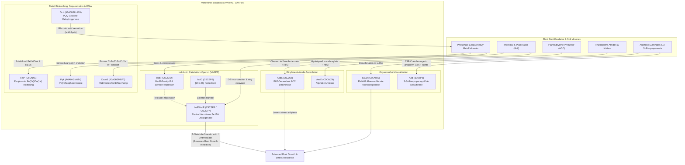

# *Variovorax*: Rhizosphere Plant–Microbe Interactions & Critical Metal Recovery

## Overview

Members of the betaproteobacterial genus ***Variovorax*** (`NCBITaxon:34072`, family *Comamonadaceae*) are metabolically versatile "hub" bacteria in terrestrial and rhizosphere ecosystems. Across synthetic community (SynCom) plant microbiome studies and bio-mining/bioremediation surveys, *Variovorax* stands out for two tightly linked capabilities:

1. **Keystone Rhizosphere Chemical Signaling & Plant Growth Promotion:**
   - **Auxin (IAA) Homeostasis (`iad` Operon):** In complex root microbiomes, diverse bacteria secrete indole-3-acetic acid (IAA) or stimulate host auxin/ethylene signaling, triggering severe root growth inhibition (RGI). A single genus — *Variovorax* — is both necessary and sufficient to reverse microbiome-induced RGI across phylogenetically diverse bacterial communities via a conserved **indole-3-acetic acid degradation (`iad`) operon** (Finkel et al. 2020, PMID:32999461; Conway et al. 2022, PMID:36266335; Ma et al. 2023, PMID:37459330).
   - **Ethylene Stress Buffering (`acdS`) & Nitrile/Amide Crosstalk (`amiE`):** *Variovorax* strains co-express pyridoxal 5'-phosphate (PLP)-dependent **1-aminocyclopropane-1-carboxylate (ACC) deaminase (`acdS`)**, which cleaves the immediate precursor of plant ethylene into 2-oxobutanoate and ammonia, dampening stress-induced ethylene spikes under heavy-metal, drought, and salt stress (Belimov et al. 2005, PMID:15933030; Han et al. 2011, PMID:21166890). Concurrently, aliphatic amidase (`amiE`) and nitrile hydratases assimilate rhizosphere nitriles and amides into organic acids and bioavailable nitrogen.
   - **Organosulfur & Nutrient Mobilization (`ssuD`, `acd`):** Under sulfate limitation in the rhizosphere, *Variovorax* mineralizes aliphatic sulfonates via the $\text{FMNH}_2$-dependent alkanesulfonate monooxygenase (`ssuD`) and cleaves sulfinopropionyl-CoA via 3-sulfinopropanoyl-CoA desulfinase (`acd`) to supply inorganic sulfur to both the bacterium and host roots (Schürmann et al. 2013, PMID:23354705; Brandt et al. 2015, PMID:25635840).

2. **Critical Metal Recovery, Mineral Bioleaching & Heavy-Metal Homeostasis:**
   - **PQQ-Dependent Acidolysis Bioleaching (`gcd`, `pqqABCDE`):** Membrane-bound quinoprotein glucose dehydrogenase (`gcd`) oxidizes periplasmic D-glucose to D-glucono-1,5-lactone (which hydrolyzes to gluconic acid), acidifying the mineral-root interface to solubilize recalcitrant phosphate minerals and leach rare earth elements (REEs/lanthanides) and transition metals (linking to [REE](REE.md) and [METEA_MLL_CLUSTER](METEA_MLL_CLUSTER.md)).
   - **Periplasmic Iron/Metal Trafficking & Photoreactive Metallophores (`fetP`, `vac`/`var`):** *Variovorax paradoxus* S110 synthesizes photoreactive $\beta$-hydroxyaspartate-containing lipopeptide/catecholate siderophores (vacidobactin A/B, variobactin, variochelin) and deploys periplasmic metal-trafficking proteins (`fetP`) and TonB-dependent receptors to scavenge $\text{Fe}^{3+}$ and trivalent metal ions.
   - **Intracellular Polyphosphate Sequestration (`ppk`) & Tripartite RND Efflux (`czcCBA`):** Polyphosphate kinase (`ppk`) synthesizes long-chain inorganic polyphosphate granules that chelate intracellular heavy metals and lanthanides, while the RND-family $\text{Co}^{2+}/\text{Zn}^{2+}/\text{Cd}^{2+}$ efflux complex (`czcCBA`, anchored by `czcA3`) confers high-level resistance in polymetallic soils and mine tailings.

---

## System Architecture

---

## Curated Gene Reviews & Modules

### Pathway Modules

- **[`bacterial_iad_auxin_catabolism`](../modules/bacterial_iad_auxin_catabolism.html)** — *Variovorax* `iad` operon-mediated oxidative indole-3-acetic acid (IAA) catabolism (`iadR`, `iadC`, `iadD`, `iadE`) and microbiome root growth inhibition reversal.
- **[`variovorax_metallophore_metal_homeostasis`](../modules/variovorax_metallophore_metal_homeostasis.html)** — *Variovorax* periplasmic gluconic acid mineral/REE bioleaching (`gcd`), periplasmic iron/metal trafficking (`fetP`), intracellular polyphosphate metal sequestration (`ppk`), and RND heavy-metal efflux (`czcA3`).
- **[`bacterial_alkanesulfonate_uptake_desulfonation`](../modules/bacterial_alkanesulfonate_uptake_desulfonation.html)** — Bacterial `ssuEADCB` alkanesulfonate uptake and $\text{FMNH}_2$-dependent monooxygenase desulfonation (`ssuD`).

### Curated *Variovorax* Genes

| Organism | Gene Symbol | UniProt ID | Locus Tag | Protein / Function | Batch | Review Link |
| :--- | :--- | :--- | :--- | :--- | :--- | :--- |
| `VARPS` | `iadD` | `C5CSP6` | `Vapar_1493` | Indole-3-acetic acid Rieske dioxygenase $\alpha$ subunit | 1A (Auxin Catabolism) | [VARPS/iadD](../genes/VARPS/iadD/iadD-ai-review.html) |
| `VARPS` | `iadE` | `C5CSP7` | `Vapar_1494` | Indole-3-acetic acid dioxygenase $\beta$ subunit | 1A (Auxin Catabolism) | [VARPS/iadE](../genes/VARPS/iadE/iadE-ai-review.html) |
| `VARPS` | `iadC` | `C5CSP5` | `Vapar_1492` | `[2Fe-2S]` ferredoxin electron-transfer component | 1A (Auxin Catabolism) | [VARPS/iadC](../genes/VARPS/iadC/iadC-ai-review.html) |
| `VARPS` | `iadR` | `C5CSP2` | `Vapar_1489` | MarR-family IAA-sensing transcriptional repressor | 1A (Auxin Catabolism) | [VARPS/iadR](../genes/VARPS/iadR/iadR-ai-review.html) |
| `VARPD` | `acdS` | `Q6J256` | `acdS` | 1-aminocyclopropane-1-carboxylate deaminase (EC 3.5.99.7) | 1B (Ethylene Buffering) | [VARPD/acdS](../genes/VARPD/acdS/acdS-ai-review.html) |
| `VARPS` | `amiE` | `C5CWZ4` | `Vapar_0135` | Aliphatic amidase (EC 3.5.1.4) | 1B (Amide Assimilation) | [VARPS/amiE](../genes/VARPS/amiE/amiE-ai-review.html) |
| `VARPS` | `fetP` | `C5CNX5` | `Vapar_2982` | Periplasmic $\text{Fe}^{2+}/\text{Cu}^{+}$-trafficking protein FetP | 2A (Metal Trafficking) | [VARPS/fetP](../genes/VARPS/fetP/fetP-ai-review.html) |
| `VARPD` | `gcd` | `A0A0H2LUW4` | `VPARA_65850` | PQQ-dependent glucose dehydrogenase (EC 1.1.5.2) | 2A (Mineral/REE Bioleaching) | [VARPD/gcd](../genes/VARPD/gcd/gcd-ai-review.html) |
| `VARPD` | `ppk` | `A0A0H2M4T4` | `VPARA_28600` | Polyphosphate kinase (EC 2.7.4.1) | 2A (PolyP Metal Storage) | [VARPD/ppk](../genes/VARPD/ppk/ppk-ai-review.html) |
| `VARPD` | `czcA3` | `A0A0H2MBF7` | `VPARA_44890` | Cobalt-zinc-cadmium RND efflux transporter CzcA | 2B (Heavy-Metal Efflux) | [VARPD/czcA3](../genes/VARPD/czcA3/czcA3-ai-review.html) |
| `VARPS` | `ssuD` | `C5CNW9` | `Vapar_2976` | Alkanesulfonate monooxygenase (EC 1.14.14.5) | 2B (Sulfur Mobilization) | [VARPS/ssuD](../genes/VARPS/ssuD/ssuD-ai-review.html) |
| `VARPD` | `acd` | `B9U6P5` | `VPARA_05440` | 3-sulfinopropanoyl-CoA desulfinase (EC 4.4.1.29) | 2B (Sulfur Mobilization) | [VARPD/acd](../genes/VARPD/acd/acd-ai-review.html) |

---

## Cross-Project Connections

- **[Rare Earth Elements (REE) & Lanthanide Metabolism](REE.md):** *Variovorax* strains co-isolated with methylotrophs and lanthanide-accumulating rhizosphere communities contribute PQQ-dependent organic acid bioleaching (`gcd`), biosorption, and polyphosphate-mediated intracellular lanthanide storage (`ppk`).
- **[METEA MLL Cluster](METEA_MLL_CLUSTER.md):** Complements the lanthanophore (`mll`) and XoxF/ExaF systems of *Methylorubrum extorquens* AM1 with betaproteobacterial rhizosphere co-habitant metal-mobilization and phytohormone-buffering pathways.
- **[Pseudomonas putida Genome-Wide Curation](P_PUTIDA.md):** Provides comparative betaproteobacterial (`VARPS`/`VARPD`) counterparts to gammaproteobacterial (`PSEPK`) rhizosphere colonization, alkanesulfonate desulfonation (`ssuD`), and heavy-metal efflux (`czcCBA`) modules.
- **[Module & Batch Curation Plan](VARIOVORAX/VARIOVORAX_MODULE_PLAN.html):** Detailed breakdown of target batches, UniProt proteome coverage, and GO term conventions.
