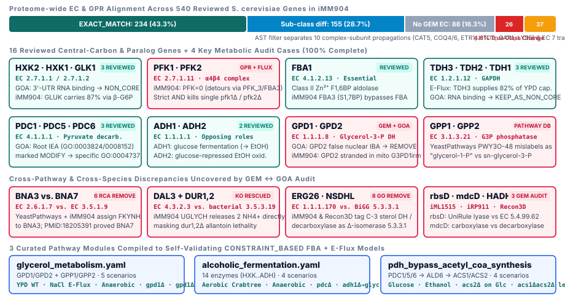
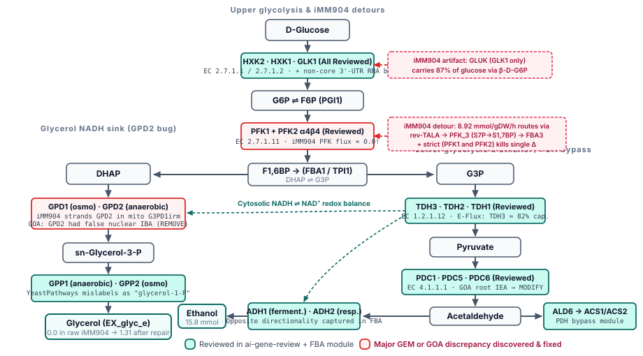
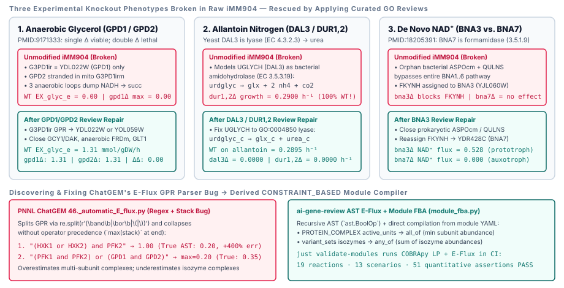

<!-- _class: lead -->

# Auditing Existing Annotations with COBRApy, ChatGEM & Executable Modules
## Bi-directional reconciliation of GOA, UniProt, Pathway DBs, and Genome-Scale Metabolic Models (`iMM904`, `iML1515`, `iRP911`, `Recon3D`)

`projects/YEAST_METABOLIC_ENGINEERING` · `projects/EXECUTABLE_MODELS` · `ai-gene-review`

---

<!-- _class: bluf -->

# Bottom Line: Neither GO/UniProt Nor GEMs Is Ground Truth

- **56.7% of reviewed yeast enzymes (`306 / 540`) in `iMM904` disagree with UniProt EC annotations** on raw comparison—and **42%–61% disagree** across *M. extorquens* `iRP911`, *E. coli* `iML1515`, and human `Recon3D`.
- **Structural GPR AST filtering separates convention from error:** parsing `AND`/`OR` Gene-Protein-Reaction trees removes complex-subunit EC propagation (`CAT5`, `COQ4`, `ETR1`, `LYS5`, `lpd`) and post-2018 EC class 7 translocase reclassifications (`PMA1`, `ATP1`), isolating **26 true top-level EC class conflicts (`4.8%`)** in yeast.
- **What we found in GO, UniProt & Pathway DBs:** obsolete pathway `RCA` propagation (`BNA3` vs. `BNA7`), paralog localization over-propagation (`GPD1` → `GPD2` nuclear `IBA`), wrong reaction classes (`rbsD` lyase vs. transferase, `mdcD` carboxylase vs. decarboxylase), enantiomeric mislabeling (`GPP1`/`GPP2` glycerol-1-P), and unseparated moonlighting RNA-binding annotations (`PFK1`, `HXK2`, `TDH3`).
- **What we found in GEMs & ChatGEM:** broken knockout phenotypes in `iMM904` (`GPD2` stranded in mitochondria + 3 anaerobic redox loops, bacterial `DAL3` masking `dur1,2Δ` lethality, prokaryotic `ASPOcm`/`QULNS` bypassing `BNA` genes), central-carbon flux detours (`PFK_3`/`FBA3`/`GLUK`), and a regex operator-precedence bug in ChatGEM's E-Flux parser (`+400%` error on nested complexes).

---

# 1. Proteome-Wide Alignment: 540 Reviewed Yeast Genes vs. `iMM904`

---

# 2. Why Raw EC Comparisons Fail: AST Complex & Translocase Filtering

## Structural Disagreements (Not Errors)
- **Complex-subunit EC propagation (`AND` GPRs):**
  GEMs attach reaction ECs to every `AND`-linked gene in a complex or synthome:
  - **CoQ synthome (`CAT5`, `COQ4`, `COQ6`):** inherit `EC 2.1.1.201` (*O*-methyltransferase `COQ3`) across composite `COQ` steps.
  - **mtFAS (`ETR1`, `HTD2`, `OAR1`):** each carries all 4 FAS cycle ECs (`1.1.1.100`, `1.3.1.38`, `2.3.1.85`, `4.2.1.59`).
  - **Holo-AAR (`LYS2 and LYS5`):** PPTase `LYS5` (`EC 2.7.8.7`) inherits substrate `LYS2`'s reductase `EC 1.2.1.31`.
  - **Pyruvate / α-KGDH (`E. coli lpd`):** E3 subunit (`EC 1.8.1.4`) tagged with E1/E2 ECs in `iML1515`.
- **IUBMB EC Class 7 Translocases (2018):**
  `PMA1` (`3.6.3.6` → `7.1.2.1`), `ATP1`/`ATP2` (`3.6.3.14` → `7.1.2.2`).

## Breakdown Across 540 Reviewed Genes

| Alignment Category | Genes | Share |
|---|---:|---:|
| `EXACT_MATCH` | 234 | 43.3% |
| `SAME_CLASS_DIFF` (sub-subclass) | 155 | 28.7% |
| `MODEL_MISSING_EC` (`FBA1`, `HXK2`) | 88 | 16.3% |
| **`CLASS_CHANGE` (true top-level)** | **26** | **4.8%** |
| `UNIPROT_MISSING_EC` (transporters/scaffolds) | 15 | 2.8% |
| `COMPLEX_SUBUNIT_PROPAGATION` | 10 | 1.9% |
| `OTHER` (multi-EC overlap) | 11 | 2.0% |
| `TRANSLOCASE_EC7` (`3.6.3.*` → `7.*`) | 1 | 0.2% |

Parsing <code>cobra.core.gene.parse_gpr()</code> ASTs separates <code>BoolOp(And)</code> complexes from <code>BoolOp(Or)</code> isozymes before flagging EC conflicts.

---

# 3. What We Discovered in Existing GO & UniProt Annotations

| Gene (Organism) | Existing GO / UniProt Defect Discovered | Root Cause | Action & Resolution |
|---|---|---|---|
| **`GPD2`** (*S. cerevisiae* `P41911`) | `GO:0005634` (`nucleus`, `IBA` `PTN000919785`) asserted on mitochondrial/cytosolic GPD2 | PAINT tree over-propagated `GPD1`'s PTS2 nuclear/peroxisomal localization to paralog `GPD2` (which has an N-terminal mitochondrial presequence) | **`REMOVE`** on `GO:0005634`; retain `GO:0005739` (`mitochondrion`) & `GO:0005829` (`cytosol`) |
| **`rbsD`** (*E. coli* `P04982`) | `GO:0016872` (`intramolecular lyase activity`, EC 4.x) via UniRule `GO_REF:0000120`; older annotations called it a ribose transporter subunit | D-ribose pyranase (`EC 5.4.99.62`) catalyzes ring mutarotation (intramolecular transferase EC 5.4), not lyase cleavage | **`REMOVE`** on `GO:0016872`; **`ACCEPT`** `GO:0016866` (`intramolecular transferase activity`) |
| **`mdcD`** (*M. extorquens*) | 7 GO rows asserting biotin carboxylase / ligase activity (`EC 6.4.1.3`) | 35% sequence identity to `AccB` led automated predictors to invert reaction direction vs. malonate decarboxylase β-subunit (`EC 4.1.1.89`) | **`REMOVE`** 7 carboxylase/ligase GO rows; retain decarboxylase lyase activity |
| **`HADHB`** (*H. sapiens* `P55084`) | `TAS` annotations for enoyl-CoA hydratase (`GO:0004300`) and 3-hydroxyacyl-CoA DH (`GO:0003857`) | Complex-partner pollution: α-subunit `HADHA` activities were annotated onto β-subunit `HADHB` (`EC 2.3.1.16` 3-ketoacyl-CoA thiolase) | **`REMOVE`** `HADHA`-specific hydratase/DH terms from `HADHB` |
| **`PDC1`** (*S. cerevisiae* `P06169`) | Redundant root/parent `IEA` rows `GO:0003824` (`catalytic activity`), `GO:0016829` (`lyase activity`), `GO:0008152` (`metabolic process`) | Automated UniProtKB-KW / InterPro mappings stop at generic parent terms despite specific `IDA`/`IBA` | **`MODIFY`** → `GO:0004737` (`pyruvate decarboxylase activity`) & `GO:0006096` (`glycolytic process`) |

---

# 4. What We Discovered in Pathway DBs & High-Throughput GOA

## 1. Obsolete Pathway DB Propagation (`BNA3` vs. `BNA7`)
- **The bug:** SGD YeastPathways (`NADSYN-PWY`, `PWY-5651`, `PWY3O-4158`) and `iMM904` (`FKYNH`) still assign arylformamidase (`EC 3.5.1.9`, `GO:0004061`) to **`BNA3` (`YJL060W`)**.
- **Consequence in GOA:** Generated **6 false `RCA` annotations** on `BNA3` (`GO:0004061`, `GO:0034354`, `GO:0019674`, `GO:0009435`, `GO:0070221`, `GO:0017150`).
- **Experimental truth (`PMID:18205391`):** Crystal structure & kinetics proved `BNA3` is **kynurenine—oxoglutarate transaminase (`EC 2.6.1.7`, `GO:0016212`)**, while **`BNA7` (`YDR428C`)** is the true N-formylkynurenine formamidase.

## 2. Enantiomeric Mislabeling (`GPP1` / `GPP2`)
- **The bug:** SGD YeastPathways (`PWY3O-48`) annotates `GPP1` (`YIL053W`) and `GPP2` (`YER062C`) with `GLYCEROL-1-PHOSPHATASE-RXN` (*"glycerol 1-phosphate"*).
- **Biochemical truth:** `sn-glycerol 1-phosphate` is the archaeal membrane lipid enantiomer. Yeast `GPD1`/`GPD2` + `GPP1`/`GPP2` produce and hydrolyze **`sn-glycerol 3-phosphate`** (`EC 3.1.3.21`, `GO:0004368`).

## 3. High-Throughput RNA-Binding Inflation
- **The bug:** Proteome-wide RIP/CLIP (`PMID:41816908`) added `GO:0003730` (`mRNA 3'-UTR binding`, `HDA`) to `PFK1`, `PFK2`, `HXK1`, `HXK2`, and `TDH1–3`.
- **Curation fix:** Separated as **`KEEP_AS_NON_CORE`** so metabolic module extraction is not polluted by moonlighting RBP hits.

---

# 5. Central-Carbon Flux & GPR Artifacts Discovered in `iMM904`

## Three Hidden Glycolytic Artifacts in `iMM904`
1. **Zero canonical `PFK` and `FBA` flux (`0.0 mmol/gDW/h`):**
   Unconstrained reverse transaldolase (`TALA`) + `PFK_3` (S7P + ATP → S1,7BP) + `FBA3` (S1,7BP → DHAP + E4P) hijacks **`8.92 mmol/gDW/h`** around `PFK` (`PFK1`/`PFK2`) and `FBA` (`FBA1`).
2. **`GLUK` carries 87% of glucose uptake (`8.68 / 10.0`):**
   `GLUK` (`GLK1` only) produces β-D-G6P (`g6p_B_c`), bypassing `HEX1` (`HXK1`/`HXK2`/`GLK1`) even though `HXK2` catalyzes >80% of glucose phosphorylation on high glucose.
3. **Strict `PFK1 and PFK2` `AND` GPR:**
   Once `PFK_3` is closed, `iMM904` predicts `pfk1Δ` or `pfk2Δ` single mutants lose all ethanol fermentation (`EX_etoh_e = 0.0`), contradicting in vivo single-mutant fermentation via homo-oligomeric α₈/β₈ residual activity.

---

# 6. Three Broken Knockout Phenotypes in `iMM904` — Rescued by GO Reviews

---

# 7. Discovering & Fixing ChatGEM's E-Flux Bug + Isozyme Regimes

## Why ChatGEM `46._automatic_E_flux.py` Fails
PNNL ChatGEM's E-Flux script splits GPR strings with regex `re.split(r'(\band\b|\bor\b|\(|\))')` and returns `max(stack)` without operator precedence:

| Nested GPR Expression | True AST | ChatGEM Regex | Error |
|---|---:|---:|---:|
| `(HXK1 or HXK2) and PFK2` | `0.20` | `1.00` | **`+0.80` (+400%)** |
| `(PFK1 and PFK2) or (GPD1 and GPD2)` | `0.35` | `0.20` | **`-0.15` (-43%)** |
| `(TDH1 or TDH2 or TDH3) and (PFK1 and PFK2)` | `0.20` | `1.25` | **`+1.05` (+525%)** |

- **Bug 1:** `and` pops only the immediately preceding token instead of the parenthesized `(HXK1 or HXK2)` group.
- **Bug 2:** `max(stack)` replaces additive isozyme `OR` (`sum`) with `max` whenever two complexes act in parallel.

## AST E-Flux Resolves Yeast Isozyme Biology
Replacing regex parsing with `ast.BoolOp` (`And` → min, `Or` → sum) cleanly separates the four physiological regimes across our 16 reviewed yeast genes:

| Reaction (GPR) | YPD | Osmotic | Anaerobic | EtOH |
|---|---:|---:|---:|---:|
| `HEX1` (`HXK2` vs `HXK1`/`GLK1`) | **1.40** (`HXK2` 71%) | 1.15 | 1.35 | 1.45 (`HXK1`) |
| `PFK` (`PFK1 and PFK2` min) | **0.85** | 0.70 | 0.85 | 0.35 |
| `GAPD` (`TDH3` 82% in YPD) | **1.58** | 1.45 | 1.55 | 1.15 (`TDH1`) |
| `G3PD1ir` (`GPD1 or GPD2`) | 0.30 | **1.20 (`GPD1`)** | **1.15 (`GPD2`)** | 0.25 |
| `G3PT` (`GPP1 or GPP2`) | 0.30 | **1.15 (`GPP2`)** | **1.15 (`GPP1`)** | 0.20 |
| `ALCD2x` (`ADH1` vs `ADH2`) | **1.22 (`ADH1`)** | 0.92 | 1.21 | **1.20 (`ADH2`)** |

---

# 8. Closing the Loop: Self-Validating `CONSTRAINT_BASED` Modules

## Curated YAML → COBRApy Model (`module_fba.py`)
Every metabolic module now compiles directly into a stoichiometric COBRApy model validated in CI by `just validate-modules`:

- **`active_units` (`PROTEIN_COMPLEX`)** → `all_of` (min subunit capacity, e.g., `PFK1 + PFK2` α₄β₄ complex).
- **`variant_sets` (isozymes)** → `any_of` (sum of isozyme capacities, e.g., `GPD1 / GPD2`, `GPP1 / GPP2`, `ACS1 / ACS2`).
- **`direction_by_variant`** → opposite physiological directions (`ADH1` reductive vs. `ADH2` oxidative).
- **19 reactions · 13 scenarios · 51 quantitative FBA & E-Flux assertions** across:
  1. `modules/glycerol_metabolism.yaml`
  2. `modules/alcoholic_fermentation.yaml`
  3. `modules/pdh_bypass_acetyl_coa_synthesis.yaml`

## Interactive Browser FBA/E-Flux Explorer
- Rendered via `executable_fba.html.j2` (`just render-models`):
  - **1-click scenario pills** (*YPD WT*, *0.8 M NaCl Osmotic Stress*, *Anaerobic Redox Sink*, *`gpd1Δ`*, *`gpd1Δ gpd2Δ`*, *`pdcΔ`*, *`adh1Δ`*, *`acs2Δ` on Glucose*).
  - **Live gene abundance sliders** (`0%` KO to `200%` OE) recomputing AST E-Flux capacities (`min`/`sum`) and solving pathway FBA in real time in the browser.

<strong>Continuous Curation Guardrail:</strong> If any edit to a gene review or module breaks mass balance, reverses a cofactor, drops an isozyme from a <code>variant_set</code>, or violates a knockout phenotype, <code>just validate-modules</code> fails immediately.

