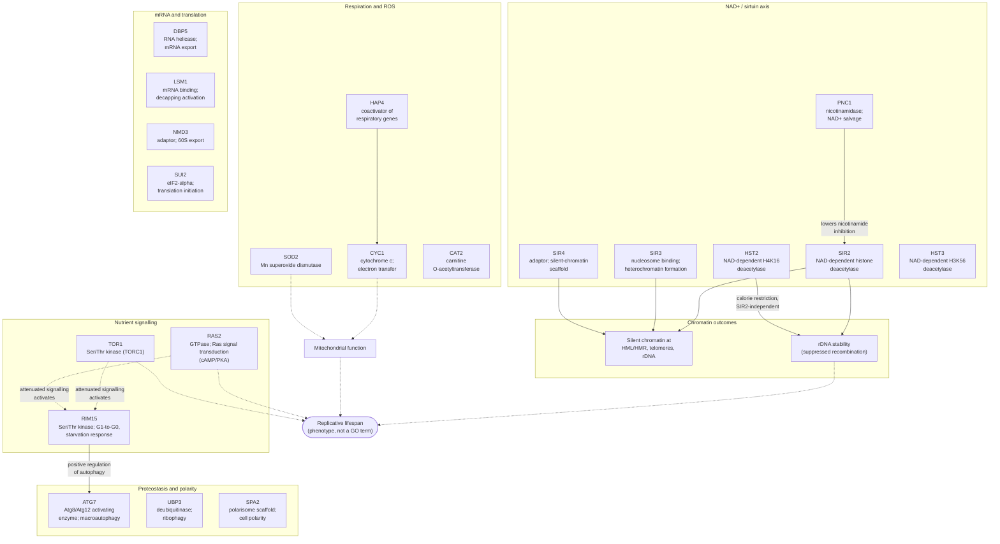

# Pathway Summary: Yeast Replicative Aging

[Back to project page](../YEAST_REPLICATIVE_AGING.md)

## Scope and how to read this page

This page connects the core functions recorded in the 20 *Saccharomyces
cerevisiae* gene reviews of the
[YEAST_REPLICATIVE_AGING](../YEAST_REPLICATIVE_AGING.md) project. Each gene box
below names the molecular function and process kept as **core** in that gene's
`core_functions`; it is not a list of every annotation the gene carries.

Two cautions apply throughout:

- **A lifespan phenotype is not a GO process.** Most of these genes were chosen
  because a mutant changes replicative lifespan (RLS) or because they sit in a
  pathway implicated in aging. The reviews deliberately annotate what each
  product *does* (deacetylate H4K16, deamidate nicotinamide, activate Atg8),
  not the lifespan outcome. The arrows labelled "lifespan" below are
  literature links, not GO annotations.
- **The strength of the aging link differs by module.** The
  sirtuin/rDNA axis has direct mechanistic RLS evidence in the cited papers.
  For the nutrient-signalling genes the cited lifespan evidence is largely
  chronological lifespan or general. For the mRNA-processing, translation,
  polarity and proteostasis genes, the reviews contain no direct replicative
  lifespan evidence: these genes were scoped into the project because of their
  pathway, and their place in the aging network is a hypothesis.

## Pathway architecture

Solid arrows are mechanisms supported in the gene reviews or the cited
abstracts. Dotted arrows are regulatory or phenotype links taken from the
literature cited below, not from GO annotations. Genes with no arrow (HST3,
CAT2, the mRNA and translation module, UBP3, SPA2) have well-characterised core
functions but no aging link established in this curation.

## Module 1: NAD+ / sirtuin axis (strongest replicative-aging evidence)

**Mechanism.** SIR2 is an NAD-dependent histone deacetylase; the founding
biochemistry showed that "yeast and mouse Sir2 proteins are nicotinamide adenine
dinucleotide (NAD)-dependent histone deacetylases, which deacetylate lysines 9
and 14 of H3 and specifically lysine 16 of H4", and that this activity
"accounts for silencing, recombination suppression and extension of life span
in vivo" [PMID:10693811]. SIR3 (nucleosome binding) and SIR4 (molecular
adaptor) are the structural partners that build silent chromatin at the
mating-type loci, telomeres and rDNA; deacetylation of H4K16 is "necessary for
binding the silencing protein, Sir3" [PMID:10693811].

**The rDNA as the aging locus.** The Sir complex "is relocalized from telomeres
to the nucleolus in old wild-type cells", leading to the proposal "that the rDNA
is the AGE locus" [PMID:9150138]. Later work summarises the current view that
"replicative life span (RLS) is primarily affected by the stability of ribosomal
DNA (rDNA)", maintained "through transcriptional silencing by the
NAD+-dependent histone deacetylase Sir2" [PMID:33837734].

**NAD+ supply and calorie restriction.** PNC1 deamidates nicotinamide, a Sir2
inhibitor; increased PNC1 expression "is both necessary and sufficient for
lifespan extension by calorie restriction and low-intensity stress"
[PMID:12736687]. Calorie restriction also works without SIR2: this
"Sir2-independent life-span extension is mediated by Hst2, a Sir2 homolog that
promotes the stability of repetitive ribosomal DNA" [PMID:16051752]. HST2's
core function in its own review is NAD-dependent H4K16 deacetylation in mitotic
chromatin compaction; its rDNA-stability role (GO:0045950 negative regulation of
mitotic recombination, GO:0000183 rDNA heterochromatin formation) is kept as
non-core because it is condition-dependent.

**HST3** is a sirtuin too, but its core function is H3K56 deacetylation after
DNA replication; its review records no replicative-lifespan mechanism.

**Mitochondria and SIR3.** Cells that adapt to loss of mtDNA extend RLS, and
"deletion of SIR3 ... inhibits silencing of subtelomeric genes associated with
adaptation to loss of mtDNA, as well as adaptation-associated increases in
mitochondrial function and RLS extension" [PMID:31599702], tying the silencing
module to the respiratory module.

## Module 2: Nutrient signalling (RAS2, TOR1, RIM15)

RAS2 is a GTPase whose core role is Ras signal transduction through
adenylate cyclase and PKA, with separate morphogenetic roles. TOR1 is the
TORC1 kinase. RIM15 is the kinase activated when these signals fall: "attenuation
of signaling by these kinases following nitrogen and/or carbon limitation
activates the protein kinase Rim15, which orchestrates the initiation of a
reversible cellular quiescence program to ensure normal chronological life
span" [PMID:23273919]. A general statement that Tor1, Sch9 and Ras2 deficiency
"promotes lifespan extension" is in [PMID:27922823]. **These cited links are to
chronological lifespan or are not specific to replicative lifespan**; the gene
reviews do not annotate lifespan processes, and RIM15's G1-to-G0 and autophagy
roles were kept as its core processes.

## Module 3: Respiration and ROS defence (HAP4, CYC1, SOD2, CAT2)

HAP4 is the activation subunit of the CCAAT-binding complex that induces
respiratory genes; CYC1 transfers electrons from complex III to complex IV;
SOD2 removes superoxide in the mitochondrial matrix; CAT2 is a carnitine
O-acetyltransferase in the carnitine shuttle (not a catalase, despite the
symbol). The reviews record their enzymatic and transcriptional functions; the
only RLS-mitochondria link cited here is the mtDNA-adaptation work above
[PMID:31599702].

## Module 4: mRNA export, decay and translation (DBP5, LSM1, NMD3, SUI2)

DBP5 is the RNA helicase that completes mRNA export at the nuclear pore; LSM1
binds deadenylated mRNA in the Lsm1-7-Pat1 decapping-activator complex; NMD3 is
the adaptor that exports the 60S ribosomal subunit; SUI2 (eIF2-alpha) is the
regulatory subunit of the initiation factor that delivers Met-tRNAi. The
project page frames intron retention and translation reprogramming as features
of old cells, but none of these four reviews cites replicative-lifespan data
for the gene itself.

## Module 5: Proteostasis and polarity (ATG7, UBP3, SPA2)

ATG7 is the E1-like enzyme that activates both Atg12 and Atg8 for
autophagosome assembly; UBP3 is a cysteine-type deubiquitinase that works with
its Bre5 cofactor in substrate turnover and selective autophagy (ribophagy); SPA2 is the polarisome scaffold that positions the
Slt2 MAPK module and actin-nucleation factors at sites of polarized growth.
RIM15's positive regulation of autophagy is the only edge from signalling into
this module that the reviews support.

## Annotation status relevant to the pathway

- All 20 genes are reviewed. After the follow-up in issue #4027, one
  UNDECIDED row remains, and it is outside the aging pathway: RAS2
  GO:0000411 positive regulation of transcription by galactose (IMP,
  PMID:16292676), held because the paywalled full text could not be checked and
  the visible evidence concerns a hyperactive RAS2 allele.
- The three HST2 GO:0045950 negative regulation of mitotic recombination rows
  (IMP, IGI with SIR2, IGI with FOB1; PMID:16051752) are now KEEP_AS_NON_CORE,
  consistent with the sibling rDNA heterochromatin row from the same paper.
- SIR3 GO:0070481 nonstop mRNA decay (IMP, PMID:17660569) is
  MARK_AS_OVER_ANNOTATED: the deletion phenotype is real, but a
  heterochromatin protein is not a participant in cytoplasmic nonstop decay.

## Open biological questions

- Does PNC1-driven nicotinamide depletion activate HST2 as well as SIR2 under
  calorie restriction, and does that explain the SIR2-independent arm?
- Which of the nutrient-signalling effects on lifespan act on the replicative
  (mother-cell) clock as opposed to chronological survival, and do they route
  through rDNA stability?
- Do the mRNA-processing and translation genes change with age as a cause of
  replicative senescence or as a consequence of it?
